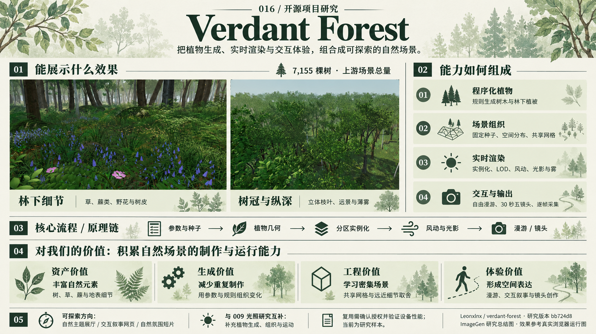
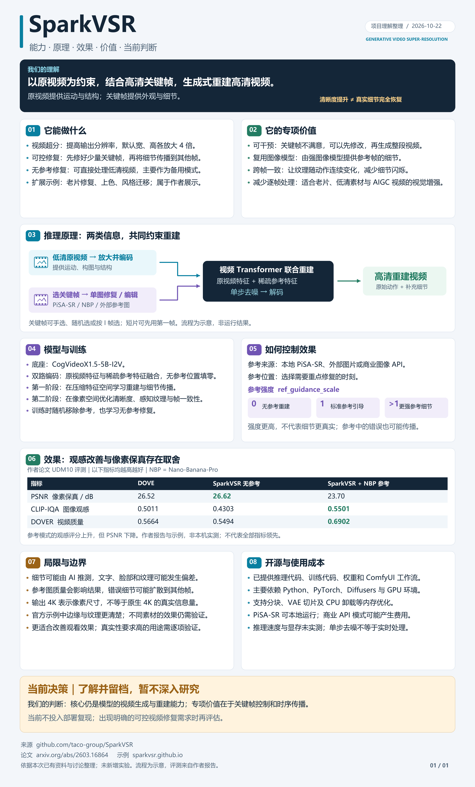
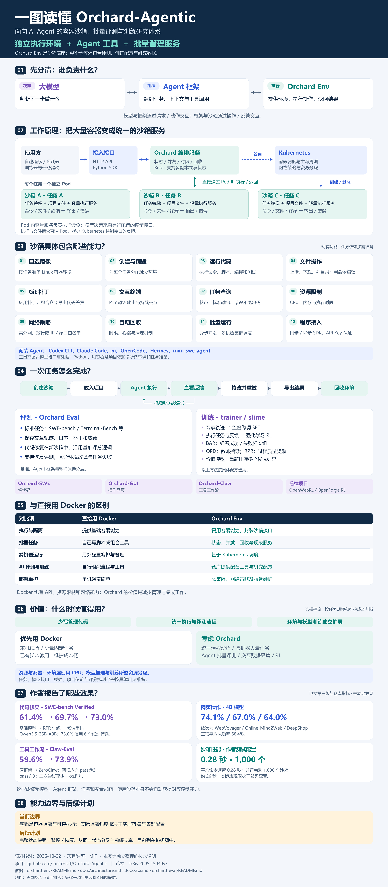

<p align="center">
  
</p>

# GitHub 项目研究库

把最近遇到的优秀开源项目，整理成可以持续查阅、复现和实践的研究记录。

每个子项目都有独立编号、来源、研究笔记和配图；需要时，再提供可运行的代码与 Web 演示。首页用于浏览与导航，详细内容放在各子项目中。

[一句话导读](#一句话导读) · [项目索引](#项目索引) · [项目图览](#项目图览) · [新增项目](#新增项目) · [研究约定](docs/project-guide.md) · [Web 部署](docs/deployment.md)

**快速回看**：先用下面的一句话想起项目用途，再到索引看 **能力 / 原理 / 价值**；看效果进入 **在线演示**，看依据、复现与扩展进入 **项目研究详情**。源库名称保留 GitHub 原名，方便回忆和检索。

## 一句话导读

每条说明“它能做什么、对我们有什么用”，按固定编号排列，点击源库名称进入对应研究记录。

<!-- PROJECT_OVERVIEW:START -->
- **001 · [SwiftUIShaders](projects/001-swiftui-shaders/README.md)**：为 SwiftUI 图片、文字和卡片添加镭射、波纹等实时特效，复用 GPU 算法来丰富封面、展示页与交互反馈。
- **002 · [todofy](projects/002-todofy/README.md)**：用列表、看板和日历组织个人任务，配合提醒与计时推进管理；重点参考看板布局、卡片层级与交互组织。
- **003 · [algorithmic-sublime-poster](projects/003-algorithmic-sublime-poster/README.md)**：把照片转为实体与数据融合海报，并将研究扩展为情绪图片、短片与返修方法，积累可复用的艺术方向 Skill。
- **004 · [xxd-panel-106](projects/004-xxd-panel-106/README.md)**：将已有照片重绘为柔彩几何像素海报、对照图与多端壁纸，为我们比较和复用视觉风格提供完整样本。
- **005 · [scene-card-studio](projects/005-scene-card-studio/README.md)**：把照片二次创作整理为场景卡、提示词和对照返修流程，让相册、内容制作与多图统一的要求能够复用和检查。
- **006 · [oil-tone](projects/006-oil-tone/README.md)**：用 23 条编辑规则引导 AI 起草和改稿，保留事实、减少空话，并转为文章、产品文案与口播的复用标准。
- **007 · [dr-aria](projects/007-dr-aria/README.md)**：把 Agent 回复与工作状态变成会动的字符角色，为自有助手增加可见反馈、稳定形象和可嵌入的表达层。
- **009 · [web-starter-kit-webgpu-pipline](projects/009-webgpu-render-pipeline/README.md)**：在浏览器三维场景中实现反弹光、软阴影与自然材质受光，把光照计算和缓存方法沉淀为游戏、漫游和展厅的渲染能力。
- **010 · [jianying-headless](projects/010-jianying-headless/README.md)**：通过逆向适配复用本机剪映引擎，让 AI 编排剪辑；同时离线保全核心库与完整 Skill 仓库，防止上游失联。
- **011 · [auto-paper-digest](projects/011-open-notebook-research/README.md)**：从 Auto Paper Digest 的论文采集出发，探索 Open Notebook 问答与原文核读，形成可追溯的水生毒理学档案。
- **012 · [super-hermes](projects/012-super-hermes/README.md)**：用五个 Skill 组织问题定位、反驳与盲区复查；我们进一步提炼七步定位协议和九项报告，便于跨项目复用。
- **013 · [old-coder](projects/013-old-coder/README.md)**：把 AI 编码要求整理成规格、测试和证据报告，让需求与结果逐项对应，减少反复提醒并支持复跑验收。
- **014 · [seijaku](projects/014-seijaku/README.md)**：用连续镜头、四季和构造拆解讲解日式住宅；对比同类项目，提炼可用于旅宿导览、建筑教育与产品说明的方法。
- **015 · [heytea-style](projects/015-heytea-style/README.md)**：把照片二次创作为手绘海报、怪兽和产品互动图，再交付可互动桌宠，为商品内容与原创角色创作提供流程参考。
- **016 · [verdant-forest](projects/016-verdant-forest/README.md)**：在浏览器生成并漫游有枝叶、花草、风动和光雾的森林，学习自然场景制作与运行，用于空间导览和氛围表达。
- **017 · [SparkVSR](projects/017-sparkvsr/README.md)**：用原视频约束运动与结构，以少量高清关键帧引导整段视频重建，研究可审核、可调节的修复与增强流程。
- **018 · [Orchard-Agentic](projects/018-orchard-agentic/README.md)**：为 Agent 提供可批量管理的容器、命令和文件接口，再连接轨迹与评测训练，作为远程执行和自动修复的底座。
<!-- PROJECT_OVERVIEW:END -->

## 项目索引

按收录顺序编号，从 **001** 开始递增。编号长期保留，不因进度、热度或归档重新排序。

摘要统一按 **能力**（能做什么）、**原理**（如何实现）、**价值**（可复用到哪里）分行阅读；有离线归档的项目补充 **备份**，需要说明实测范围的项目补充 **边界**。研究进度表示整理进度，具体运行与验证结果见各项目记录。

<!-- PROJECT_INDEX:START -->
当前收录 **17** 个项目。

| 编号 | 项目 | 关注源库 | 理解摘要 | 研究进度 | Web 演示 |
| --- | --- | --- | --- | --- | --- |
| 001 | [SwiftUIShaders](projects/001-swiftui-shaders/README.md) | [SwiftUIShaders](https://github.com/krispuckett/SwiftUIShaders) | **能力**：为 SwiftUI 视图提供 41 种实时特效，涵盖光影、变形与触摸反馈。<br>**原理**：将视图交给 Metal，逐像素改变采样位置、颜色与混合方式。<br>**价值**：复用算法与参数，减少封面、卡片和展示页的特效接入工作。<br>**边界**：网页为 WebGL 移植展示；原生设备效果与性能尚待验证。 | 研究中 | [在线演示](https://yydshly.github.io/1022_codex_project/001-swiftui-shaders/) |
| 002 | [Todofy](projects/002-todofy/README.md) | [todofy](https://github.com/salarzeidanlou/todofy) | **能力**：提供任务编辑、状态流转、日历、提醒、计时与本地保存。<br>**原理**：多种视图共用任务数据，由 Preact、Tauri/Rust 与 SQLite 驱动。<br>**价值**：参考看板布局、卡片信息层级，以及界面交互与业务规则的分工。 | 研究中 | [在线演示](https://yydshly.github.io/1022_codex_project/002-todofy/) |
| 003 | [Algorithmic Sublime Poster](projects/003-algorithmic-sublime-poster/README.md) | [algorithmic-sublime-poster](https://github.com/xianxie6/algorithmic-sublime-poster) | **能力**：组织照片重绘，呈现像素、点云、字符与数据连接海报。<br>**原理**：Skill 将视觉要求组织成提示词，交外部图像模型生成并对照返修。<br>**价值**：把模糊审美转为创作条件；本研究扩展情绪导演、图片短片与 Skill。 | 已完成 | [在线演示](https://yydshly.github.io/1022_codex_project/003-algorithmic-sublime-poster/) |
| 004 | [XXD Panel 106 · 柔彩像素记](projects/004-xxd-panel-106/README.md) | [xxd-panel-106](https://github.com/nevertoday/xxd-panel-106) | **能力**：把照片重绘为柔彩几何像素风，输出对照图、纯设计或多端壁纸。<br>**原理**：Agent 读取固定风格提示词，追加版式与文字要求，再调用图像模型。<br>**价值**：积累风格规则、完整请求与返修案例，作为后续风格库的研究样本。 | 研究中 | [在线演示](https://yydshly.github.io/1022_codex_project/004-xxd-panel-106/) |
| 005 | [Scene Card Studio](projects/005-scene-card-studio/README.md) | [scene-card-studio](https://github.com/swping999/scene-card-studio) | **能力**：组织照片二次创作，明确保留、改变、删除范围及叙事与材质要求。<br>**原理**：场景卡编译为提示词，交外部模型改图，再对照检查与定向返修。<br>**价值**：让改图要求可复用、结果可检查，便于多图统一与团队交接。 | 研究中 | [在线演示](https://yydshly.github.io/1022_codex_project/005-scene-card-studio/) |
| 006 | [oil-tone · 写作约束拆解](projects/006-oil-tone/README.md) | [oil-tone](https://github.com/oil-oil/oil-tone) | **能力**：引导 AI 起草、润色与调整结构，补清逻辑并删去无依据的评价。<br>**原理**：将 23 条规则与事实、原稿一起交给模型，按清单复核；脚本辅助提醒。<br>**价值**：把“写自然、讲清楚”落实为编辑动作、完整提示词与复核标准。 | 研究中 | [在线演示](https://yydshly.github.io/1022_codex_project/006-oil-tone/) |
| 007 | [dr-aria · 角色效果与表达图鉴](projects/007-dr-aria/README.md) | [dr-aria](https://github.com/MPMyburgh/dr-aria) | **能力**：用字符角色呈现等待、思考、工作和回复，配合气泡、嘴型与点头。<br>**原理**：预制字符网格构成形象，状态事件驱动动作，回复文字驱动气泡与嘴型。<br>**价值**：让等待有反馈、对话有角色，可适配为聊天或任务助手的表达层。<br>**边界**：展示未连接真实模型；角色动作不代表理解或识别了语义情绪。 | 已完成 | [在线演示](https://yydshly.github.io/1022_codex_project/007-dr-aria/) |
| 009 | [WebGPU Render Pipeline · 光照效果实现与复用](projects/009-webgpu-render-pipeline/README.md) | [web-starter-kit-webgpu-pipline](https://github.com/vibegameengine/web-starter-kit-webgpu-pipline) | **能力**：呈现反弹光、环境补光、软阴影，以及水面、植被与大气效果。<br>**原理**：BVH/Surfel 估计间接光，缓存为 Lightmap/探针，再与实时光影合成。<br>**价值**：为浏览器游戏、空间漫游与 Web3D 展厅积累可复用的渲染方法。 | 已完成 | [在线演示](https://yydshly.github.io/1022_codex_project/009-webgpu-render-pipeline/) |
| 010 | [Jianying Headless · 原理研究与双仓离线备份](projects/010-jianying-headless/README.md) | [jianying-headless](https://github.com/mcncarl/jianying-headless)<br>[yichen-skills](https://github.com/mcncarl/yichen-skills) | **能力**：构造可编辑多轨草稿，适配版本可调用本机剪映引擎导出。<br>**原理**：逆向适配工程与内部接口；Skill 指导 AI，REA 辅助研究与版本适配。<br>**价值**：连接 AI 编排、批量剪辑与人工精修，并保全可能失联的上游资料。<br>**备份**：2026-10-22 获取 jianying-headless 与整个 yichen-skills（含 yichen-jianying-edit）；统一 ZIP 约 24 MiB，保留 Git 历史、源码、原许可与校验恢复资料，防止上游失联。<br>**边界**：原生运行尚未本机实测；固定主分支 Windows 导出使用 FFmpeg。 | 研究中 | [在线演示](https://yydshly.github.io/1022_codex_project/010-jianying-headless/) |
| 011 | [Auto Paper Digest · 水生毒理学研究档案](projects/011-open-notebook-research/README.md) | [auto-paper-digest](https://github.com/brianxiadong/auto-paper-digest) | **能力**：编排论文采集与解读；本研究保存三篇精读及一份跨论文综合报告。<br>**原理**：源库用 Python 连接采集与 NotebookLM；本研究另探 Open Notebook 并核读原文。<br>**价值**：借鉴领域检索、模型适配与证据归档，建立可复核的论文研究流程。 | 已完成 | [在线演示](https://yydshly.github.io/1022_codex_project/011-open-notebook-research/) |
| 012 | [Super Hermes · 多 Skill 问题定位与审查](projects/012-super-hermes/README.md) | [super-hermes](https://github.com/Cranot/super-hermes) | **能力**：组织问题定位、多轮反驳、三视角审查、方向探索与历史盲区复查。<br>**原理**：Markdown 约定检查动作与产物，模型分析材料，运行证据检验判断。<br>**价值**：将排查经验整理成可复用规范；本研究提炼七步协议与九项报告。<br>**边界**：七步协议是研究提炼，并非原库自动执行器。 | 已完成 | [在线演示](https://yydshly.github.io/1022_codex_project/012-super-hermes/) |
| 013 | [Old Coder · AI 编码的验收与证据](projects/013-old-coder/README.md) | [old-coder](https://github.com/AmazingAng/old-coder) | **能力**：要求 AI 按验收规格实现代码，交付测试结果与可复跑的证据报告。<br>**原理**：Skill 组织 SPEC、测试驱动和多层检查；脚本与 CI 执行门槛。<br>**价值**：沉淀故障模型与验收模板，用于修复、重构、订单及 API 交付。 | 已完成 | [在线演示](https://yydshly.github.io/1022_codex_project/013-old-coder/) |
| 014 | [Seijaku · 住宅导览与三项目对比](projects/014-seijaku/README.md) | [seijaku](https://github.com/MengTo/seijaku) | **能力**：滚动穿行住宅，联动四季、材料特写、构造拆解、水面与环境声。<br>**原理**：Three.js 将镜头、环境状态、构件展开与标注统一到参观流程。<br>**价值**：研究季节材质、结构讲解与加载调度，服务旅宿、展馆和工艺展示。 | 已完成 | [在线演示](https://yydshly.github.io/1022_codex_project/014-seijaku/) |
| 015 | [heytea-style · 照片二次创作与桌宠](projects/015-heytea-style/README.md) | [heytea-style](https://github.com/Hchen1218/heytea-style) | **能力**：基于照片创作海报、风味怪兽和产品互动图，并交付点击拖拽桌宠。<br>**原理**：Skill 组织分阶段生图与身份约束，透明动画帧由事件和运行器驱动。<br>**价值**：沉淀风格规则、局部返修和角色资产流程，扩展商品内容与原创 IP。<br>**边界**：已验证样张、角色包与浏览器动画；未实测生图或启动原生桌宠。 | 已完成 | [在线演示](https://yydshly.github.io/1022_codex_project/015-heytea-style/) |
| 016 | [Verdant Forest · 浏览器里的程序化森林](projects/016-verdant-forest/README.md) | [verdant-forest](https://github.com/Leonxlnx/verdant-forest) | **能力**：生成茂密三维森林，支持自由漫游、自动导览、风动和林间光雾。<br>**原理**：参数化植物与空间分布结合实例化、LOD、风动着色和体积光合成。<br>**价值**：积累自然场景制作与运行方法，扩展展厅、庭院导览和氛围短片。 | 已完成 | [在线演示](https://yydshly.github.io/1022_codex_project/016-verdant-forest/) |
| 017 | [SparkVSR · 关键帧引导的视频高清重建](projects/017-sparkvsr/README.md) | [SparkVSR](https://github.com/taco-group/SparkVSR) | **能力**：生成式视频超分与修复，并将少量高清关键帧的外观传播到视频。<br>**原理**：原视频约束运动和结构，参考帧提供纹理，视频模型联合重建。<br>**价值**：借鉴选帧审核、单图修复与时序传播，用于老片和 AIGC 视频增强。<br>**边界**：仅完成理解归档，未部署或运行模型；生成细节不等于真实信息恢复。 | 已归档 | [在线演示](https://yydshly.github.io/1022_codex_project/017-sparkvsr/) |
| 018 | [Orchard-Agentic · Agent 沙箱与评测训练](projects/018-orchard-agentic/README.md) | [Orchard-Agentic](https://github.com/microsoft/Orchard-Agentic) | **能力**：批量提供可控容器，支持代码、文件、终端操作及配套评测训练。<br>**原理**：Kubernetes 管理环境生命周期，Pod 执行服务通过统一 API 返回结果。<br>**价值**：沉淀沙箱接口、资源网络策略和轨迹规范，支持自动修复与回归评测。<br>**边界**：未运行上游集群、模型或训练；作者成绩与性能数字未本地复现。 | 已完成 | [在线演示](https://yydshly.github.io/1022_codex_project/018-orchard-agentic/) |
<!-- PROJECT_INDEX:END -->

## 项目图览

每个项目展示一张封面或截图，并附一句说明。更多截图、使用步骤和研究结论请进入对应项目。

<!-- PROJECT_CARDS:START -->
### 001 · SwiftUIShaders

为 SwiftUI 图片、文字和卡片提供 41 种 GPU 实时特效；通过 Metal 采样与颜色变换实现镭射、波纹、折射等效果，适合封面、卡片与展示页


> 能力全景图：SwiftUI 视图与参数输入 → GPU 逐像素采样与变换 → 实时视图输出，并说明效果、适用场景和扩展方向。

[研究详情](projects/001-swiftui-shaders/README.md) · 源库：[SwiftUIShaders](https://github.com/krispuckett/SwiftUIShaders) · [在线演示](https://yydshly.github.io/1022_codex_project/001-swiftui-shaders/)

标签：SwiftUI / Metal / WebGL 2 / 交互特效

### 002 · Todofy

任务展示板与管理应用：列表、看板、日历呈现任务，编辑、状态流转、提醒、计时与本地存储驱动管理；对我们主要是看板样式、卡片信息层级和交互组织的参考


> 我们生成的总结图：引用官方看板画面，说明任务数据、管理界面、驱动逻辑三层本质，归纳能力与效果；重点参考看板布局、卡片信息层级和交互组织。

[研究详情](projects/002-todofy/README.md) · 源库：[todofy](https://github.com/salarzeidanlou/todofy) · [在线演示](https://yydshly.github.io/1022_codex_project/002-todofy/)

标签：任务管理 / 本地优先 / Tauri 2 / Rust / SQLite

### 003 · Algorithmic Sublime Poster

以情绪与艺术意图组织创作，匹配像素、点云、字符与数据连接等视觉语言形成提示词；展示源库海报、图片返修和真实AI短片，沉淀可复用Skill


> ImageGen研究总览：突出源库三组效果与数字连接，串联情绪、风格、提示词、图片视频探索和Skill沉淀。案例为依据原件的AI概览合成；21份情绪档案和跨媒介方法为本研究扩展。

[研究详情](projects/003-algorithmic-sublime-poster/README.md) · 源库：[algorithmic-sublime-poster](https://github.com/xianxie6/algorithmic-sublime-poster) · [在线演示](https://yydshly.github.io/1022_codex_project/003-algorithmic-sublime-poster/)

标签：情绪创作 / 像素与点云 / 图片与视频 / 提示词与Skill

### 004 · XXD Panel 106 · 柔彩像素记

对已有图片二次处理，通过提示词与图像模型重绘为柔彩几何像素海报；支持对照图、纯设计和多端壁纸，可作为我们探索风格库的一个样本


> 使用我们生成的理解总结图作引导：已有图片输入、1种柔彩几何像素风格、4种输出方式，以及提示词、效果差异、适用场景和实测边界；可作为探索风格库的样本。图内缩略图为示意。

[研究详情](projects/004-xxd-panel-106/README.md) · 源库：[xxd-panel-106](https://github.com/nevertoday/xxd-panel-106) · [在线演示](https://yydshly.github.io/1022_codex_project/004-xxd-panel-106/)

标签：AI 海报 / 像素艺术 / 真实生图 / Agent Skill

### 005 · Scene Card Studio

照片二次创作工作流：原图与表达目标输入，整理场景卡和提示词，交外部模型改图、对照返修，输出成片与记录；适合相册、内容创作和多图统一，可扩展风格模板、模型接入与团队流程，让要求可复用、结果可检查


> 使用 ImageGen 生成的理解总结图：说明基于原图二次创作的原理、可复用与可检查的规则流程、四种效果参考及扩展场景与意义。效果区参考上游样张，非本次改图实测。

[研究详情](projects/005-scene-card-studio/README.md) · 源库：[scene-card-studio](https://github.com/swping999/scene-card-studio) · [在线演示](https://yydshly.github.io/1022_codex_project/005-scene-card-studio/)

标签：提示词提取 / 照片创作 / 视觉叙事 / Python

### 006 · oil-tone · 写作约束拆解

将 23 条写作规则交给 AI，引导起草、润色与结构调整，保留事实、减少空话；适用于文章、产品文案与口播，可复用为我们的编辑标准和完整提示词


> 使用 ImageGen 生成的理解总结图：能力、规则进入 AI 上下文的原理、五组共 23 条约束、可选的 16 组正则检查、使用场景、对我们的意义与能力边界。教学提醒数不代表质量评分。

[研究详情](projects/006-oil-tone/README.md) · 源库：[oil-tone](https://github.com/oil-oil/oil-tone) · [在线演示](https://yydshly.github.io/1022_codex_project/006-oil-tone/)

标签：写作规范 / Agent Skill / 提示词 / 规则检查

### 007 · dr-aria · 角色效果与表达图鉴

将 Agent 回复和部分运行状态转成可见角色反馈：预制字符画配合事件驱动动作、文字驱动气泡与嘴型，呈现等待、思考、工作和回复，让等待有反馈、对话有角色，并可作为自有 Agent 的表达层


> ImageGen 理解总结图：定位、原理、四状态效果、价值、场景与边界。效果区参考本地实际截图绘制；角色层仅呈现回复和部分状态，未调用真实模型。

[研究详情](projects/007-dr-aria/README.md) · 源库：[dr-aria](https://github.com/MPMyburgh/dr-aria) · [在线演示](https://yydshly.github.io/1022_codex_project/007-dr-aria/)

标签：ASCII 动画 / 角色展示 / 状态表达 / 情绪表达

### 009 · WebGPU Render Pipeline · 光照效果实现与复用

在浏览器实现反弹光、环境补光、软阴影及水面与植被受光：先用 BVH/Surfel 估计间接光，缓存为 Lightmap/空间探针，再实时合成画面；可沉淀为游戏、空间漫游和 Web3D 展厅的渲染能力，附一图总览与四场景交互


> 我们整理的一图总览：光照效果的核心价值、计算原理、10 类全部 89 项能力、四场景本机实测与复用方向；缩略图来自真实运行，应用方向需单独集成和验收。

[研究详情](projects/009-webgpu-render-pipeline/README.md) · 源库：[web-starter-kit-webgpu-pipline](https://github.com/vibegameengine/web-starter-kit-webgpu-pipline) · [在线演示](https://yydshly.github.io/1022_codex_project/009-webgpu-render-pipeline/)

标签：WebGPU / Three.js / 全局光照 / 水面与大气 / 能力图鉴

### 010 · Jianying Headless · 原理研究与双仓离线备份

逆向适配工程格式与内部接口，复用本机剪映引擎，重建 AI 可编排的控制层；归档 2026-10-22 获取的 jianying-headless 与整个 yichen-skills（含 yichen-jianying-edit），统一 ZIP 约 24 MiB，保留 Git 历史、源码、原许可与校验恢复资料，防止上游失联


> 原创原理图：Skill 指导 AI，核心库桥接本机剪映引擎，REA 辅助适配；子项目另存两仓固定版本的 Git bundle、源码 ZIP、许可和恢复资料。原生运行尚未本机实测。

[研究详情](projects/010-jianying-headless/README.md) · 源库：[jianying-headless](https://github.com/mcncarl/jianying-headless) / [yichen-skills](https://github.com/mcncarl/yichen-skills) · [在线演示](https://yydshly.github.io/1022_codex_project/010-jianying-headless/)

标签：原生草稿 / 内部接口 / AI 编排 / 逆向适配 / 扩展研究 / 离线备份

### 011 · Auto Paper Digest · 水生毒理学研究档案

Auto Paper Digest 用 Python、SQLite、Playwright 与 Gradio 串联论文采集、NotebookLM 生成和归档；我们补 Europe PMC 领域检索，切换 Open Notebook 的 Next.js/FastAPI/SurrealDB 与 MiniMax 问答路线，再精读原文，形成可追溯的水生毒理学研究：3篇详细报告、1篇综合及完整证据。


> 原创一图总览：源库能力、技术架构、从 NotebookLM 转向 Open Notebook/MiniMax 的探索、四层扩展及实测效果。详细报告来自研究代理精读，历史模型短回答另行保留。

[研究详情](projects/011-open-notebook-research/README.md) · 源库：[auto-paper-digest](https://github.com/brianxiadong/auto-paper-digest) · [在线演示](https://yydshly.github.io/1022_codex_project/011-open-notebook-research/)

标签：Auto Paper Digest / 论文研究 / 水生毒理学 / Open Notebook / 模型核对 / 静态档案

### 012 · Super Hermes · 多 Skill 问题定位与审查

面向代码问题定位与方案审查的提示词 Skill 包：5 个 Skill 组织定向检查、多轮反驳、三视角分析、方向探索与盲区记录，7 份模板提供检查角度。模型结合材料分析，工具和证据验证；本研究归纳七步定位与九项报告，可复用为跨项目排查规范。


> 我们生成的理解总结图：五个 Skill、模型与工具分工、七步定位协议、逐步要求和产物、九项结论报告、验证边界与复用价值。七步与完整报告是研究提炼，非原库内置强制执行器。

[研究详情](projects/012-super-hermes/README.md) · 源库：[super-hermes](https://github.com/Cranot/super-hermes) · [在线演示](https://yydshly.github.io/1022_codex_project/012-super-hermes/)

标签：Agent Skill / 代码审查 / 提示词工作流 / 盲区反馈 / 研究指南

### 013 · Old Coder · AI 编码的验收与证据

把需求写成SPEC，以测试驱动、多层检查和可复跑报告核对AI代码，让已定义的错误可暴露、交付有据可验；可沉淀验收模板、故障模型、变异与属性测试、检查器和CI门槛，扩展到订单库存、权限与API、重构迁移及团队发布验收


> 本研究原创能力总览图：四项能力、六阶段原理、库存重复通知案例、适用任务与价值边界。案例为本地教学模型，图解用矢量排版绘制并导出PNG，非真实支付系统实测。

[研究详情](projects/013-old-coder/README.md) · 源库：[old-coder](https://github.com/AmazingAng/old-coder) · [在线演示](https://yydshly.github.io/1022_codex_project/013-old-coder/)

标签：Agent Skill / 测试驱动 / 质量验收 / 可执行实验 / 证据报告

### 014 · Seijaku · 住宅导览与三项目对比

基于 Three.js 的日式住宅交互网页：连续漫游室内外，结合四季联动、材料特写、构造拆解和声景；对比 Kage、Sublevel 及已有住宅扩展，研究季节材质、构件展开与标注、资源预热与按需绘制，可扩展到旅宿导览、展馆教育、产品工艺展示和空间作品集。


> 使用我们生成的 Seijaku 研究总览作引导图：效果、实现流程、Kage / Sublevel 对比、三项优先技术与四类扩展场景。Imagegen 参考庭院运行画面绘制，其他场景为示意；建议模块仍待独立提炼。

[研究详情](projects/014-seijaku/README.md) · 源库：[seijaku](https://github.com/MengTo/seijaku) · [在线演示](https://yydshly.github.io/1022_codex_project/014-seijaku/)

标签：Three.js / 住宅导览 / 四季与构造 / 同类对比

### 015 · heytea-style · 照片二次创作与桌宠

以已有照片为素材，用AI二次创作手绘海报、风味怪兽和产品互动图，再把角色制成可点击拖拽的桌宠；可沉淀风格规则、分阶段生成与身份约束、透明帧校验及事件驱动运行，扩展到餐饮电商内容、原创IP系列、互动营销与轻陪伴应用。


> 内置 ImageGen 参考上游样张生成的一图总览：展示海报、风味小怪兽、产品互动图与桌宠四种效果，解释照片、Skill、AI、Python及Electron的分工，并归纳内容表达、协作复用和角色延展价值。效果为概览合成，桌面为示意。

[研究详情](projects/015-heytea-style/README.md) · 源库：[heytea-style](https://github.com/Hchen1218/heytea-style) · [在线演示](https://yydshly.github.io/1022_codex_project/015-heytea-style/)

标签：AI 海报 / 手绘叙事 / 角色设计 / Agent Skill / Electron

### 016 · Verdant Forest · 浏览器里的程序化森林

在浏览器生成并漫游茂密的三维森林，呈现立体枝叶、林下花草、风动与林间光雾；可沉淀参数化植物生成、空间分布、实例化与LOD、风动着色、体积光合成和确定性镜头采集，扩展到自然展厅、庭院与旅宿导览、交互叙事网页及氛围短片。



> 使用我们已生成的理解总览图作引导：参考原版林下与树冠画面，说明森林生成、组织、渲染与交互输出能力，归纳可沉淀技术及自然展厅、庭院旅宿、交互叙事和短片的扩展价值。效果区为ImageGen参考排版，原始运行截图独立保留。

[研究详情](projects/016-verdant-forest/README.md) · 源库：[verdant-forest](https://github.com/Leonxlnx/verdant-forest) · [在线演示](https://yydshly.github.io/1022_codex_project/016-verdant-forest/)

标签：Three.js / 程序化植物 / WebGL 2 / 森林漫游 / 渲染原理

### 017 · SparkVSR · 关键帧引导的视频高清重建

以原视频约束运动与结构，用少量高清关键帧引导生成式视频超分，改善清晰度、纹理与跨帧一致性；可沉淀关键帧审核、单图修复与时序传播、参考强度调节和保真评测流程，扩展到老片修复、AIGC增强、系列风格化与人工修图接入。当前仅理解归档，未部署模型。



> 沿用本次对话已生成的理解总览图，说明原视频约束下的高清重建、关键帧控制、作者效果、技术沉淀与扩展场景，并保留暂不深入研究的判断；图为精确排版示意，非推理截图。

[研究详情](projects/017-sparkvsr/README.md) · 源库：[SparkVSR](https://github.com/taco-group/SparkVSR) · [在线演示](https://yydshly.github.io/1022_codex_project/017-sparkvsr/)

标签：视频超分 / 关键帧引导 / 生成式修复 / 时序传播 / 理解归档

### 018 · Orchard-Agentic · Agent 沙箱与评测训练

基于 Kubernetes 为 Agent 批量提供可控容器，执行代码、文件和终端操作，配套轨迹记录、评测与训练；作者报告 SWE 修复率 69.7%，六候选重排后 73.0%（未复现）。可沉淀沙箱 API、生命周期治理、网络资源策略和评测数据规范，扩展到远程代码执行、自动修复、回归评测、浏览器任务及 Agent 训练。



> 沿用本次讨论生成并确认的中文理解长图：区分模型、Agent 框架与沙箱，解释执行架构、十二项环境能力、Docker 对比、技术价值及效果口径。图为文字与矢量排版，指标为作者报告，未本地复现；快照分叉标为后续计划。

[研究详情](projects/018-orchard-agentic/README.md) · 源库：[Orchard-Agentic](https://github.com/microsoft/Orchard-Agentic) · [在线演示](https://yydshly.github.io/1022_codex_project/018-orchard-agentic/)

标签：Agent 沙箱 / Kubernetes / 评测与训练 / 生命周期治理 / 技术复用
<!-- PROJECT_CARDS:END -->

## 目录结构

```text
.
├── README.md                 # 总索引、摘要、配图与入口
├── projects/
│   ├── catalog.json          # 子项目登记表，索引的唯一数据源
│   └── 001-project-slug/     # 新增首个项目时生成
│       ├── README.md         # 来源、简介、复现方法与研究结论
│       ├── notes.md          # 研究过程与待解决问题
│       └── assets/           # 项目配图及其来源说明
├── docs/                     # 研究规范与部署指南
├── templates/                # 子项目与部署工作流模板
├── scripts/                  # 新建项目、同步和检查索引
├── assets/                   # 仓库首页公共图片
└── .github/workflows/        # 索引与结构检查
```

## 新增项目

需要 Python 3.10 或更新版本，脚本只使用标准库。在仓库根目录执行下面的命令，把示例信息替换为实际项目：

```bash
python scripts/project_catalog.py add --slug project-slug --name "项目名称" --repo https://github.com/owner/repository --summary "用一句话说明项目解决什么问题，以及为什么值得研究"
```

脚本会分配下一个编号，复制研究模板，并更新本页索引和图览。编号从 `001` 开始，例如首个项目目录为 `projects/001-project-slug/`。

接下来：

1. 补充子项目 `README.md` 中的上游版本、复现方法和研究结论。
2. 用真实截图替换默认封面，在 `assets/README.md` 记录来源和图片说明。
3. 在 `projects/catalog.json` 更新进度、标签、封面路径或演示链接。
4. 执行下面的命令，同步并检查首页。

```bash
python scripts/project_catalog.py sync
python scripts/project_catalog.py check
```

研究进度：`待研究` → `研究中` → `已完成`；暂时停止维护的项目标记为 `已归档`，保留原编号。

## Web 演示

按需为子项目增加 `web/` 目录，各自选择技术栈和构建方式。GitHub Pages 部署时，统一汇总到根目录下的 `_site/`，每个演示使用自己的编号路径，例如 `/1022_codex_project/001-project-slug/`。

已发布 [演示总导航](https://yydshly.github.io/1022_codex_project/) 和 [001 · SwiftUIShaders 图解与 41 种特效](https://yydshly.github.io/1022_codex_project/001-swiftui-shaders/)。项目页先用两张引导图说明能力、原理、效果、场景与扩展方向，再提供完整交互实验。构建与自动部署方式见 [Web 部署指南](docs/deployment.md)。

已发布 [002 · Todofy 任务展示板与管理驱动](https://yydshly.github.io/1022_codex_project/002-todofy/)：列表、看板和日历展示任务，编辑、状态流转、提醒、计时与存储支撑管理。对我们主要是看板样式、卡片信息层级和交互组织的参考；用我们生成的总结图引导，再看八张源库官方原图、原理与六个场景。总结图和八张原图已完成线上文件校验，切换、放大、原理与场景导航已通过浏览器检查。

已发布 [010 · 剪映引擎原理与双仓离线备份](https://yydshly.github.io/1022_codex_project/010-jianying-headless/)：理解逆向适配工程格式和内部接口、复用本机引擎与扩展控制层。为防上游删除、封禁或访问中断，保存 **2026-10-22** 获取的 `jianying-headless` 和**整个 `yichen-skills`（含 `yichen-jianying-edit`）**，统一 ZIP 约 **24 MiB**，保留 Git 历史、源码、原许可、SHA-256 与离线恢复资料。[备份 ZIP](projects/010-jianying-headless/backups/upstream-preservation-20261022.zip) · [备份与恢复说明](projects/010-jianying-headless/backups/README.md)。

## 来源与许可

研究记录应注明原仓库、作者、所研究的版本以及截图来源。引用或改动第三方代码时，遵守原项目许可并保留相应声明；各项目的具体许可信息记录在各自的研究页中。
