<p align="center">
  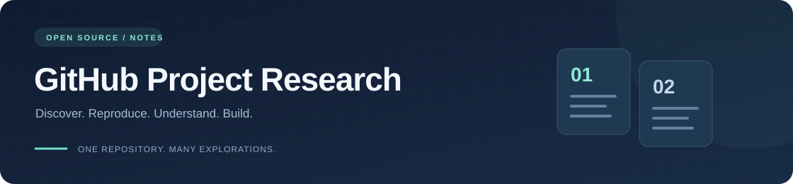
</p>

# GitHub 项目研究库

把最近遇到的优秀开源项目，整理成可以持续查阅、复现和实践的研究记录。

每个子项目都有独立编号、来源、研究笔记和配图；需要时，再提供可运行的代码与 Web 演示。首页用于浏览与导航，详细内容放在各子项目中。

[项目索引](#项目索引) · [项目图览](#项目图览) · [新增项目](#新增项目) · [研究约定](docs/project-guide.md) · [Web 部署](docs/deployment.md)

## 项目索引

按收录顺序编号，从 **001** 开始递增。编号长期保留，不因进度、热度或归档重新排序。

<!-- PROJECT_INDEX:START -->
当前收录 **12** 个项目。

| 编号 | 项目 | 关注源库 | 一句话摘要 | 研究进度 | Web 演示 |
| --- | --- | --- | --- | --- | --- |
| 001 | [SwiftUIShaders](projects/001-swiftui-shaders/README.md) | [SwiftUIShaders](https://github.com/krispuckett/SwiftUIShaders) | 为 SwiftUI 图片、文字和卡片提供 41 种 GPU 实时特效；通过 Metal 采样与颜色变换实现镭射、波纹、折射等效果，适合封面、卡片与展示页 | 研究中 | [在线演示](https://yydshly.github.io/1022_codex_project/001-swiftui-shaders/) |
| 002 | [Todofy](projects/002-todofy/README.md) | [todofy](https://github.com/salarzeidanlou/todofy) | 任务展示板与管理应用：列表、看板、日历呈现任务，编辑、状态流转、提醒、计时与本地存储驱动管理；对我们主要是看板样式、卡片信息层级和交互组织的参考 | 研究中 | [在线演示](https://yydshly.github.io/1022_codex_project/002-todofy/) |
| 003 | [Algorithmic Sublime Poster](projects/003-algorithmic-sublime-poster/README.md) | [algorithmic-sublime-poster](https://github.com/xianxie6/algorithmic-sublime-poster) | 以情绪与艺术意图组织创作，匹配像素、点云、字符与数据连接等视觉语言形成提示词；展示源库海报、图片返修和真实AI短片，沉淀可复用Skill | 已完成 | [在线演示](https://yydshly.github.io/1022_codex_project/003-algorithmic-sublime-poster/) |
| 004 | [XXD Panel 106 · 柔彩像素记](projects/004-xxd-panel-106/README.md) | [xxd-panel-106](https://github.com/nevertoday/xxd-panel-106) | 对已有图片二次处理，通过提示词与图像模型重绘为柔彩几何像素海报；支持对照图、纯设计和多端壁纸，可作为我们探索风格库的一个样本 | 研究中 | [在线演示](https://yydshly.github.io/1022_codex_project/004-xxd-panel-106/) |
| 005 | [Scene Card Studio](projects/005-scene-card-studio/README.md) | [scene-card-studio](https://github.com/swping999/scene-card-studio) | 照片二次创作工作流：原图与表达目标输入，整理场景卡和提示词，交外部模型改图、对照返修，输出成片与记录；适合相册、内容创作和多图统一，可扩展风格模板、模型接入与团队流程，让要求可复用、结果可检查 | 研究中 | [在线演示](https://yydshly.github.io/1022_codex_project/005-scene-card-studio/) |
| 006 | [oil-tone · 写作约束拆解](projects/006-oil-tone/README.md) | [oil-tone](https://github.com/oil-oil/oil-tone) | 将 23 条写作规则交给 AI，引导起草、润色与结构调整，保留事实、减少空话；适用于文章、产品文案与口播，可复用为我们的编辑标准和完整提示词 | 研究中 | [在线演示](https://yydshly.github.io/1022_codex_project/006-oil-tone/) |
| 007 | [dr-aria · 角色效果与表达图鉴](projects/007-dr-aria/README.md) | [dr-aria](https://github.com/MPMyburgh/dr-aria) | 将 Agent 回复和部分运行状态转成可见角色反馈：预制字符画配合事件驱动动作、文字驱动气泡与嘴型，呈现等待、思考、工作和回复，让等待有反馈、对话有角色，并可作为自有 Agent 的表达层 | 已完成 | [在线演示](https://yydshly.github.io/1022_codex_project/007-dr-aria/) |
| 009 | [WebGPU Render Pipeline · 光照效果实现与复用](projects/009-webgpu-render-pipeline/README.md) | [web-starter-kit-webgpu-pipline](https://github.com/vibegameengine/web-starter-kit-webgpu-pipline) | 在浏览器实现反弹光、环境补光、软阴影及水面与植被受光：先用 BVH/Surfel 估计间接光，缓存为 Lightmap/空间探针，再实时合成画面；可沉淀为游戏、空间漫游和 Web3D 展厅的渲染能力，附一图总览与四场景交互 | 已完成 | [在线演示](https://yydshly.github.io/1022_codex_project/009-webgpu-render-pipeline/) |
| 011 | [Auto Paper Digest · 水生毒理学研究档案](projects/011-open-notebook-research/README.md) | [auto-paper-digest](https://github.com/brianxiadong/auto-paper-digest) | Auto Paper Digest 用 Python、SQLite、Playwright 与 Gradio 串联论文采集、NotebookLM 生成和归档；我们补 Europe PMC 领域检索，切换 Open Notebook 的 Next.js/FastAPI/SurrealDB 与 MiniMax 问答路线，再精读原文，形成可追溯的水生毒理学研究：3篇详细报告、1篇综合及完整证据。 | 已完成 | [在线演示](https://yydshly.github.io/1022_codex_project/011-open-notebook-research/) |
| 012 | [Super Hermes · 多 Skill 问题定位与审查](projects/012-super-hermes/README.md) | [super-hermes](https://github.com/Cranot/super-hermes) | 面向代码问题定位与方案审查的提示词 Skill 包：5 个 Skill 组织定向检查、多轮反驳、三视角分析、方向探索与盲区记录，7 份模板提供检查角度。模型结合材料分析，工具和证据验证；本研究归纳七步定位与九项报告，可复用为跨项目排查规范。 | 已完成 | [在线演示](https://yydshly.github.io/1022_codex_project/012-super-hermes/) |
| 013 | [Old Coder · AI 编码的验收与证据](projects/013-old-coder/README.md) | [old-coder](https://github.com/AmazingAng/old-coder) | 把需求写成SPEC，以测试驱动、多层检查和可复跑报告核对AI代码，让已定义的错误可暴露、交付有据可验；可沉淀验收模板、故障模型、变异与属性测试、检查器和CI门槛，扩展到订单库存、权限与API、重构迁移及团队发布验收 | 已完成 | [在线演示](https://yydshly.github.io/1022_codex_project/013-old-coder/) |
| 014 | [Seijaku · 住宅导览与三项目对比](projects/014-seijaku/README.md) | [seijaku](https://github.com/MengTo/seijaku) | 基于 Three.js 的日式住宅交互网页：连续漫游室内外，结合四季联动、材料特写、构造拆解和声景；对比 Kage、Sublevel 及已有住宅扩展，研究季节材质、构件展开与标注、资源预热与按需绘制，可扩展到旅宿导览、展馆教育、产品工艺展示和空间作品集。 | 已完成 | [在线演示](https://yydshly.github.io/1022_codex_project/014-seijaku/) |
<!-- PROJECT_INDEX:END -->

## 项目图览

每个项目展示一张封面或截图，并附一句说明。更多截图、使用步骤和研究结论请进入对应项目。

<!-- PROJECT_CARDS:START -->
### 001 · SwiftUIShaders

为 SwiftUI 图片、文字和卡片提供 41 种 GPU 实时特效；通过 Metal 采样与颜色变换实现镭射、波纹、折射等效果，适合封面、卡片与展示页


> 能力全景图：SwiftUI 视图与参数输入 → GPU 逐像素采样与变换 → 实时视图输出，并说明效果、适用场景和扩展方向。

[研究详情](projects/001-swiftui-shaders/README.md) · [原始仓库](https://github.com/krispuckett/SwiftUIShaders) · [在线演示](https://yydshly.github.io/1022_codex_project/001-swiftui-shaders/)

标签：SwiftUI / Metal / WebGL 2 / 交互特效

### 002 · Todofy

任务展示板与管理应用：列表、看板、日历呈现任务，编辑、状态流转、提醒、计时与本地存储驱动管理；对我们主要是看板样式、卡片信息层级和交互组织的参考

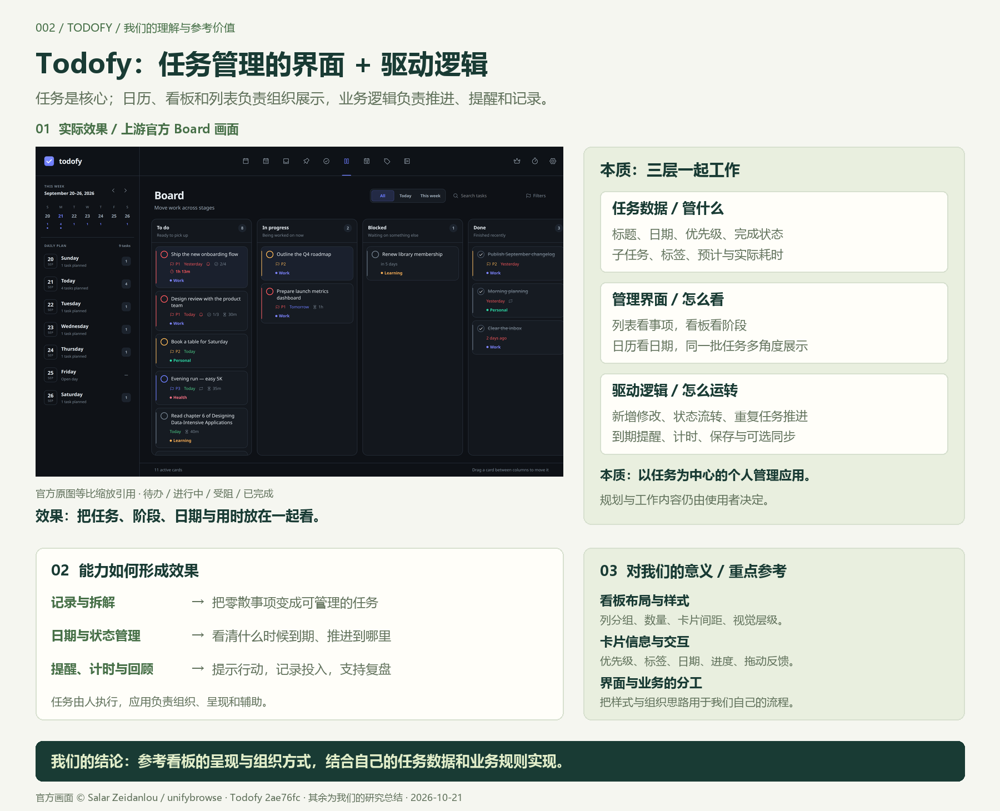

> 我们生成的总结图：引用官方看板画面，说明任务数据、管理界面、驱动逻辑三层本质，归纳能力与效果；重点参考看板布局、卡片信息层级和交互组织。

[研究详情](projects/002-todofy/README.md) · [原始仓库](https://github.com/salarzeidanlou/todofy) · [在线演示](https://yydshly.github.io/1022_codex_project/002-todofy/)

标签：任务管理 / 本地优先 / Tauri 2 / Rust / SQLite

### 003 · Algorithmic Sublime Poster

以情绪与艺术意图组织创作，匹配像素、点云、字符与数据连接等视觉语言形成提示词；展示源库海报、图片返修和真实AI短片，沉淀可复用Skill

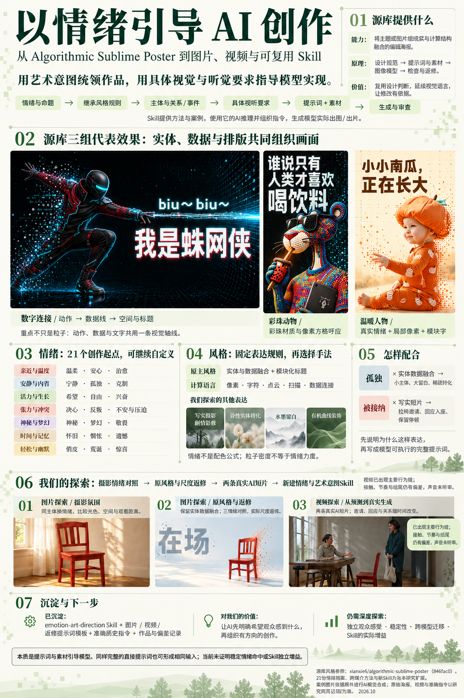

> ImageGen研究总览：突出源库三组效果与数字连接，串联情绪、风格、提示词、图片视频探索和Skill沉淀。案例为依据原件的AI概览合成；21份情绪档案和跨媒介方法为本研究扩展。

[研究详情](projects/003-algorithmic-sublime-poster/README.md) · [原始仓库](https://github.com/xianxie6/algorithmic-sublime-poster) · [在线演示](https://yydshly.github.io/1022_codex_project/003-algorithmic-sublime-poster/)

标签：情绪创作 / 像素与点云 / 图片与视频 / 提示词与Skill

### 004 · XXD Panel 106 · 柔彩像素记

对已有图片二次处理，通过提示词与图像模型重绘为柔彩几何像素海报；支持对照图、纯设计和多端壁纸，可作为我们探索风格库的一个样本

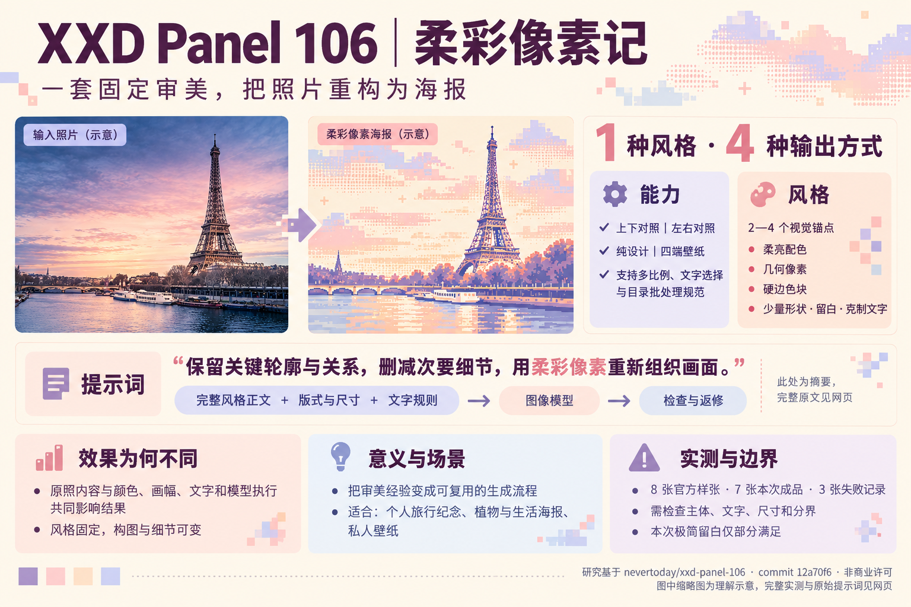

> 使用我们生成的理解总结图作引导：已有图片输入、1种柔彩几何像素风格、4种输出方式，以及提示词、效果差异、适用场景和实测边界；可作为探索风格库的样本。图内缩略图为示意。

[研究详情](projects/004-xxd-panel-106/README.md) · [原始仓库](https://github.com/nevertoday/xxd-panel-106) · [在线演示](https://yydshly.github.io/1022_codex_project/004-xxd-panel-106/)

标签：AI 海报 / 像素艺术 / 真实生图 / Agent Skill

### 005 · Scene Card Studio

照片二次创作工作流：原图与表达目标输入，整理场景卡和提示词，交外部模型改图、对照返修，输出成片与记录；适合相册、内容创作和多图统一，可扩展风格模板、模型接入与团队流程，让要求可复用、结果可检查


> 使用 ImageGen 生成的理解总结图：说明基于原图二次创作的原理、可复用与可检查的规则流程、四种效果参考及扩展场景与意义。效果区参考上游样张，非本次改图实测。

[研究详情](projects/005-scene-card-studio/README.md) · [原始仓库](https://github.com/swping999/scene-card-studio) · [在线演示](https://yydshly.github.io/1022_codex_project/005-scene-card-studio/)

标签：提示词提取 / 照片创作 / 视觉叙事 / Python

### 006 · oil-tone · 写作约束拆解

将 23 条写作规则交给 AI，引导起草、润色与结构调整，保留事实、减少空话；适用于文章、产品文案与口播，可复用为我们的编辑标准和完整提示词

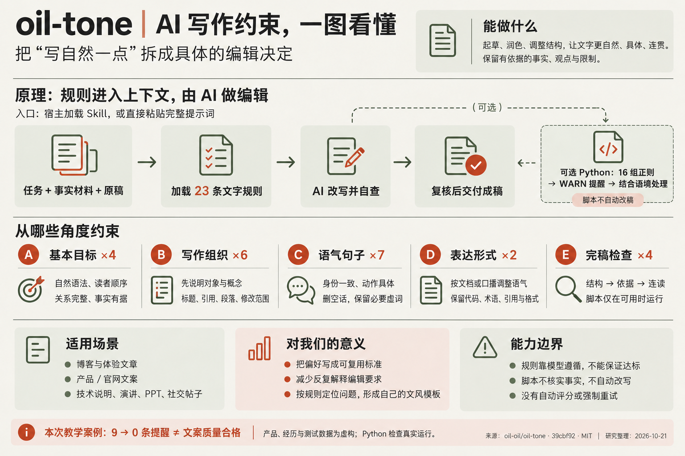

> 使用 ImageGen 生成的理解总结图：能力、规则进入 AI 上下文的原理、五组共 23 条约束、可选的 16 组正则检查、使用场景、对我们的意义与能力边界。教学提醒数不代表质量评分。

[研究详情](projects/006-oil-tone/README.md) · [原始仓库](https://github.com/oil-oil/oil-tone) · [在线演示](https://yydshly.github.io/1022_codex_project/006-oil-tone/)

标签：写作规范 / Agent Skill / 提示词 / 规则检查

### 007 · dr-aria · 角色效果与表达图鉴

将 Agent 回复和部分运行状态转成可见角色反馈：预制字符画配合事件驱动动作、文字驱动气泡与嘴型，呈现等待、思考、工作和回复，让等待有反馈、对话有角色，并可作为自有 Agent 的表达层

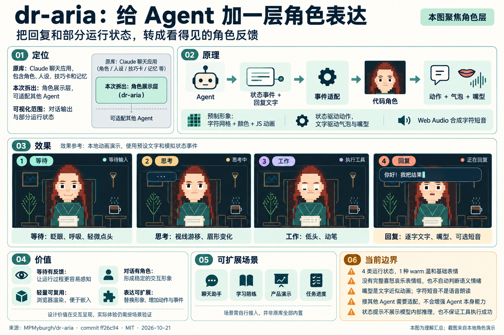

> ImageGen 理解总结图：定位、原理、四状态效果、价值、场景与边界。效果区参考本地实际截图绘制；角色层仅呈现回复和部分状态，未调用真实模型。

[研究详情](projects/007-dr-aria/README.md) · [原始仓库](https://github.com/MPMyburgh/dr-aria) · [在线演示](https://yydshly.github.io/1022_codex_project/007-dr-aria/)

标签：ASCII 动画 / 角色展示 / 状态表达 / 情绪表达

### 009 · WebGPU Render Pipeline · 光照效果实现与复用

在浏览器实现反弹光、环境补光、软阴影及水面与植被受光：先用 BVH/Surfel 估计间接光，缓存为 Lightmap/空间探针，再实时合成画面；可沉淀为游戏、空间漫游和 Web3D 展厅的渲染能力，附一图总览与四场景交互

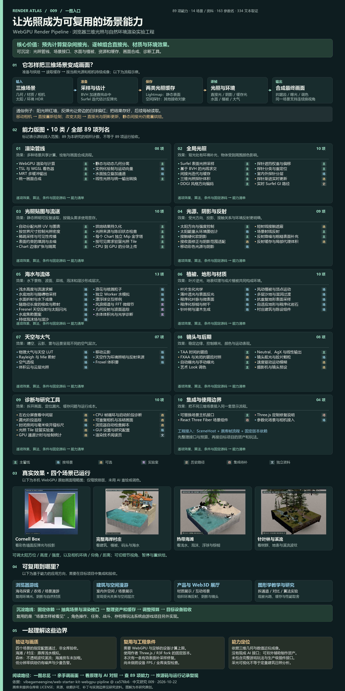

> 我们整理的一图总览：光照效果的核心价值、计算原理、10 类全部 89 项能力、四场景本机实测与复用方向；缩略图来自真实运行，应用方向需单独集成和验收。

[研究详情](projects/009-webgpu-render-pipeline/README.md) · [原始仓库](https://github.com/vibegameengine/web-starter-kit-webgpu-pipline) · [在线演示](https://yydshly.github.io/1022_codex_project/009-webgpu-render-pipeline/)

标签：WebGPU / Three.js / 全局光照 / 水面与大气 / 能力图鉴

### 011 · Auto Paper Digest · 水生毒理学研究档案

Auto Paper Digest 用 Python、SQLite、Playwright 与 Gradio 串联论文采集、NotebookLM 生成和归档；我们补 Europe PMC 领域检索，切换 Open Notebook 的 Next.js/FastAPI/SurrealDB 与 MiniMax 问答路线，再精读原文，形成可追溯的水生毒理学研究：3篇详细报告、1篇综合及完整证据。

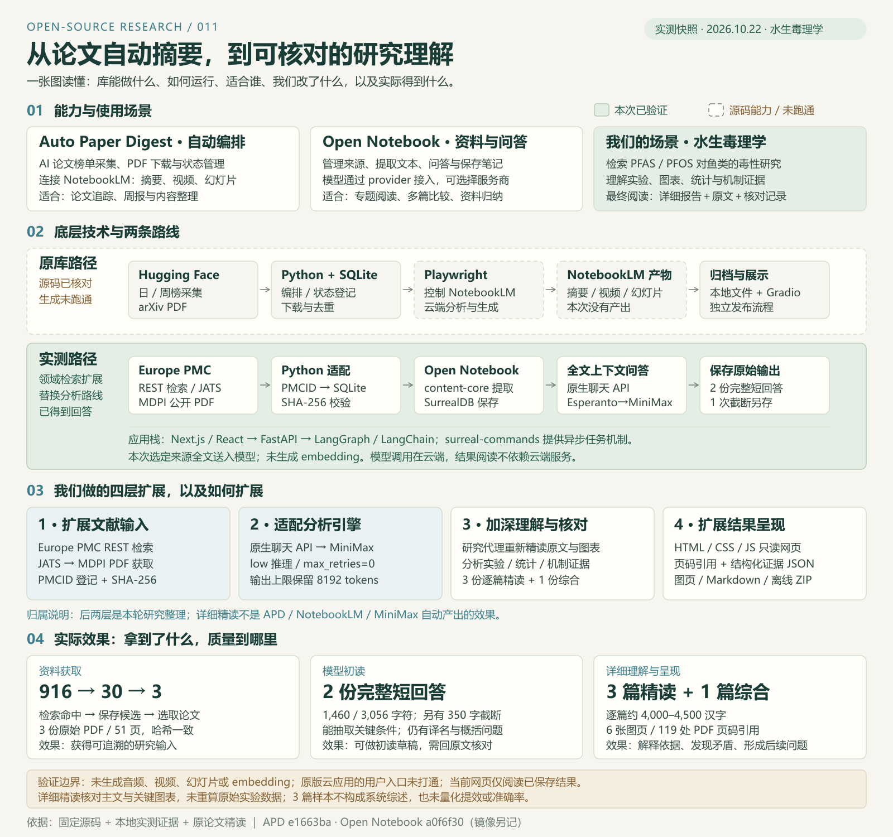

> 原创一图总览：源库能力、技术架构、从 NotebookLM 转向 Open Notebook/MiniMax 的探索、四层扩展及实测效果。详细报告来自研究代理精读，历史模型短回答另行保留。

[研究详情](projects/011-open-notebook-research/README.md) · [原始仓库](https://github.com/brianxiadong/auto-paper-digest) · [在线演示](https://yydshly.github.io/1022_codex_project/011-open-notebook-research/)

标签：Auto Paper Digest / 论文研究 / 水生毒理学 / Open Notebook / 模型核对 / 静态档案

### 012 · Super Hermes · 多 Skill 问题定位与审查

面向代码问题定位与方案审查的提示词 Skill 包：5 个 Skill 组织定向检查、多轮反驳、三视角分析、方向探索与盲区记录，7 份模板提供检查角度。模型结合材料分析，工具和证据验证；本研究归纳七步定位与九项报告，可复用为跨项目排查规范。

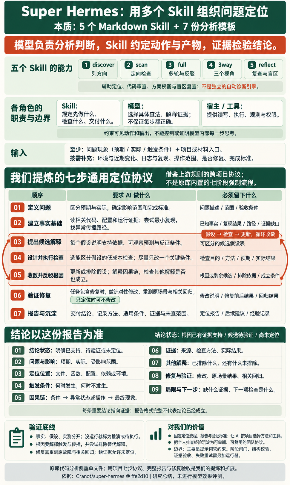

> 我们生成的理解总结图：五个 Skill、模型与工具分工、七步定位协议、逐步要求和产物、九项结论报告、验证边界与复用价值。七步与完整报告是研究提炼，非原库内置强制执行器。

[研究详情](projects/012-super-hermes/README.md) · [原始仓库](https://github.com/Cranot/super-hermes) · [在线演示](https://yydshly.github.io/1022_codex_project/012-super-hermes/)

标签：Agent Skill / 代码审查 / 提示词工作流 / 盲区反馈 / 研究指南

### 013 · Old Coder · AI 编码的验收与证据

把需求写成SPEC，以测试驱动、多层检查和可复跑报告核对AI代码，让已定义的错误可暴露、交付有据可验；可沉淀验收模板、故障模型、变异与属性测试、检查器和CI门槛，扩展到订单库存、权限与API、重构迁移及团队发布验收

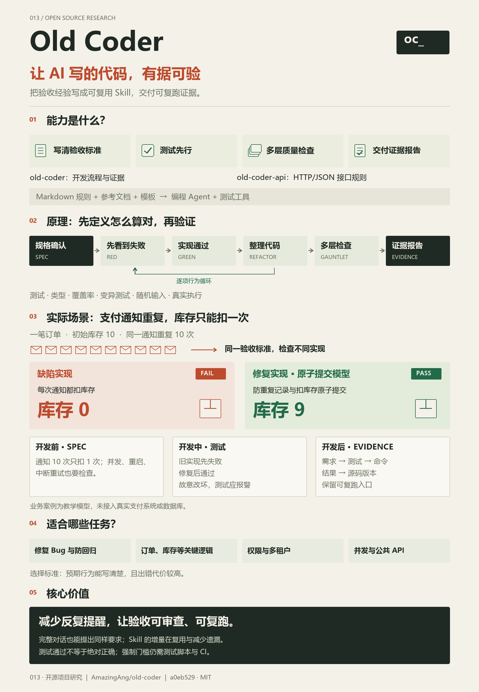

> 本研究原创能力总览图：四项能力、六阶段原理、库存重复通知案例、适用任务与价值边界。案例为本地教学模型，图解用矢量排版绘制并导出PNG，非真实支付系统实测。

[研究详情](projects/013-old-coder/README.md) · [原始仓库](https://github.com/AmazingAng/old-coder) · [在线演示](https://yydshly.github.io/1022_codex_project/013-old-coder/)

标签：Agent Skill / 测试驱动 / 质量验收 / 可执行实验 / 证据报告

### 014 · Seijaku · 住宅导览与三项目对比

基于 Three.js 的日式住宅交互网页：连续漫游室内外，结合四季联动、材料特写、构造拆解和声景；对比 Kage、Sublevel 及已有住宅扩展，研究季节材质、构件展开与标注、资源预热与按需绘制，可扩展到旅宿导览、展馆教育、产品工艺展示和空间作品集。

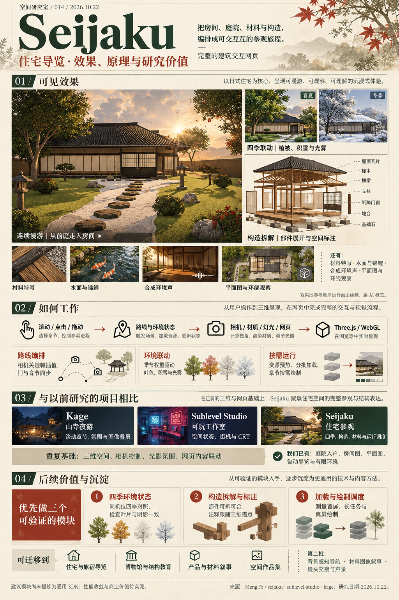

> 使用我们生成的 Seijaku 研究总览作引导图：效果、实现流程、Kage / Sublevel 对比、三项优先技术与四类扩展场景。Imagegen 参考庭院运行画面绘制，其他场景为示意；建议模块仍待独立提炼。

[研究详情](projects/014-seijaku/README.md) · [原始仓库](https://github.com/MengTo/seijaku) · [在线演示](https://yydshly.github.io/1022_codex_project/014-seijaku/)

标签：Three.js / 住宅导览 / 四季与构造 / 同类对比
<!-- PROJECT_CARDS:END -->

## 目录结构

```text
.
├── README.md                 # 总索引、摘要、配图与入口
├── projects/
│   ├── catalog.json          # 子项目登记表，索引的唯一数据源
│   └── 001-project-slug/     # 新增首个项目时生成
│       ├── README.md         # 来源、简介、复现方法与研究结论
│       ├── notes.md          # 研究过程与待解决问题
│       └── assets/           # 项目配图及其来源说明
├── docs/                     # 研究规范与部署指南
├── templates/                # 子项目与部署工作流模板
├── scripts/                  # 新建项目、同步和检查索引
├── assets/                   # 仓库首页公共图片
└── .github/workflows/        # 索引与结构检查
```

## 新增项目

需要 Python 3.10 或更新版本，脚本只使用标准库。在仓库根目录执行下面的命令，把示例信息替换为实际项目：

```bash
python scripts/project_catalog.py add --slug project-slug --name "项目名称" --repo https://github.com/owner/repository --summary "用一句话说明项目解决什么问题，以及为什么值得研究"
```

脚本会分配下一个编号，复制研究模板，并更新本页索引和图览。编号从 `001` 开始，例如首个项目目录为 `projects/001-project-slug/`。

接下来：

1. 补充子项目 `README.md` 中的上游版本、复现方法和研究结论。
2. 用真实截图替换默认封面，在 `assets/README.md` 记录来源和图片说明。
3. 在 `projects/catalog.json` 更新进度、标签、封面路径或演示链接。
4. 执行下面的命令，同步并检查首页。

```bash
python scripts/project_catalog.py sync
python scripts/project_catalog.py check
```

研究进度：`待研究` → `研究中` → `已完成`；暂时停止维护的项目标记为 `已归档`，保留原编号。

## Web 演示

按需为子项目增加 `web/` 目录，各自选择技术栈和构建方式。GitHub Pages 部署时，统一汇总到根目录下的 `_site/`，每个演示使用自己的编号路径，例如 `/1022_codex_project/001-project-slug/`。

已发布 [演示总导航](https://yydshly.github.io/1022_codex_project/) 和 [001 · SwiftUIShaders 图解与 41 种特效](https://yydshly.github.io/1022_codex_project/001-swiftui-shaders/)。项目页先用两张引导图说明能力、原理、效果、场景与扩展方向，再提供完整交互实验。构建与自动部署方式见 [Web 部署指南](docs/deployment.md)。

已发布 [002 · Todofy 任务展示板与管理驱动](https://yydshly.github.io/1022_codex_project/002-todofy/)：列表、看板和日历展示任务，编辑、状态流转、提醒、计时与存储支撑管理。对我们主要是看板样式、卡片信息层级和交互组织的参考；用我们生成的总结图引导，再看八张源库官方原图、原理与六个场景。总结图和八张原图已完成线上文件校验，切换、放大、原理与场景导航已通过浏览器检查。

## 来源与许可

研究记录应注明原仓库、作者、所研究的版本以及截图来源。引用或改动第三方代码时，遵守原项目许可并保留相应声明；各项目的具体许可信息记录在各自的研究页中。
