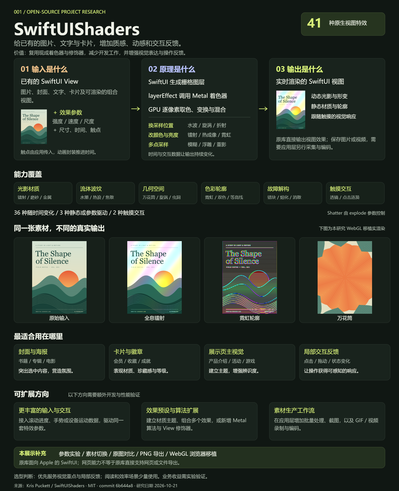
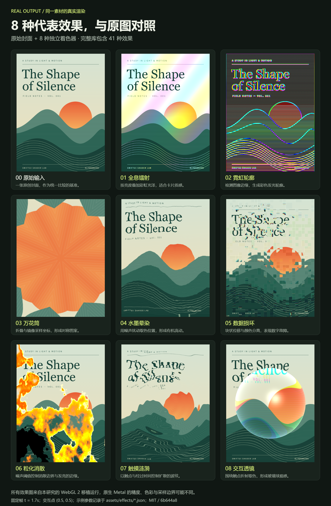
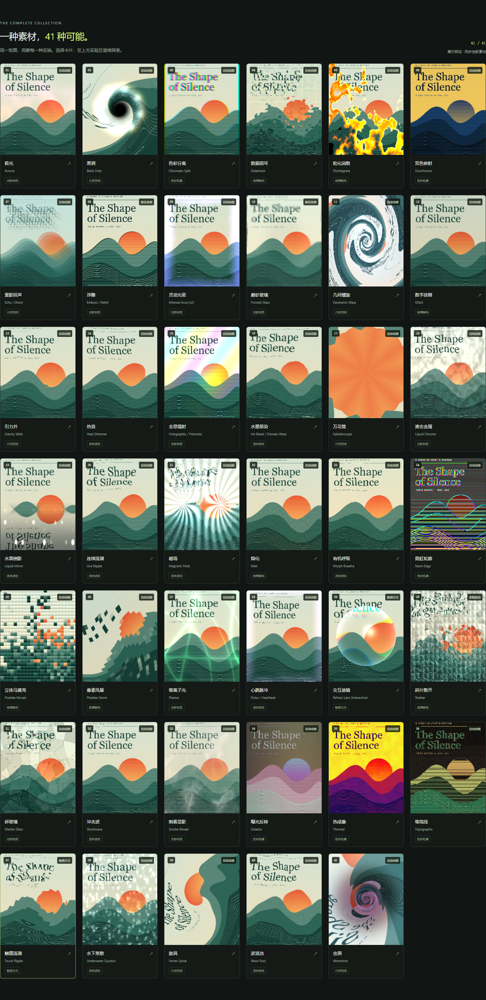

# 001 · SwiftUIShaders

> 为 SwiftUI 图片、文字和卡片提供 41 种 GPU 实时特效；通过 Metal 采样与颜色变换实现镭射、波纹、折射等效果，适合封面、卡片与展示页。

[完整 41 项能力与参数](CAPABILITIES.md) · [原生 SwiftUI 展示](native/README.md) · [验证结果](verification.json) · [研究笔记](notes.md)

## 先理解它能做什么

| 问题 | 结论 |
| --- | --- |
| 能力与输入 | 接收已有的 SwiftUI View（图片、文字、卡片或可渲染的组合视图），以及尺寸、时间、触点和效果参数；提供 41 个公开特效修饰器。 |
| 实现原理 | SwiftUI 将视图栅格化为图层，`layerEffect` 调用 Metal 着色器；GPU 逐像素改变采样位置、计算颜色或混合多次采样，产生变形、材质和动态。 |
| 可实现效果与输出 | 全息镭射、液态金属、流体波纹、折射、万花筒、霓虹描边、水墨、故障与消散等。直接输出实时显示的视图：36 种随时间变化、3 种静态或参数驱动、2 种触摸交互。 |
| 价值与适用场景 | 复用现成算法与参数，减少 SwiftUI 特效接入工作；用于封面海报、会员或收藏卡、产品与活动展示主视觉、游戏界面和局部操作反馈。 |
| 可扩展方向 | 接入滚动、手势或设备运动；建立预设、组合效果、增加 Metal 算法；扩展批量图片导出、GIF 或视频制作。这些方向需要额外开发与设备验证。 |

**最终结果通常是实时视图。** 截取一帧可以得到图片；连续动效需要持续渲染，若要保存为视频则需另做录制与编码。本研究网页额外实现了 WebGL 移植、素材上传、原图比较与 PNG 导出。

### 引导图 1：能力全景



[下载 PNG](web/assets/understanding-overview.png) · [可编辑 SVG](web/assets/understanding-overview.svg)。图中效果来自真实 WebGL 渲染，说明源库能力与展示页补充功能的边界。

### 引导图 2：原图与真实效果



[下载 PNG](web/assets/effect-atlas.png) · [可编辑 SVG](web/assets/effect-atlas.svg)。使用相同素材与固定时间、参数；网页中的 8 个效果模块可继续调参。来源和截图边界见 [素材说明](assets/README.md)。

**离线体验：[下载后打开完整交互展示](web/standalone.html)**。支持 WebGL 2 的浏览器即可运行，无需安装前端依赖。GitHub 文件页显示 HTML 源码，在线入口在 Pages 发布验证后补充。

## 来源与研究范围

| 信息 | 内容 |
| --- | --- |
| 上游仓库 | [krispuckett/SwiftUIShaders](https://github.com/krispuckett/SwiftUIShaders) |
| 作者 | Kris Puckett |
| 固定 commit | [`6b644a8bd4f3131401bd6765990e476352d3cdef`](https://github.com/krispuckett/SwiftUIShaders/tree/6b644a8bd4f3131401bd6765990e476352d3cdef) |
| 上游许可 | MIT，保留于 [upstream/LICENSE](upstream/LICENSE) |
| 收录日期 | 2026-10-21 |
| 当前阶段 | 全量能力展示与源码核对；原生设备验证待完成 |
| 原生平台 | iOS 17+、macOS 14+、tvOS 17+、visionOS 1+；Xcode 15+ |
| 本次验证环境 | Windows、Python 3.10.11、Playwright Chromium、ANGLE SwiftShader 软件 WebGL 2 |
| 在线发布 | 尚未部署；登记表 `demo_url` 保持为空 |

原始 Metal、Swift 修饰器、参数表与包配置纳入 [`upstream/`](upstream/)；[来源与文件校验值](upstream/SOURCE.json)固定其研究版本。未引入第三方前端运行库。

## 真实效果的来源

两张引导图以可编辑 SVG 排版并导出 PNG。效果模块保存在 `web/assets/effects/`，相邻 JSON 记录实际参数、时间、触点、逻辑尺寸和上游版本；网页可从模块直接进入对应实验。

图解是研究说明，效果图是 WebGL 移植输出，尚未用原生 Metal 截图做逐像素核对。图解尺寸、真实模块、网页跳转、手机布局和离线资源一致性的检查记录见 [visuals-verification.json](visuals-verification.json)。

## 我们对用途与价值的理解

核心能力是对已有的 SwiftUI 视觉内容添加 GPU 实时特效。图片和封面是直观的使用对象，也可用于文字、卡片与可渲染的组合视图。

优先适用的位置是封面、卡片，以及展示页中的视觉重点：书籍或专辑封面的轻微流光用于突出内容；会员卡、收藏卡和徽章的反光与折射用于表现材质；产品介绍、活动页和游戏界面的主视觉可使用风格化效果建立主题。涟漪、脉冲和消散也适合局部操作反馈。

价值主要在减少着色器接入工作、增强视觉表达和补充交互反馈。以表单、表格和长文本阅读为主的页面应优先保证清晰与效率；真实设备开销及留存、转化等业务收益需要单独验证。

网页新增“用途与价值”说明，并提供直接进入对应效果实验的按钮。需区分原生 SwiftUI 库与本研究的 WebGL 移植展示；图片上传、PNG 导出属于展示页功能。

## 现在能完整展示什么

- **41 个独立算法**：全部从对应的 Metal 实现移植到 WebGL 2，逐项编译、实际渲染；没有用 CSS 滤镜统一替代不同效果。
- **完整效果图集**：41 张同素材效果卡片，按光影材质、流体波纹、几何空间、色彩轮廓、故障解构、触摸交互分类；支持中文、英文、方法名与参数名搜索。
- **全部 168 项上游效果参数**：166 个数值参数、2 个触点参数。数值滑块、触点 X/Y 控件、恢复上游默认值与展示预设可分别使用。
- **实时实验**：暂停/播放、30 秒时间轴、指定时刻预览、可拖动的原图分界对比。
- **真实交互**：拖动折射透镜、点击产生涟漪，支持方向键移动触点和空格触发。
- **不同内容**：山野封面、植物插画、文字海报三份原创 SVG，以及本地图片上传。上传仅在浏览器内处理，按 3:4 居中裁切。
- **可复用输出**：导出当前 PNG，复制带当前参数的 SwiftUI 调用，并查看对应 Metal 源码与固定版本链接。
- **原生对照入口**：macOS SwiftUI 工程直接调用上游的全部 41 个公开修饰器；已生成，尚未经过 Xcode 构建验证。

### 驱动方式需要准确区分

上游 README 称 37 个效果为 animated。源码显示 37 个修饰器确实使用动画封装，但 **Shatter 的函数体没有使用 `time`**，其变化由 `explode` 控制。因此网页按实际行为标注：

| 实际驱动方式 | 数量 | 说明 |
| --- | --- | --- |
| 随时间变化 | 36 | 时间推进会改变输出；Glitch 为间歇触发 |
| 静态或参数驱动 | 3 | Emboss、Frosted、Shatter |
| 触摸交互 | 2 | RefractLens、TouchRipple；后者需要更新 `touchAge` |



*图集采用明确的“展示预设”，部分参数不同于上游默认值，以便观察效果；实验区可一键恢复上游默认值。*

## 运行

### 最快：离线文件

直接用 Chrome、Edge 或其他支持 WebGL 2 的浏览器打开 `web/standalone.html`。其中已内嵌样式、运行代码、全部着色器和三份素材。测试已验证 `file://` 入口与素材切换，无需网络。

### 开发预览

在仓库根目录运行：

```bash
python -m http.server 8000 --bind 127.0.0.1 --directory projects/001-swiftui-shaders/web
```

访问 [http://127.0.0.1:8000/](http://127.0.0.1:8000/)。也可使用 `/#effect=TouchRipple` 等片段直达某个效果。

页面的 HTTP 入口使用 ES Modules 与本地 `shaders.json`，需要通过 HTTP 访问；直接打开磁盘文件时请使用专门的 `standalone.html`。

### 修改和重新生成

```bash
python projects/001-swiftui-shaders/scripts/build_gallery.py
python projects/001-swiftui-shaders/scripts/build_native.py
python projects/001-swiftui-shaders/scripts/package_web.py
```

1. `build_gallery.py` 解析实际 Metal 签名，按签名顺序绑定参数，生成全部 GLSL 程序、完整能力文档和许可证副本。
2. `build_native.py` 生成调用 41 个公开 Swift 修饰器的原生展示代码。
3. `package_web.py` 生成离线单文件。网页开发直接编辑 `web/index.html`、`style.css`、`app.js` 和 `renderer.js`。

不要手改生成的 `shaders.json`、`standalone.html`、`CAPABILITIES.md` 或 `native/ShaderGalleryApp.swift`。

### 重新生成图解与效果模块

运行展示本身不需要 Python 图像依赖。重新排版 SVG 时需要 Pillow 提供字体宽度测量，并使用系统的微软雅黑字体。执行：

```bash
python -m pip install pillow
python projects/001-swiftui-shaders/scripts/capture_visuals.py
```

在支持 WebGL 2 的浏览器打开脚本打印的 [本地渲染页](http://127.0.0.1:8012/__render)。它会保存原图与 8 个真实效果 PNG，自动运行 `build_visuals.py` 排版两张 SVG，再将两张图栅格化为 PNG。页面显示 `11 / 11` 后，停止该服务，再执行：

```bash
python projects/001-swiftui-shaders/scripts/package_web.py
```

只修改图解文案时，编辑 `scripts/build_visuals.py` 后也可直接运行它来更新 SVG，再按上述渲染流程导出 PNG。所有图像都保留在 `web/assets/`，静态部署与离线文件会一起包含这些资源。

### 验证

运行时只需要浏览器。重新执行浏览器 QA 另需安装 Playwright 与 Chromium：

```bash
python -m pip install playwright
python -m playwright install chromium
python projects/001-swiftui-shaders/scripts/verify_gallery.py
python projects/001-swiftui-shaders/scripts/build_gallery.py --check
python projects/001-swiftui-shaders/scripts/build_native.py --check
python scripts/project_catalog.py check
```

已验证：41/41 编译与渲染、每项展示预设均与原图有可见差异、36/36 时间变化算法发生画面变化、全部数值控件、交互、搜索、筛选、三种素材、自选图片、PNG 导出、390px 手机布局和离线入口。原始像素差结果见 [verification.json](verification.json)。

本机 Chromium 默认图形后端曾出现 GPU 上下文丢失，自动检查使用 ANGLE SwiftShader 软件后端完成，**这些结果不能用于推断真实设备帧率或功耗**。原生 Metal 效果、Xcode 构建和 Apple 真机性能尚未验证。

## 实现与差异

原生链路为 `SwiftUI View → layerEffect → [[ stitchable ]] Metal 函数`。Swift 封装传入视图尺寸、时间、触点和参数；GPU 逐像素重新采样与混色。

网页保留各效果的数学算法，只转换语言与渲染接口：Metal 的向量类型转为 GLSL 向量，`layer.sample` 转为纹理采样，`atan2`、`fmod` 和反向 `smoothstep` 显式适配。实际参数绑定按 Metal 签名解析，避免 `ChromaticSplit` 的 `time` 位于参数中间而导致错序。

需要保留的差异：

- 浏览器使用高精度 GLSL，原生主要使用 `half`；色彩空间、噪声精度与渲染后端不同，复杂图案可能出现差异，尚无逐像素原生对照。
- 网页使用共同的 `450×600` 逻辑图层比较位移效果，物理输出分辨率随画布尺寸调整；原生图层尺寸由 SwiftUI 布局决定。
- 网页不模拟 SwiftUI `maxSampleOffset` 的边界裁剪。所有公开修饰器均有此公共参数，原默认值 `64×64`；原生强位移效果可能需要增加它。
- `EtherealAura` 的 5 个参数及 `touchAge` 在上游没有建议范围，滑块使用明确标注的实验范围；`NeonEdge.glowAmount` 默认 4、建议 0–2，页面保留默认值并扩展滑块范围。
- 当前仅实时渲染选中效果。41 个缩略图在换素材时各渲染一次，避免为每张卡片持续运行 GPU 动画。

## 目录

```text
001-swiftui-shaders/
├── README.md / CAPABILITIES.md / notes.md
├── verification.json       # 实际浏览器检查与像素差结果
├── assets/                 # 真实截图、原生素材和来源说明
├── upstream/               # 固定版本的必要源码、参数和 MIT 许可
├── web/                    # 无运行依赖的浏览器展示
│   └── standalone.html     # 可直接从磁盘打开的完整入口
├── native/                 # 原生 macOS SwiftUI 对照工程（待 Xcode 验证）
└── scripts/                # 生成、打包和浏览器集成验证
```

## 部署与来源

项目所有网页资源都使用相对路径，可部署到 `/1022_codex_project/001-swiftui-shaders/`。仅打包，不自动发布：

```bash
python projects/001-swiftui-shaders/scripts/package_web.py --output _site/001-swiftui-shaders
```

输出目录须为空，脚本不会删除已有文件。多项目站点流程见[部署规范](../../docs/deployment.md)。本次未创建线上站点、未修改远程仓库。

- [固定版本的上游 README](https://github.com/krispuckett/SwiftUIShaders/blob/6b644a8bd4f3131401bd6765990e476352d3cdef/README.md)
- [Apple：layerEffect](https://developer.apple.com/documentation/swiftui/view/layereffect(_:maxsampleoffset:isenabled:))
- [图片说明与来源](assets/README.md)
- [返回项目索引](../../README.md#项目索引)

Metal/Swift 原始代码与派生 GLSL 遵循上游 MIT 许可，Copyright (c) 2026 Kris Puckett。测试封面、植物插画、文字海报均为本研究原创矢量素材，不包含上游书籍封面的第三方版权图片。
