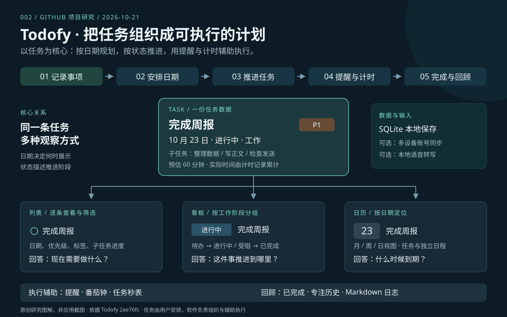

# Todofy 能力展示

研究快照：[`2ae76fc80b0b96ad8191e3d1ae4949ee340190a7`](https://github.com/salarzeidanlou/todofy/tree/2ae76fc80b0b96ad8191e3d1ae4949ee340190a7)。以下效果来自源码推导和上游官方展示，尚未经过本机原生端操作验收。

[研究首页](README.md) · [原理分析](ARCHITECTURE.md) · [使用场景](SCENARIOS.md)

## 1. 一条任务，三种观察方式



示例任务由本研究编写，日期固定为 **2026-10-23**，便于比较：

| 属性 | 示例值 | 用途 |
| --- | --- | --- |
| 标题 | 完成周报 | 说明要做什么 |
| 日期 / 提醒 | 2026-10-23 / 当天 16:00 | 决定展示日期和提醒时间 |
| 完成状态 / 看板阶段 | 未完成 / 进行中 | 区分是否完成与推进阶段 |
| 优先级 / 标签 | P1 / 工作 | 帮助筛选与识别 |
| 子任务 | 整理数据、写正文、检查发送 | 拆成可执行步骤 |
| 预计 / 实际耗时 | 60 分钟 / 计时后累计 | 对比计划与投入 |

| 视图 | 这个任务如何展示 | 改动的影响 |
| --- | --- | --- |
| 列表 / 今日 | 一行任务，带日期、标签、优先级、子任务进度与耗时 | 编辑标题后，其他视图读取更新后的任务 |
| 看板 | “进行中”列的一张卡片 | 移动到“受阻”会改变工作阶段，不会自动修改截止日期 |
| 日历 | 出现在 10 月 23 日 | 通过日期编辑器调整任务日期后，对应日期位置更新 |

底层都是同一个任务 ID。日期、看板阶段与完成状态相互关联，但并不是一个字段。无日期任务仍可在收件箱、标签视图或看板中管理。证据：[任务类型](https://github.com/salarzeidanlou/todofy/blob/2ae76fc80b0b96ad8191e3d1ae4949ee340190a7/src/types.ts)、[任务命令](https://github.com/salarzeidanlou/todofy/blob/2ae76fc80b0b96ad8191e3d1ae4949ee340190a7/src-tauri/src/commands.rs)。

## 2. 完整能力矩阵

| 能力 | 用户输入 / 操作 | 可以看到的结果 | 边界或使用条件 |
| --- | --- | --- | --- |
| 任务与子任务 | 标题、备注、检查清单 | 一条可编辑任务与子任务进度 | 子任务是任务内部检查项；本次未发现独立依赖图 |
| 优先级与标签 | P1–P4、自定义标签与颜色 | 标志、标签筛选与搜索 | 优先级由用户设置，不自动计算 |
| 智能列表 | 选择今日、未来、收件箱、已完成、置顶 | 今日含逾期分组；未来按日期分组 | 本质是筛选、分组与排序 |
| 看板 | 拖动卡片、切换阶段、列内排序 | 待办 / 进行中 / 受阻 / 已完成等流程 | 看板排序和列表排序独立保存 |
| 自定义列 | 创建、重命名、调色、重排、删除列 | 适合个人工作流程的列 | 删除时选择任务迁入列；完成列有固定语义 |
| 在制数量提醒 | 给列设置 WIP 限额 | 活跃任务超过限额时提示 | 提示不会阻止移动；计数不只针对当前筛选结果 |
| 日期与重复 | 选择日期、时间、每日 / 工作日 / 周 / 月 / 年 | 到期展示；完成重复任务后向后推进一期 | 按原日期推进一次；不是按历史生成多份任务 |
| 本地日历 | 切换月 / 周 / 日，创建全天或定时事件 | 任务和独立日程出现在日历 | 独立日程只保存在本机 |
| 全局快速添加 | `Ctrl+Alt+A`，输入并确认 | 浮动输入窗记录任务 | 桌面应用需要运行；快捷键受系统环境影响 |
| 自然语言添加 | 英文日期短语、`p1`、已有 `#标签` | 日期、时间、优先级和标签变成可见字段 | 标签需要已经存在；未识别内容保留为标题 |
| 本地语音输入 | 下载引擎与模型，录音，停止 | 可编辑转写文本，再由用户添加 / 保存 | 模型首次获取需要网络；转写质量和速度未实测 |
| 到期提醒 | 设置时间，选择系统通知或应用弹窗 | 到时提示、稍后提醒、可选重复提醒与声音 | 后台检查约 20 秒一次；系统通知权限可能影响效果 |
| 任务计时 | 开始、暂停、继续、停止 | 实际耗时累计，可与预估比较 | 持久化计时状态；快照有 12 小时安全上限 |
| 番茄钟 | 设置专注、短休息、长休息与间隔轮数 | 阶段倒计时、到时提示和专注历史 | 与任务计时是相关但不同的状态模型 |
| 日志回顾 | Markdown、标题、1–5 心情 | 按天展示日志；插入完成数和专注时长摘要 | 摘要为结构化计数文本，不是生成式总结 |
| 账号同步 | 登录，选择官方服务或配置自建服务 | 同一账号的任务、列、标签、专注历史、日志同步 | 官方 Cloud Sync 是 Pro；不是团队协作权限模型 |
| Google Calendar | 单独授权，连接专用日历 | 有日期任务变成全天或定时事件 | 单向推送；不读取原有日历事件 |
| 桌面体验 | 托盘、开机启动、主题、键盘操作、更新设置 | 少开窗口也能记录、计时和接收提醒 | 自动更新有签名验证；安装行为按平台而异 |

证据：[固定版本功能说明](https://github.com/salarzeidanlou/todofy/blob/2ae76fc80b0b96ad8191e3d1ae4949ee340190a7/README.md)、[数据库结构](https://github.com/salarzeidanlou/todofy/blob/2ae76fc80b0b96ad8191e3d1ae4949ee340190a7/src-tauri/src/db.rs)、[看板组件](https://github.com/salarzeidanlou/todofy/blob/2ae76fc80b0b96ad8191e3d1ae4949ee340190a7/src/components/BoardView.tsx)。具体机制与代码对应关系见 [ARCHITECTURE.md](ARCHITECTURE.md)。

## 3. 快速输入的效果

前提：已经建立 `home` 标签。输入：

```text
pay rent friday 5pm #home p1
```

| 提取结果 | 值 |
| --- | --- |
| 标题 | `pay rent` |
| 日期 | 由当前本地时间解析出的向前周五日期 |
| 时间 | 17:00 |
| 标签 | 已存在的 `home` |
| 优先级 | P1 |

如果 `home` 不存在，`#home` 不会自动创建标签，会留在标题中。重复短语由英文正则识别，日期由 `chrono-node` 解析；当前实现提取第一个日期结果。中文任务标题可直接保存，但不能将“明天下午五点”当成已支持的自动排期语法。证据：[nlp.ts](https://github.com/salarzeidanlou/todofy/blob/2ae76fc80b0b96ad8191e3d1ae4949ee340190a7/src/lib/nlp.ts)。

## 4. 官方界面展示入口

下面链接指向研究快照中的官方图片，观察的是上游演示数据和界面，不是本次本地复现结果。配图来源、许可处理见 [assets/README.md](assets/README.md)。

| 官方界面 | 观察重点 |
| --- | --- |
| [Today 今日视图](https://github.com/salarzeidanlou/todofy/blob/2ae76fc80b0b96ad8191e3d1ae4949ee340190a7/docs/today.png) | 逾期任务、优先级、标签、清单进度 |
| [Board 看板](https://github.com/salarzeidanlou/todofy/blob/2ae76fc80b0b96ad8191e3d1ae4949ee340190a7/docs/board.png) | 列、阶段与任务卡片；卡片信息与列表一致 |
| [Calendar 日历](https://github.com/salarzeidanlou/todofy/blob/2ae76fc80b0b96ad8191e3d1ae4949ee340190a7/docs/calendar.png) | 按日期展示任务与独立日程 |
| [Focus 专注](https://github.com/salarzeidanlou/todofy/blob/2ae76fc80b0b96ad8191e3d1ae4949ee340190a7/docs/focus.png) | 倒计时、阶段配置与历史 |
| [Quick capture 快速记录](https://github.com/salarzeidanlou/todofy/blob/2ae76fc80b0b96ad8191e3d1ae4949ee340190a7/docs/quickadd.png) | 全局浮动输入窗 |
| [Journal 日志](https://github.com/salarzeidanlou/todofy/blob/2ae76fc80b0b96ad8191e3d1ae4949ee340190a7/docs/journal.png) | Markdown、心情、每日分组 |
| [Voice 本地语音设置](https://github.com/salarzeidanlou/todofy/blob/2ae76fc80b0b96ad8191e3d1ae4949ee340190a7/docs/voice.png) | 模型与引擎需要用户选择下载 |

## 5. 如何判断是否适合自己

适合希望把个人待办、日期计划、专注计时和回顾集中管理的人。若需求是多人派工、共享项目权限、自动安排空闲时段、工时开票或全面双向日历整合，应先核对功能缺口，不把这些能力从“有看板 / 有日历 / 有计时”直接推导出来。

[继续阅读使用场景](SCENARIOS.md) · [返回研究首页](README.md)
