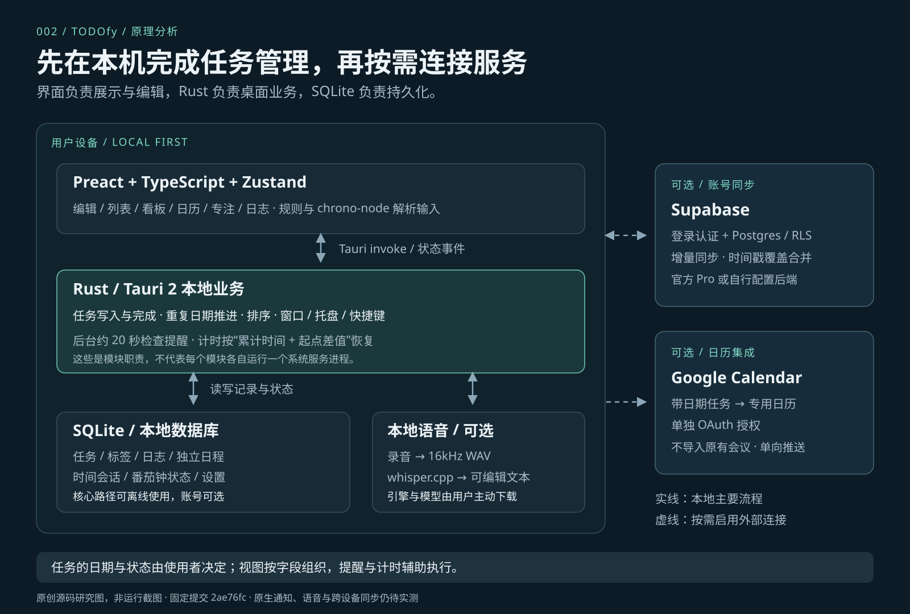

# 002 · Todofy：任务展示板与管理驱动

> 我们的理解：**任务展示板＋管理驱动**。列表、看板和日历呈现同一批任务，编辑、状态流转、重复任务、提醒、计时与本地存储支撑管理。**对我们主要是看板样式、卡片信息层级和交互组织的参考。**

[在线展示](https://yydshly.github.io/1022_codex_project/002-todofy/) · [本地网页](web/index.html) · [能力展示](CAPABILITIES.md) · [原理分析](ARCHITECTURE.md) · [使用场景](SCENARIOS.md) · [复现与验证](REPRODUCTION.md) · [研究笔记](notes.md)

*使用我们生成的总结图作为引导。图中文字与结构为本研究整理，内含等比引用的上游官方 Board 截图；画面版权归 Salar Zeidanlou / unifybrowse。[PNG](assets/understanding-summary.png) · [SVG](assets/understanding-summary.svg) · [来源与生成信息](summary-image.json) · [八张官方原图与哈希](screenshots.json)。*

## 来源与研究范围

| 信息 | 内容 |
| --- | --- |
| 上游仓库 | [salarzeidanlou/todofy](https://github.com/salarzeidanlou/todofy) |
| 作者 / 品牌 | Salar Zeidanlou / unifybrowse |
| 研究快照 | [`2ae76fc80b0b96ad8191e3d1ae4949ee340190a7`](https://github.com/salarzeidanlou/todofy/tree/2ae76fc80b0b96ad8191e3d1ae4949ee340190a7)，2026-10-14 的 main 提交 |
| 快照中的版本号 | `1.14.0`；发布标签 [`v1.14.0`](https://github.com/salarzeidanlou/todofy/releases/tag/v1.14.0) 指向 `19a8907fc85e608027014e49f9d1e704754f2656`，与研究快照不是同一提交 |
| 上游许可 | [Todofy Source-Available License](https://github.com/salarzeidanlou/todofy/blob/2ae76fc80b0b96ad8191e3d1ae4949ee340190a7/LICENSE)，源码可见，非 OSI 开源许可 |
| 收录 / 核查日期 | 2026-10-21，Asia/Shanghai |
| 目标平台 | Windows、macOS、Linux 桌面端 |
| 本次验证层级 | 源码静态核查、八张官方原图与展示网页验证、文档与分析图检查；原生运行、通知、语音、云同步未实测 |
| 研究进度 | 研究中；以 [登记表](../catalog.json) 为准 |
| 复现环境 | Windows / PowerShell，Python 3.10.11、Node.js 22.15.0、Rust 1.95.0；Bun 未安装 |
| Web 展示 | [已发布的 Todofy 展示与分析](https://yydshly.github.io/1022_codex_project/002-todofy/)；总结引导图、八张官方原图、原理分析和场景说明 |

源码位置与版本校验信息见 [SOURCE.json](SOURCE.json)，文档与图解检查结果见 [verification.json](verification.json)。本文把“代码中存在的实现”“官方展示”和“本地运行验证”分开记录，功能存在不等于已经验证全部平台的实际表现。

## 网页导览

[展示网页](web/index.html) 把源库内容与我们的分析分成四个连续部分：

1. **源库真实展示**：直接展示今日任务、看板、日历、专注、快速记录、日志、语音和设置八张官方 PNG，可切换、放大、打开原文件及追溯上游来源。
2. **原理分析**：根据固定提交源码解释输入、存储、视图和后台机制；列出真实字段的职责，提供源码链接和本研究的分析图。
3. **使用场景**：六个场景分别说明问题、操作路径、结果与边界，并跳转到相应官方界面。
4. **我们的理解与参考意义**：用任务数据、管理界面、驱动逻辑三层解释其本质，以一张图总结能力与效果，并明确我们优先参考的看板样式、卡片信息层级和交互组织。

网页的产品画面全部来自上游原始截图，已移除自制任务工作台、拖动和计时模拟。图中日期、任务与安装状态保留作者展示环境的内容。中文注解、原理与场景是我们的研究整理；实际操作需使用官方原生应用。可直接打开 HTML，也可按 [网页说明](web/README.md) 启动静态服务。原图哈希、静态检查及浏览器验证范围见 [web-verification.json](web-verification.json)，线上 HTTP、文件一致性与发布记录见 [deployment-verification.json](deployment-verification.json)。

## 我们的理解与参考价值

**本质是以任务为中心的个人管理软件，由任务数据、管理界面和驱动逻辑组成。** 日历是按时间查看任务的视图，看板是按工作阶段查看任务的视图；新增修改、状态流转、重复推进、提醒计时、保存同步等业务逻辑使这些界面运转。

对我们更直接的意义是参考 **看板布局、卡片信息层级、日期与状态组织，以及界面交互和业务规则的分工**，再结合自己的任务数据与流程实现。任务内容与规划决定仍由使用者完成。

首图集中归纳了本质、能力、效果与参考价值；网页首屏采用同一张图，并在“我们的理解”章节展开具体参考项。

## 先用一个例子理解

创建任务 **“完成周报”**，设置截止日期为 **2026-10-23**、优先级为 **P1**、预估耗时为 **60 分钟**，再拆成“整理数据、写正文、检查发送”三个步骤：

1. 在列表里，它是一条带日期、优先级和子任务进度的待办。
2. 在看板里，它可以从“待办”移到“进行中”；这些阶段描述任务的工作状态。
3. 在日历里，它出现在 10 月 23 日；日期描述任务什么时候到期。
4. 开始做时启动任务计时或番茄钟；设置了提醒后，后台到时通知。
5. 完成后，普通任务进入已完成记录；日志可以引用当天完成数量与专注时长。

这是一个使用流程示例，未宣称已在本机完成上述原生操作。**规划由使用者决定，软件负责组织、展示、提醒和记录。** 没有日期的任务仍可进入收件箱或看板，不必先排进日历。

## 能力一览

| 核心问题 | 对应能力 | 结果 |
| --- | --- | --- |
| 要做什么？ | 任务、备注、子任务、标签、搜索、优先级、置顶 | 把事项变成可查找、可拆解的记录 |
| 什么时候做 / 到期？ | 今日与逾期视图、未来日期分组、月 / 周 / 日历、重复任务 | 按日期查看和安排事项 |
| 推进到哪里了？ | 看板、可定制列、拖动排序、在制任务数量提醒 | 按工作阶段展示进度 |
| 怎么帮助执行？ | 全局快捷添加、提醒、稍后提醒、任务秒表、番茄钟 | 降低记录成本，提醒行动，记录实际耗时 |
| 做完以后怎么看？ | 已完成视图、专注历史、Markdown 日志与心情 | 回顾完成情况、投入时间和个人感受 |
| 数据放在哪里？ | SQLite 离线存储、可选账号同步、本地语音识别 | 先在本机使用，再按需要连接外部服务 |

完整功能、输入与输出、边界及官方界面入口见 [能力展示](CAPABILITIES.md)。

## 原理概览

*本仓库原创架构图。实线表示本地主要数据流，虚线表示按需启用的外部连接；本地语音模型也在设备内执行。*

- **界面层**：Preact + TypeScript + Zustand，负责编辑、筛选、分组与展示。
- **桌面层**：Tauri 2 + Rust，负责窗口、快捷键、托盘、数据库命令与后台调度。
- **数据层**：SQLite 保存任务、标签、日志、计时状态与设置；任务有独立的日期、完成状态、看板阶段和排序字段。
- **辅助能力**：规则与 `chrono-node` 解析英文输入；`whisper.cpp` 在本机把录音变成文字。
- **可选服务**：Supabase 同步同一账号的数据；Google Calendar 接收带日期任务的单向推送。

字段、数据流、重复任务的推进方式、计时恢复、同步冲突和源码证据见 [原理分析](ARCHITECTURE.md)。

## 适用场景

| 场景 | 建议的使用方式 | 主要价值 |
| --- | --- | --- |
| 每日工作与周计划 | 收集任务 → 设置日期与优先级 → 今日视图执行 | 知道今天需要处理什么 |
| 个人项目推进 | 子任务拆解 → 看板推进 → 标记阻塞 | 看清工作进展和下一步 |
| 学习与备考 | 重复学习任务 → 番茄钟 → 专注历史 → 日志 | 形成节奏，回顾投入时间 |
| 自由职业与创作 | 预估耗时 → 任务计时 → 实际耗时对比 | 改善下次的时间估计 |
| 离线记录与隐私偏好 | 本地任务 / 日志 → 可选本地语音 → 按需同步 | 核心流程不依赖网络 |

每个场景的具体操作、预期结果、限制和选择建议见 [使用场景](SCENARIOS.md)。

## 已确认的边界

1. **个人效率工具的定位**：代码主线是个人任务与同一账号多设备同步；本次未发现任务指派、团队权限或多人评论的完整协作流程。
2. **日期展示不等于自动排程**：设置截止日期后可以在日历看到任务；没有发现基于工作量、依赖与空闲时间自动生成计划的排程器。
3. **输入解析以英文规则为主**：中文标签可以按已有名称匹配；中文自然语言排期未由当前快速添加实现支持。多语言语音转文字与日期理解是两项不同能力。
4. **Google Calendar 是单向推送**：只操作它创建的专用日历；不会导入用户原有会议。本地独立日程不进入账号同步，也不推送到 Google。
5. **后台能力有运行前提**：驻留托盘时继续提醒；完全退出或电脑关机时没有应用线程执行提醒。计时恢复依据持久化时间戳计算。
6. **源码与说明有细节差异**：README 描述计时器不会自动停止，但研究快照实际有 12 小时安全上限；重复任务完成会更新原任务的下一次日期，不产生独立的每次完成历史。详见 [分析中的边界](ARCHITECTURE.md#8-实现边界与取舍)。

## 复现与后续验证

优先从 [官方 v1.14.0 发布页](https://github.com/salarzeidanlou/todofy/releases/tag/v1.14.0) 获取安装包，或在本机准备 Bun、Rust 和 Tauri 平台依赖后构建固定提交。详细命令、验收清单与未验证事项见 [REPRODUCTION.md](REPRODUCTION.md)。

研究文档、源码分析图与官方原图展示网页已建立；下一步重点是原生提醒 / 托盘、重启计时恢复、语音转写以及两设备离线冲突实验。状态保留为“研究中”。

## 许可与材料处理

上游允许个人或企业内部自行构建和修改使用，但对分发软件或修改版、对第三方提供托管服务等用途有限制，具体以固定版本 [LICENSE](https://github.com/salarzeidanlou/todofy/blob/2ae76fc80b0b96ad8191e3d1ae4949ee340190a7/LICENSE) 为准。官方 Cloud Sync 属于单独提供的付费服务；自建后端的步骤在上游 README 中说明。

本目录引用八张未改动的上游官方截图，逐张记录来源、版权与哈希，并保留 [上游许可原文](assets/upstream/LICENSE.todofy.txt)。中文注解和源码分析图由本研究整理；不引入上游应用代码、安装包或模型，不对上游材料追加本仓库许可。

[研究笔记](notes.md) · [图片与来源](assets/README.md) · [返回项目索引](../../README.md#项目索引)
