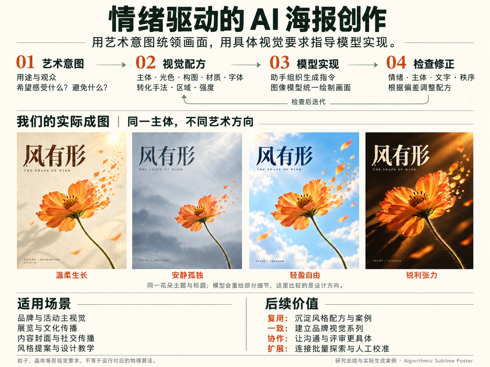
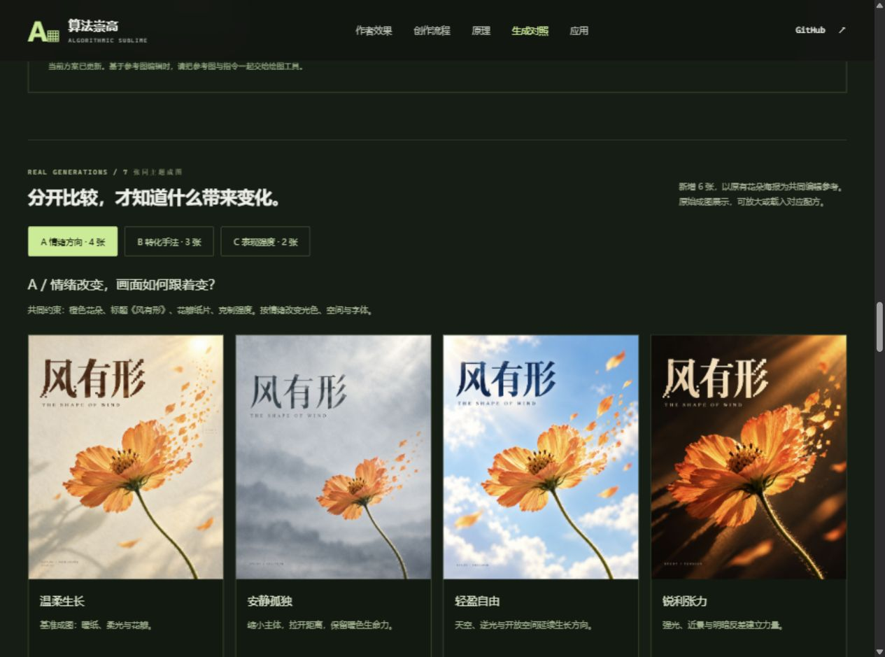

# 情绪先行：定位、定制与实际生成对照

*研究总结图，参考本项目四张实际成图，使用内置 ImageGen 工具生成。原图、完整指令与来源记录分别保存在 [PNG](assets/understanding-overview.png)、[提示词](assets/understanding-overview-prompt.txt)、[生成记录](assets/understanding-overview.json)。图中缩略画面可能经模型重绘；原始海报仍以各自 PNG 为准。*

网页的主要创作流程已改为：**用途与观众 → 目标感受与避免感受 → 主体与识别中心 → 光色、空间、基底和字体 → 转化区域与强度 → 实际成图校准**。

这是本研究新增的创作工作法，不声称原库提供了情绪识别模型、心理量表或以下所有材料算法。原库仍主要提供设计规范、提示词组织和生成后检查。

后续增加了 [风格档案与跨主体作品](style-profiles.md)：用固定规则、可变边界、禁用倾向和参考图描述三种视觉语法，并以人物和香水瓶各生成一张。下文四个情绪起点仍属于共享视觉语法中的方向变化，不等于四种独立风格。

网页已进一步把 [原有 Algorithmic Sublime 主档案](original-style.md) 放回默认主线：先保留实体与数据、计算隐喻、模块大字和光色层级，再调情绪与手法。本文所述花朵与材料实验继续保留为旁支；其中纸片等作品不作为原有计算风格的严格复现证据。

## 情绪如何定位

先写清三句话：给谁、在什么场景看；看完希望感到什么；不希望感到什么。再补一个故事，例如“生命在变化中仍然温柔”，比“高级感、科技感”更能指导画面。

页面用两条可编辑的设计标尺辅助讨论：

- **设计能量**：安静缓慢到强烈有力，用来讨论动势、对比、密度、光线和字体力度。
- **观看距离**：疏离远观到亲近可触，用来讨论主体尺度、景别、细节与留白。

这些数值是人为设定的创作意图，不是对图片或观众进行心理测量，也不会自动识别用户输入的语义。改变数值会改变指令；光色和构图仍可逐项定制。冷色、留白或粒子都不能单独保证某种情绪，最后需看实际成图。

| 起点 | 希望产生的感受 | 默认视觉配方 | 避免 |
| --- | --- | --- | --- |
| 温柔生长 | 亲近、希望、有生命力 | 低能量，柔和金色侧光，奶油暖橙，纸感近景 | 生硬、破碎、阴郁 |
| 安静孤独 | 独处、克制、停下来思考 | 低能量，灰青柔光，小主体和大留白，疏朗字体 | 恐怖、枯萎、绝望 |
| 轻盈自由 | 开阔、轻盈、向外生长 | 中等能量，天空青蓝，通透逆光，开放空间 | 封闭、沉重、爆裂 |
| 锐利张力 | 力量、决心、方向明确 | 高能量，炭黑暖橙，硬侧光，斜向近景与有力标题 | 火灾、恐怖、无序噪声 |

## 风格如何定制

情绪按钮载入完整示例配方，四个起点不是全部风格。之后可以逐项覆盖：

1. 用途、观众、目标感受和避免感受。
2. 主体类型、具体故事和必须保留的识别特征；指令会说明有参考图时编辑、无参考图时从文字生成。
3. 配色、光线、空间构图、画面基底、字体语气。
4. 花瓣、粒子、晶体、字符、水墨、纤维或保持实体；指定转化区域和强度。
5. 自由文本补充参考方向、具体颜色、材质与排版禁用项。

当前方案即时组织为中文创作指令，可复制、下载 TXT 或导出 JSON。这里的结构化配方是便于定制与复用的表达，并不与实际调用工具时的英文指令逐字相同；每张成图旁都另有实际英文指令下载。

所有有名称的输入字段都参与成图匹配。只有完整配方匹配某个已保存样例时才显示“已生成成图”。修改用途、主体、风格或其他字段后显示“自定义方案尚未生成”，保留上一张图并明确标为参考图。恢复按钮可回到该图的完整配方。网页没有图像生成后端，修改参数不会伪装成重新绘图。

## 实际生成：7 张花朵主题成图

本轮新增 6 张图，均使用内置 ImageGen 工具，以原有 [风有形](assets/warm-bloom-poster.png) 为共同编辑参考。每张一次调用、无修订、无后期；工具没有返回具体模型版本。加上原有基准图，共 7 张同主题成图，仍保留早期鲸鱼作品作为跨主体探索。

| 组别 | 保持的提示条件 | 希望比较的变化 |
| --- | --- | --- |
| A 情绪：4 张 | 橙色花朵、标题“风有形”、花瓣纸片、克制强度 | 温柔、孤独、自由、张力分别对应的光色、空间、景别与字体 |
| B 手法：3 张 | 温柔、暖纸柔光、主体和标题、克制强度 | 花瓣纸片、细粒子、透明晶体 |
| C 强度：2 张 | 温柔、暖纸、主体和标题、花瓣纸片 | 边缘轻变与一侧大范围延展 |

| 样例 | 原始成图 | 实际指令 |
| --- | --- | --- |
| 温柔 / 花瓣 / 克制（基准） | [PNG](assets/warm-bloom-poster.png) | [TXT](assets/warm-bloom-prompt.txt) |
| 孤独 / 花瓣 / 克制 | [PNG](assets/directions/solitude-petals-quiet.png) | [TXT](assets/directions/solitude-petals-quiet-prompt.txt) |
| 自由 / 花瓣 / 克制 | [PNG](assets/directions/freedom-petals-quiet.png) | [TXT](assets/directions/freedom-petals-quiet-prompt.txt) |
| 张力 / 花瓣 / 克制 | [PNG](assets/directions/tension-petals-quiet.png) | [TXT](assets/directions/tension-petals-quiet-prompt.txt) |
| 温柔 / 粒子 / 克制 | [PNG](assets/directions/warm-particles-quiet.png) | [TXT](assets/directions/warm-particles-quiet-prompt.txt) |
| 温柔 / 晶体 / 克制 | [PNG](assets/directions/warm-glass-quiet.png) | [TXT](assets/directions/warm-glass-quiet-prompt.txt) |
| 温柔 / 花瓣 / 强烈 | [PNG](assets/directions/warm-petals-bold.png) | [TXT](assets/directions/warm-petals-bold-prompt.txt) |

六张新增原图均为 1122 × 1402。来源、参考图角色、轮次和 SHA-256 见 [生成清单](assets/directions/manifest.json)。上游固定版本和许可边界继续见 [README](README.md) 与 [媒体声明](assets/NOTICE.upstream.md)。

## 从图里观察到什么

- 孤独方向缩小花朵、保留暖色锚点，灰青留白建立观看距离；并没有把主体画成枯萎。
- 自由方向使用明亮天空、逆光和向上的延展，花瓣手法保持相近。
- 张力方向即使提示保持克制转化，仍通过强光、近景和反差产生较强的视觉力量。
- 温柔方向换成粒子或玻璃后，整体纸色、暖光和主体关系大体延续，变化主要集中在右侧材料。
- 强烈花瓣版本的延展范围和碎片层次更大，但模型也改动了主体位置与尺度。

这些是定性的设计观察，不是情绪识别准确率，也不是严格的单变量实验。基准由文字生成，其余由参考图编辑；模型会同时重绘细节、字体与构图。15–20%、45–55% 等比例是提示目标，未按像素测量。

## 实现与验证

`web/direction-studio.js` 保存起点、视觉选项、实际样例与匹配规则。输入以 DOM value 读取，指令与说明以 textContent 写入；图片路径仅来自受控样例。没有把用户输入传给后端或外部生成服务。

已验证的交互、构建、截图和范围限制见 [verification.md](verification.md)。原有作者案例、完整对照、计算语言提示词和 13 种 Canvas 实验保留，后两类作为进阶研究展示。
