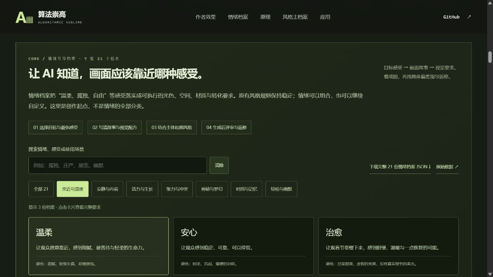
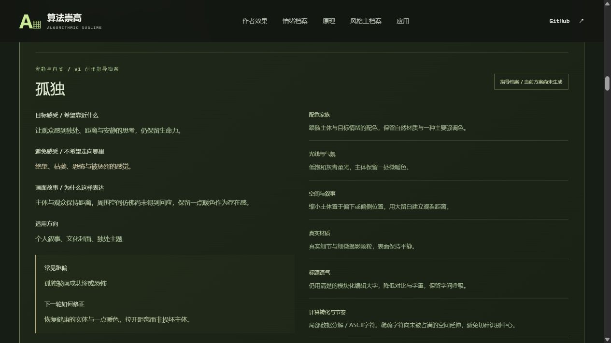

# 情绪引导档案：让 AI 靠近目标感受

网页的核心入口现在是 [情绪档案](http://127.0.0.1:8033/003-algorithmic-sublime-poster/#emotion-library)。工作顺序为：**目标与避免感受 → 画面故事 → 具体视觉要求 → 主体与原风格规则 → 生成 → 评审和返修**。

情绪用于组织画面。原有 Algorithmic Sublime 的真实实体、计算关系、识别中心与模块化标题继续保留。情绪表达力度和数据密度分开设置，不能简单把“更强烈”翻译成更多粒子、故障或全图破碎。

## 7 组、21 个创作起点

| 创作方向 | 档案 |
| --- | --- |
| 亲近与温度 | 温柔、安心、治愈 |
| 安静与内省 | 宁静、孤独、克制 |
| 活力与生长 | 希望、自由、兴奋 |
| 张力与冲突 | 决心、反叛、不安与压迫 |
| 神秘与梦幻 | 神秘、梦幻、敬畏 |
| 时间与记忆 | 怀旧、惆怅、遗憾 |
| 轻松与幽默 | 俏皮、荒诞、惊喜 |

这些是本研究编写的创作起点，不是封闭的情绪分类，也不是经过验证的心理量表。每份档案包含目标感受、避免倾向、画面故事、适用方向、光色、空间、材料、标题、计算转化、常见跑偏、修正建议和评审问题。完整定义见 [profiles.json](assets/emotions/profiles.json)，同一份数据用于网页和下载。

## 网页如何使用

1. 按七个方向浏览，或搜索“孤独”“庄严”“展览”“幽默”等词。也可选择“全部21”查看所有档案。
2. 查看目标感受与避免项，再判断故事和视觉要求是否适合当前用途与观众。
3. 可选一份副情绪，并设置含蓄／清晰／强烈的表达力度；自由补充这次创作的具体要求。
4. 复制情绪指令，或下载情绪方案 JSON/TXT，供 AI 作为情绪指导使用。
5. 点击“载入原风格编辑器”，再检查具体主体、识别中心、转化区域与标题。下载主档案得到完整方案。

主情绪决定整体。副情绪只补充一个局部细节或故事关系，优先遵守主情绪的光色、构图和避免项；不把两份完整视觉配方机械叠加。可用“孤独＋希望”表达独处而不绝望，也可以在原风格编辑器里直接重写情绪意图与配方，创建超出现有标签的方向。

载入会更新意图、计算隐喻、光色、情绪配方、计算语言与推荐强度，保留原有主体、标题、识别中心、允许区域、画幅和输入方式。切换三份原案例预设会重置已载入的情绪方案。编辑主方案的情绪字段后标记“已微调”，最终以主编辑器的完整配置与指令为准。

网页不会识别情绪、自动评分、保存草案或执行绘图。编辑只改变本地指令；需要保留时先下载。

## 后续给 AI 的使用规则

可以把完整档案 JSON 与这段要求一同交给创作助手：

> 先根据用途、观众、希望产生的感受和避免的感受选择情绪起点，允许在边界内修改。先说明画面故事，再把感受转成光线、配色、主体尺度、空间、材质、标题和数据节奏。保留原有风格的固定规则与主体识别中心。副情绪只借用一个局部线索，主情绪优先。不要只添加情绪标签或统一滤镜。生成后逐项检查实际偏差，用明确的返修要求调整。

如果需要从图片编辑，还要分别标注主体图、风格参考图和情绪参考图的角色。原有主体、目标感受和本次具体要求优先，不能强行复制参考图的角色、光色或故事。

## 扩展到作品、系列与视频

情绪档案可作为海报、插画、摄影、品牌系列、动画、短片和MV的艺术指导。单幅明确情绪中心；系列锁定共同规则、允许逐幅变化；视频进一步组织“起点感受 → 转机事件 → 结尾余味”，逐镜说明动作、镜头、光色、声音与衔接。

网页新增 [作品与视频](http://127.0.0.1:8033/003-algorithmic-sublime-poster/#creative-works) 说明，并实际制作《夜香》15秒有声概念片。它使用一张新增原创AI关键画面与动态合成展示孤独、回应、余温，支持分镜定位和方案下载。详细来源、实际能力与复现见 [motion-direction.md](motion-direction.md)。片中低密度的计算信号承担叙事作用；没有把情绪增强等同于特效增多。

后续应把创作意图、指令、成品、实际偏差和修改方法一起积累，逐渐形成自己的作品风格档案。网页继续提供创作指导；当前演示不意味着情绪档案已接入视频模型或能实时生成新片。

## 数据与导出格式

完整 [档案库 JSON](assets/emotions/profiles.json) 提供版本、七个方向、21份完整记录、表达力度定义、通用评审问题、可读的配色／计算语言词汇及使用规则。各记录的视觉要求已经展开，不依赖网页脚本才能理解。

情绪方案导出为 `kind: emotion-direction-brief`、`version: 1`，包含主／副情绪的完整快照、表达力度、本次补充、评审要求、推荐配置和当前情绪指令。`generated` 始终为 `false`。

完整主档案升级为 `kind: algorithmic-sublime-brief`、`version: 2`，在原有五条核心规则、当前配置、风格参照和完整指令之外，增加 `emotion` 快照与 `modifiedAfterLoad`。顶层 `config` 和 `prompt` 是最终编辑后的要求，`emotion` 用于追溯载入起点。

## 已有参考与尚未生成的档案

温柔、孤独、自由、决心四份档案引用之前实际保存的花朵作品。它们是历史参照，不是按照本轮档案重新生成的结果；纸片方向只用于观察光色、空间和动势，数据风格仍按主档案执行。其原始英文指令可从图旁下载，来源继续见 [原生成清单](assets/directions/manifest.json)。

其余档案明确显示“暂无独立成图”。本轮没有新增图像生成，不把21份情绪指导称为21张效果图。后续需要跨主体、跨情绪和重复生成来补充正反例与反馈。

## 实现与验证

新增 [三种实际生成对照](emotion-validation.md)，直接检查情绪配方在成图中的作用。保留参照、自定义方向、跨主体与一次定向返修的全部原始结果，明确记录温柔与暖色参照重叠、孤独与宁静歧义、标题母风格未完全执行等问题。网页支持隐藏目标后记下感受、揭示实际要求、下载指令与证据。本轮支持视觉配方与尺度返修可执行，没有得到情绪稳定命中或情绪标签独立贡献的结论。

`web/emotion-library.js` 从 `assets/emotions/profiles.json` 读取档案并组织搜索、选择、混合和导出；通过页面内事件向原风格编辑器传递受控字段。`web/app.js` 保留主体相关设置与五条固定规则，记录情绪配方载入后的变化。图片与指令明确区分历史参照和当前草案。

网页实拍与交互验证见 [verification.md](verification.md)。

