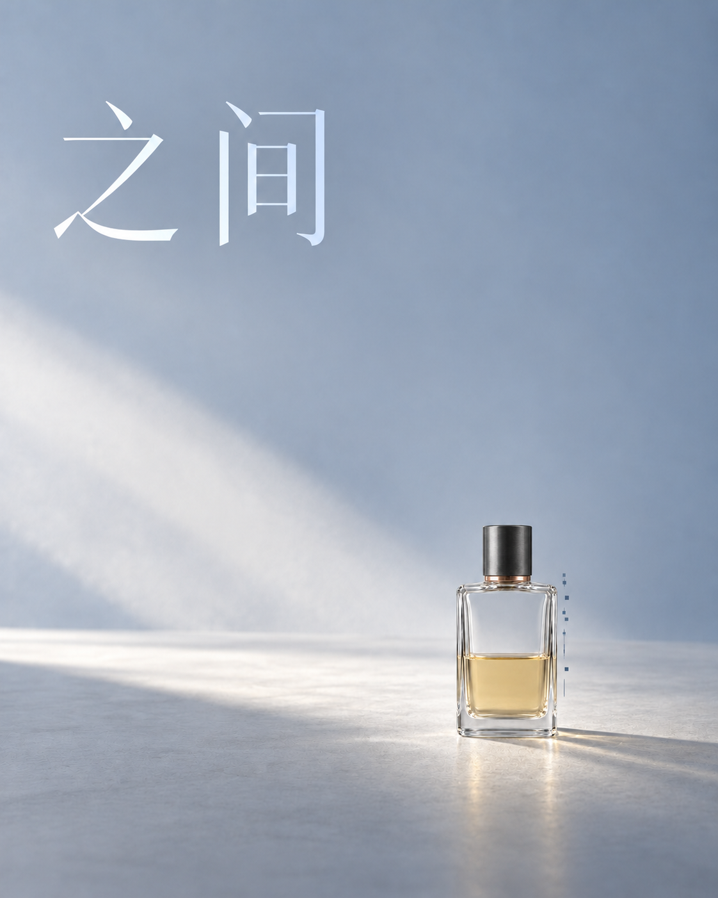

# 情绪引导实际验证：三种对照与一轮返修

本轮在2026-10-21开始、2026-10-22完成，直接使用内置ImageGen生成静态作品。共8次实际调用，得到1张中性主体参考、6张首轮作品和1张返修作品；每张一次调用，所有结果保留。工具没有返回模型版本或可固定的种子。全部PNG原样保存，没有用程序修改颜色、尺寸或内容。

打开 [实际生成验证网页](http://127.0.0.1:8033/003-algorithmic-sublime-poster/#emotion-validation)。它与之前的《夜香》代码动态合成演示分开，本轮没有调用视频模型。

## 本轮能支持什么判断

**具体视觉配方能够改变构图与光色，空间表达可以跨主体延续，明确的尺度偏差可以针对性返修。目标情绪能否稳定被观众读出，仍未证明。**

不含情绪配方的参照也产生了有质感、有光影的作品；温柔版与这个暖色参照很相似。把“漂亮”“暖色”直接视为温柔命中，会高估指令的作用。压迫版有明确的空间挤压，但也可能读成冷峻奢华；候车亭版也可能读成宁静与等待。

六张首轮作品都较多采用衬线标题，尽管共用要求写了模块化标题。这是母风格约束没有完全执行的实际偏差，保留在展示和记录中。本轮没有通过挑图或事后调色掩盖它。

## 生成前的对照计划

[protocol.json](assets/validation/protocol.json) 在实际生成前写入：

- 同一主体：共同使用新生成的中性香水瓶参考。母风格、画幅、标题与数据稀疏程度不变，比较不含情绪配方、孤独、温柔、不安与压迫。
- 同一情绪：延续灰青、低饱和、小主体、大空间与局部采样，将主体换成产品、虚构成年人物、玻璃候车亭。主体识别锚点与依附数据位置按主体适配。
- 定向返修：先观察首轮，再选择一个具体偏差，记录保留项，只做一轮实际图片编辑。

首轮共享4:5画幅、摄影实体与克制计算关系、可辨认主体、相同标题“之间”、不堆叠无关界面。情绪配方一起改变目标、避免感受、故事、光色、观看距离与空间关系，因此不是只改变一个情绪词的单变量实验。

## A：同一主体，不同方向

| 作品 | 实际要求 | 观察与边界 |
| --- | --- | --- |
| 不含情绪配方的参照 | 仅共用风格和主体要求，由模型选择光色与构图 | 自动选择暖光、大主体与明暗分区，本身已有完整产品广告氛围，不是无审美的空白基线 |
| 孤独 | 大空间、灰青、小主体、安静距离；整瓶高度22–28% | 空间与尺度明显变化，但整瓶粗估39%，仍偏近；宁静与孤独也可能重叠 |
| 温柔 | 近距离、暖象牙、柔光、真实触感 | 近景和暖色出现；强金色高光仍偏奢华广告，与参照的情绪区分有限 |
| 不安与压迫 | 狭窄边界、硬斜光、压缩余地；维持低数据密度 | 几何挤压明确，感受也可能是冷峻或被保护的陈列，需观众记录 |

产品四张都引用同一 [中性主体图](assets/validation/00-bottle-reference.png)，其作用是身份参考；它不是待编辑的整张艺术海报，也不提供风格或情绪。各图由模型重新组织，瓶型与识别锚点保留不代表像素保真。

## B：同一情绪，不同主体

产品、人物与候车亭都延续了“小主体与大空间、灰青低饱和、克制采样”的语法。人物的独处关系比较明确；候车亭因明亮天空、远山与开阔感，也可以读成宁静或等待。

人物和候车亭由文字生成，没有共用主体参考图。它们说明一种视觉组织可以迁移，不足以证明同一情绪已经跨主体稳定命中。虚构人物没有真人身份输入，因此不评价人脸保真。

## C：实际偏差与一轮返修

首轮孤独香水图的要求是整瓶高度22–28%。观察原图后，作者用包含瓶盖、不含阴影和数据的近似外接框，估计为39%。这是可讨论的构图偏差。

在调用编辑前写入 [repair-plan.json](assets/validation/repair-plan.json) 和 [完整返修指令](assets/validation/07-bottle-solitude-repaired-prompt.txt)：整瓶约缩至当前0.64倍，底部接触点尽量不动，保留瓶身身份、标题、冷灰光色与疏密；阴影与依附数据相应适配。没有同时修正字体。

| 人工近似标注 | 首轮 | 返修 |
| --- | --- | --- |
| 原图尺寸 | 1122×1402 | 1122×1402 |
| 整瓶外接框 x1,y1,x2,y2 | 668,620,925,1169 | 712,820,872,1152 |
| 高度占比 | 549÷1402，约39.2% | 332÷1402，约23.7% |
| 与22–28%目标关系 | 仍偏大 | 进入目标区间 |

这说明本轮尺度修正生效。它不是情绪分数：主体更远是否更符合“孤独”，仍由观看反馈判断。底部接触点略有上移，玻璃、液面、反射与数据细节也有重绘；标题仍是衬线，模块化要求未修，缩小后细节更难辨读。

网页上的粗框是CSS标注，默认关闭；不修改原始PNG。

## 网页如何查看与保留证据

默认隐藏目标与作者观察，可以先对每张作品记录第一感受和依据，再揭示目标、完整指令、执行观察与偏差。作者已经知道目标，之前的对话和文件名也可能泄露方向，因此这个模式不构成独立盲评实验。

个人记录只在当前页面内存中保存，不上传、不自动留存。导出会标明第一次填写及最近填写发生在揭示目标前还是之后；再次隐藏不会清除“已看过目标”的状态。同一作品在A/B/C复用时共用一份记录。

支持下载：

- 原始PNG：逐张直接下载，文件字节与内置工具输出一致。
- 实际指令：每张可复制和下载TXT，共8份，含主体参考与返修。
- 完整证据JSON：包含计划、8份实际指令、来源清单、全部观察和返修要求；图片文件另行下载。
- 个人观图JSON：只导出自己的记录，不计算准确率或显著性。

来源、输入角色、轮次、文件大小和SHA-256见 [manifest.json](assets/validation/manifest.json)；完整页面数据见 [study.json](assets/validation/study.json)。本轮20个素材与记录加入网页打包，总数66。

## 对结论的限制与后续用途

每个方向仅一张、无固定种子、没有独立观众样本；加入情绪配方也加入更多具体视觉条件。当前差异不能单独归因于情绪标签，更不能给出稳定成功率、心理测量分数或视频模型结论。

下一轮可重复生成并收集独立观看反馈，或在完全相同的视觉要求下只移除情绪标签，进一步判断标签本身的贡献。当前最直接的用途，是积累“目标 → 视觉条件 → 实际偏差 → 定向修改”的可追溯案例，逐步调整自己的风格档案。

动态方向现另有 [《候光》三种时间表达](motion-emotions.md)。它是两张AI素材加导演编排的有声动画演示，增加人物关系、事件、镜头节奏和声音；不是本静态图像生成实验的额外视频模型证据。
