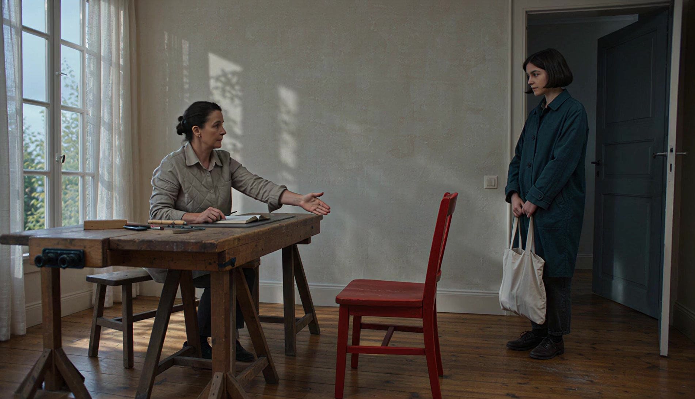

# 实际用Skill组织并生成短片：《给你留个座》

2026-10-22，实际应用已安装的[emotion-art-direction](skills/emotion-art-direction/SKILL.md)，先组织情绪、转机事件、固定影像风格和动作/空间/声音要求，再通过ChatArt Skill调用一次Seedance 2.0生成视频。任务1035011实际完成，原片、准确提示词、两张输入的角色、所读Skill文件哈希与作者审片记录分别保留。

[打开本次视频与导演方案](http://127.0.0.1:8033/003-algorithmic-sublime-poster/#skill-film)；[直接查看原片](assets/skill-film/original.mp4)；[本次实际提交的完整指令](assets/skill-film/prompt.txt)。之前的AI短片[《留一点位置》](ai-film-direction.md)继续独立保留，没有覆盖或替换其原件与记录。

## 从情绪意图，到可见事件

目标不是让画面显得更暖，而是通过一个可以看见的关系变化表达被接纳：

**局促地站在门边 → 主人拉出空椅并示意 → 来者看见邀请、走近 → 真正坐下，共处同一空间。**

Skill实际读取入口、视频模板、安心情绪档案与已有视频案例四份文件。安心档案中的“可靠支撑、可以停留”被转成空座位与邀请；视频模板要求情绪起点、转机、回应、结尾余味，以及动作、摄影连续性和声音。旧片案例只迁移“邀请—回应”的组织方法，没有复制共伞剧情。详细读取证据和文件哈希见[skill-use.json](assets/skill-film/skill-use.json)。本轮没有修改Skill或安装包以适配输出。

| 层次 | 本次可执行要求 |
| --- | --- |
| 情绪目标 | 从局促的旁观到被邀请、可以停留；克制，避免煽情和广告表演 |
| 关键事件 | 主人握椅背、拉出座位、松手示意；来者回应并入座 |
| 固定影像风格 | 同一共享活动室、自然窗光、真实木纹与衣料、正常动作速度，画内无字、无数据特效、无配乐 |
| 动作与空间 | 固定平视中远景，双方、红椅与地面接触可见；邀请、回应、走近与落座有先后 |
| 声音计划 | 室内底噪、椅脚摩擦、脚步和落座受力声；原片含音轨，但本次未完成听觉审片 |
| 审片依据 | 邀请是否可读、接受是否实际发生、接触是否可信、结尾是否留出可停留的时间 |

本次明确选择写实剧情影像规则，检验人物事件如何承载情绪。红椅海报中的“实体与数据融合”仍是另一套独立风格规则，见[原风格三情绪图片对照](chair-data-trial.md)；不能把本片说成该海报视觉风格的视频复现。

## 两张素材分别约束什么

实际采用图像参考生成模式`i2v / omni_reference`，上传两张已有原创图片：

- [朱红色木椅身份参考](assets/skill-trial/reference.png)：约束弧形顶梁、竖条、方座、四腿、横撑、红漆和木纹，不继承灰底、构图与近景比例。
- [窗边红椅光色材料参考](assets/skill-trial/safe.png)：借鉴柔窗光、亚麻帘、灰墙和木地板的材料氛围，不作为首帧，不锁定静态构图。

两张图都不是完整视频编辑目标。人物为本轮文字描述的虚构成年角色，没有提供第三方人物照片。准确请求及素材角色见[request.json](assets/skill-film/request.json)与[brief.json](assets/skill-film/brief.json)，其中不包含账号凭据。

## 计划与实际分别看

以下视觉观察基于实际原片0.5、2、3.5、5、6.5、8、9、9.8秒的八个抽检时刻。公开网页使用原片2、5、9秒直接提取的JPEG定位，其他抽帧仅用于本次私有审查，不进入素材包。没有听觉审片；抽帧观察也不能替代对所有中间动作的连续检查。

| 原计划 | 实际可见结果 | 偏差或仍需判断 |
| --- | --- | --- |
| 0–2秒：门边停顿，建立主人、来者与空椅位置 | 0.5秒两人分处桌旁与门边，红椅为空；2秒主人手已在椅背 | 停顿和人物距离清楚，不能仅由站姿推断来者内心情绪 |
| 2–5秒：缓慢拉椅约20厘米，随后松手示意 | 3.5秒椅子已向右移出并明显旋转；5秒主人张掌朝座位示意，来者仍在门边 | 椅子位移、转向幅度大于计划；3.5秒手与椅背已分离，受力连续性不能仅靠抽帧确认 |
| 5–8秒：看见、回应、走近，准备入座 | 6.5秒来者开始靠近，8秒已走至椅前；主人仍保持示意 | 走近主要集中在较后段，来者的接受没有在5秒时就完成 |
| 8–10秒：真正坐下，留出放松与共处的结尾 | 9秒处于下坐过程，9.8秒已坐在红椅上，主人坐在原位置 | 实际完成落座，但坐稳后的停留极短，不能宣称充分表现了计划中的呼吸放松与余味 |

抽检画面中，窗、门、桌、两位角色的外观与衣色持续可辨，主要机位和光色保持稳定。邀请通过空椅与手势表达，接受通过走近和落座发生；画面没有靠突然转暖或标题解释这段关系。台面出现了书本和工具等额外细节，部分服装造型也被重新生成，参考并不保证逐像素或工业尺寸保真。

*直接从实际MP4提取，表示这一刻的模型执行，不是导演计划的替代画面。完整作者观察与残留问题见[review.json](assets/skill-film/review.json)。*

## 原始媒体、消耗与记录

用户确认本次模型、参数与两张参考图后生成1条，没有自动追加重试。请求为Seedance 2.0、1080p、16:9、10秒、有声；服务估算240积分，实际返回300积分，差异60保留在[provider-result.json](assets/skill-film/provider-result.json)。生成前已披露此前同规格曾实际消耗300积分；这次仍分别记录估算和实际结果。

实际原片为1902×1092、24fps、10.048秒、H.264/AAC、32kHz双声道，共5,943,163字节。原件SHA-256：`2915b267338007d877c3a5313ebfafdb9c5a294f39f907357aa5bbf78236d7fa`。这是服务返回的原始字节，没有代码动画、重新编码、调色、拼接或追加声音。原片有音轨不代表声音内容与同步已通过审查；具体模型权重版本与种子未返回。

本轮13项素材与记录为：brief、prompt、request、provider-result、media、skill-use、review、study、manifest、original.mp4及2/5/9秒三张JPEG。各项用途：

- [brief.json](assets/skill-film/brief.json)：情绪与艺术方向、原时间计划、参数、输入角色与本次授权。
- [prompt.txt](assets/skill-film/prompt.txt)、[request.json](assets/skill-film/request.json)：实际完整提交文本及去凭据请求。
- [media.json](assets/skill-film/media.json)、[provider-result.json](assets/skill-film/provider-result.json)：实际媒体参数、任务、来源和消耗。
- [skill-use.json](assets/skill-film/skill-use.json)：所读Skill文件哈希，以及意图如何转成要求。
- [review.json](assets/skill-film/review.json)、[study.json](assets/skill-film/study.json)：实际观察、偏差与网页展示数据。
- [manifest.json](assets/skill-film/manifest.json)：原片来源、未知项与12个文件的大小和SHA-256。

辅助脚本`scripts/prepare_skill_film.py`在官方CLI实际完成后，`--ingest 私有任务目录`复制并核验原件、读取媒体参数和提取实际帧；完成真实审片记录后，`--finalize`整理展示数据与清单。脚本本身不提交生成任务，不读取或输出账号凭据，不用代码制作替代影片。复跑相同打包步骤不能重新得到相同的随机视频。

## 这轮说明什么

本次实际完成了“读取Skill → 组织意图与导演要求 → 参考图视频生成 → 原片审查”的工作链路。成片出现了可辨认的邀请、走近与落座，说明情绪要求可以被组织成可执行的事件与空间关系；结尾时间、椅子运动与接触仍需校准。

这不是情绪命中率或Skill增益实验：只有一次输出，没有无Skill对照、相同种子重复采样或独立观众。目标是被接纳，观看者也可能读出正式接待、等候或拘谨。后续若继续优化，优先拉长实际坐稳后的停留，再针对拉椅动作的接触与位移单独修正；这些是后续建议，本次没有继续生成。
