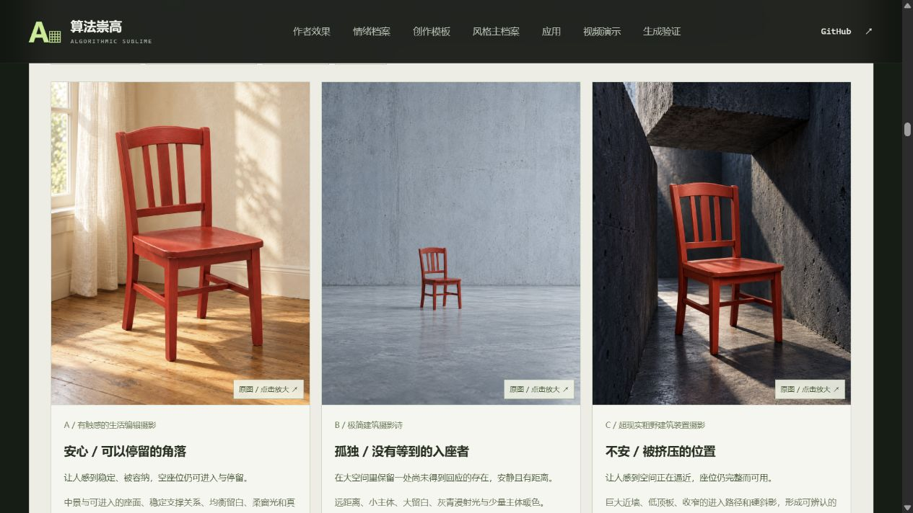

# 实际应用Skill：同一把红木椅，三种艺术方向

2026-10-22，实际读取并应用已安装的 [emotion-art-direction](skills/emotion-art-direction/SKILL.md)，换用一把无品牌朱红色木椅，先明确情绪与艺术命题，再组织风格规则和具体画面要求，使用内置ImageGen生成。共4次调用：1张身份参考、3张方向成图；每个方向一次，全部保留，没有返修、筛选或图像后期。

[打开前轮摄影分支对照](http://127.0.0.1:8033/003-algorithmic-sublime-poster/#chair-photo-trial)。三图可放大，艺术意图、准确实际提示词、原图与作者观察可查看或下载。

后续用户指出本轮丢失了原有实体数据融合风格，现已将其标为摄影旁支历史，并实际生成[固定原风格的三情绪海报及一次尺度返修](chair-data-trial.md)，作为网页主对照。摄影结果不能视作保留原主风格的成功案例。

## 先确定意图，再构造画面

共同主体为弧形顶梁、三根竖向背条、方座、四条直腿与低横撑的红漆木椅，无扶手。三图共用[身份参考](assets/skill-trial/reference.png)，只约束椅型、漆色与材料；不把它当作完整编辑目标，不继承灰底和构图。画幅目标4:5，摄影写实材料，无画内文字、人物、数据粒子或HUD。

| 方向 | 艺术意图 | 艺术语言与具体依据 | 实际原图 / 实际提交提示词 |
| --- | --- | --- | --- |
| 安心 / 可以停留的角落 | 空座位可进入、可停留，感到稳定与被容纳 | 有触感的生活编辑摄影；窗边支撑、可进入的座面、柔侧光、亚麻和木纹 | [PNG](assets/skill-trial/safe.png) / [TXT](assets/skill-trial/safe-prompt.txt) |
| 孤独 / 没有等到的入座者 | 大空间里一处没有回应的存在，安静而有距离 | 极简建筑摄影诗；小椅子、大留白、灰青漫射光、一点主体红色 | [PNG](assets/skill-trial/solitude.png) / [TXT](assets/skill-trial/solitude-prompt.txt) |
| 不安 / 被挤压的位置 | 空间逼近完整座位，压力有具体来源 | 超现实粗野建筑装置摄影；近墙、低顶板、收窄的进入路径与硬斜影 | [PNG](assets/skill-trial/unease.png) / [TXT](assets/skill-trial/unease-prompt.txt) |

本次保留摄影材料作为共同基础，在摄影内部改变艺术方向。这样能更清楚地看到空间和关系的作用；没有把“换风格”仅处理成滤镜或装饰变化。未选用算法崇高家族，因此没有给所有图强加数据粒子和标题。

## Skill实际参与了什么

读取本机安装版入口、情绪索引、图片模板、安心/孤独/不安三份档案、风格规则和既有产品案例。先按用途、目标感受、避免感受、艺术命题组织方案，再把抽象意图落实为主体与环境关系、光色、尺度、观看距离、材质、保留项及评审问题。既有产品案例提醒检查“主体比例偏大”与“孤独也可能被读为宁静”，没有复制香水瓶主体或历史指令。

生成前方案与所读8份Skill文件的SHA-256保存在[protocol.json](assets/skill-trial/protocol.json)。本轮没有修改Skill、安装副本或下载包来适配结果。它是当前对话中的实际功能试跑，没有另开独立代理前测。

## 实际看到什么，哪里没有落实

三图在观看距离、空间支撑/逼近关系、材质与光色上形成可见差异。红漆、椅背、方座与腿部关系可辨；局部连接、纹理和高光仍有重绘，未验证像素或工业尺寸保真。

整椅人工粗框含椅背与脚，不含阴影，观察如下。坐标见[作者审图记录](assets/skill-trial/review.json)；这不是自动分割或情绪分数。

| 方向 | 指令尺度目标 / 画高 | 人工粗框 / 画高 | 主要偏差或相邻解读 |
| --- | --- | --- | --- |
| 安心 | 约50% | 约73% | 主体明显偏大，也可能读成温暖、怀旧或家具广告 |
| 孤独 | 15–18% | 约20% | 小主体与空白清楚，位置偏居中，也可能读成宁静、等待或展陈 |
| 不安 | 40–45% | 约54% | 建筑压力来源清楚，也可能读成力量、庄严或超现实装置 |

身份参考本身约84%画高，大于约65%的目标；它只承担身份约束，不作为无情绪基线。三组下一轮修改建议已记录，但尚未执行，网页没有伪造返修后结果。

本次支持的是：**Skill可以帮助把艺术意图组织成可执行、可检查的完整配方，模型确实产生了相应的画面差异。** 尺度执行与情绪解读仍需要校准。每方向只有一张，没有无Skill对照、仅情绪词对照、重复采样或独立观众；情绪、构图、空间和光色一起改变，不能据此证明Skill的独立增益或情绪稳定命中率。

## 原件、准确指令与复现

四张PNG均为工具实际返回的1122×1402原件，未滤镜、调色、裁切、重编码或压缩。工具未返回模型权重版本与种子，均记录为未知。输入来源是本轮原创文字与新生成的椅子参考，没有第三方品牌或人物照片。

- [study.json](assets/skill-trial/study.json)：三份艺术意图、完整实际提示词、真实原图路径、偏差、人工粗框、局限。
- [execution.json](assets/skill-trial/execution.json)：四次实际提交文本及参考图角色；[参考提示词](assets/skill-trial/reference-prompt.txt)。
- [manifest.json](assets/skill-trial/manifest.json)：原始工具输出路径、原件与提示词哈希、12个素材/记录文件哈希。

辅助脚本`scripts/prepare_skill_trial.py`不调用生成服务：`--init`在生成前登记方案；四个`--result id=原始PNG绝对路径`登记工具原件；完成真实审图记录后，`--finalize`生成展示数据与校验清单。它依赖Pillow读取/验证PNG，网页打包与整站构建仍只依赖Python标准库。原件登记会拒绝覆盖不同文件，不能用脚本重新得到相同随机图像。

*本地浏览器直接截图，无后期；[手机版](assets/skill-trial-mobile-preview.jpg)另存。*
