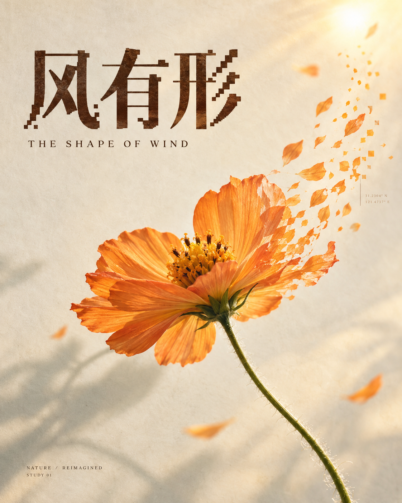

# 《风有形》/ 温柔生长

艺术意图：愿意靠近生命，感到温柔与一点希望。

具体转译：暖纸、柔侧光、真实花瓣与一条舒缓的边缘转化方向。

实际制作：2026-10-21，内置ImageGen一次文字生成，1122×1402；没有参考图片，没有后期，具体模型版本与种子未知。

[准确历史指令](flower-actual-prompt.txt)

实际观察：保留花心与花茎，让局部转化参与整体构图；这张作品不能证明温柔被所有观众读到。

## 事后整理的中文复用方案

这是参考已有《风有形》整理的中文复用方案，不是当时实际提交指令，也不是新生成结果。

用途与观众：面向普通观众的自然主题展览海报，4:5竖版。
艺术意图：让人愿意靠近生命，感到温柔、希望与安静的生长；避免破碎、冷漠和甜腻。
主体与故事：文字生成一朵橙色波斯菊，细长绿色花茎；花朵像被风轻轻带起，变化表达生长。
固定规则：摄影实体与有触感的纸面，完整识别中心，一条有方向的局部材料转化，清楚的编辑标题与留白。本例是材料旁支。
可变项：在保留上述关系下调整花朵品种与标题；更换主体时重新描述识别中心。
具体要求：奶油象牙纸、柔和金色侧光、橙色半透明花瓣、少量灰绿；花朵偏右，左上标题留白。只让右侧花瓣边缘顺一条弯曲方向变成稀疏纸片与少量方形采样，保留花心、花茎和大部分花瓣。
文字：中文标题逐字“风有形”，少量模块化切口但字形清楚；英文“THE SHAPE OF WIND”。
避免：全主体像素化、杂乱HUD、多花朵、无方向碎片、伪文字。
执行：整理完整生成指令；实际生成后保留指令与原图，检查第一眼感受、局部边界、标题和真实材质。比例是设计目标，不能当作精确测量。
