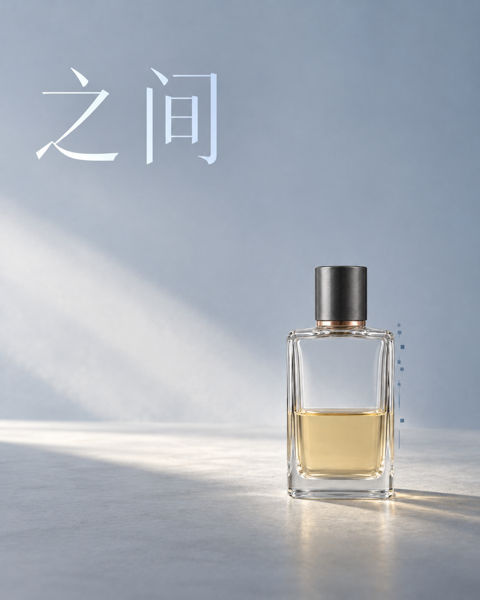

# 《之间》/ 距离与尺度返修

艺术意图：安静的疏离与内省，保留一点存在感。

具体转译：小主体、大留白、灰青柔光；数据依附瓶身轮廓，保持稀疏。

实际制作：2026-10-21至22，内置ImageGen；首轮和返修分别一次调用，均为1122×1402原件。具体模型版本与种子未知。首轮实际指令使用中性产品身份图，返修以首轮完整海报为编辑目标。

[中性主体身份图](../../assets/examples/product-reference.png)

[准确首轮指令](product-actual-prompt.txt) · [准确返修指令](product-actual-repair.txt)

实际观察：一轮尺度返修后，整瓶人工粗框由约39%降至约24%画幅高度；标题仍偏衬线，情绪仍可能被读为宁静。

比例来自人工近似外接框，并非情绪分数。底部接触点略上移，玻璃、反射和计算细节仍有重绘；返修没有解决衬线字体偏差。

## 图片复用方案（事后整理）

这是参考《之间》孤独方向整理的中文复用方案，不是当时实际提交指令，也不是新生成结果。

用途与观众：一张4:5竖版情绪产品海报。
艺术意图：安静的疏离与内省，避免绝望、惊吓和奢华广告感；通过小主体与大空间表达距离。
素材角色：使用已提供的中性香水瓶图片作为身份参考；没有该图片时先补充真实主体描述，不假设已附图。
识别中心：方形透明瓶身、深色圆柱盖、铜环和下部液面。
固定规则：真实实体与沿轮廓组织的稀疏计算采样；标题参与构图；保留识别中心与空间层级。
具体要求：低饱和灰青、柔和远侧光、右下小主体与大留白；整瓶含盖高度以画幅约22–28%为设计目标，底部有可信接触与阴影；不要增加数据数量表达孤独。
文字：标题逐字“之间”，要求清楚的模块化大字。
允许变化：主体尺度、留白与光色配方；保持瓶型、瓶盖、液面和计算依附关系。
检查：实际主体尺度、产品特征、数据边界、字形与观看感受。既有成图标题偏衬线，复用时继续检查该项，不把案例所有细节都当作成功规则。

## 返修复用方案（事后整理）

这是依据已完成的瓶身尺度返修整理的中文复用方案；完整实际返修指令另存，不是新执行结果。

目标：延续《之间》的孤独、距离与内省，以及实体与计算结构的风格。
输入：把首轮完整香水海报作为唯一编辑目标；不是只提供中性产品参考。
证据：首轮整瓶含瓶盖的人工粗框约占画幅高度39%，超过原设计目标22–28%，观看距离偏近。
本轮只修主体尺度：整瓶等比例缩至画幅高度约25%，接受22–28%；不是缩放或裁切整张海报。保持底部接触点大致在原位置，并联动调整接触阴影、反射与依附瓶身的数据。
继续保留：原画幅、瓶型和盖身比例、铜环与液面、灰青背景、柔光、既有标题字形与位置、数据疏密。
禁止顺带改变：不居中、不添加装饰、不强化戏剧光、不同时重做字体。
检查：用相同的整瓶外接框口径比较前后尺度，再查看情绪距离；不要把高度比例当作孤独分数。既有实际返修约24%，接触点与细节仍有重绘，标题问题未在这轮解决。
