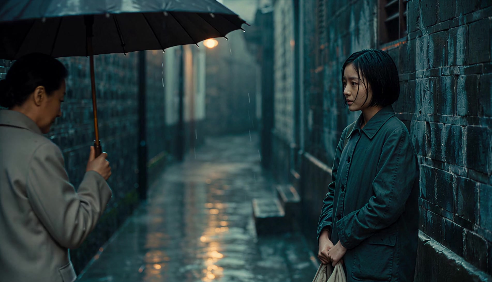
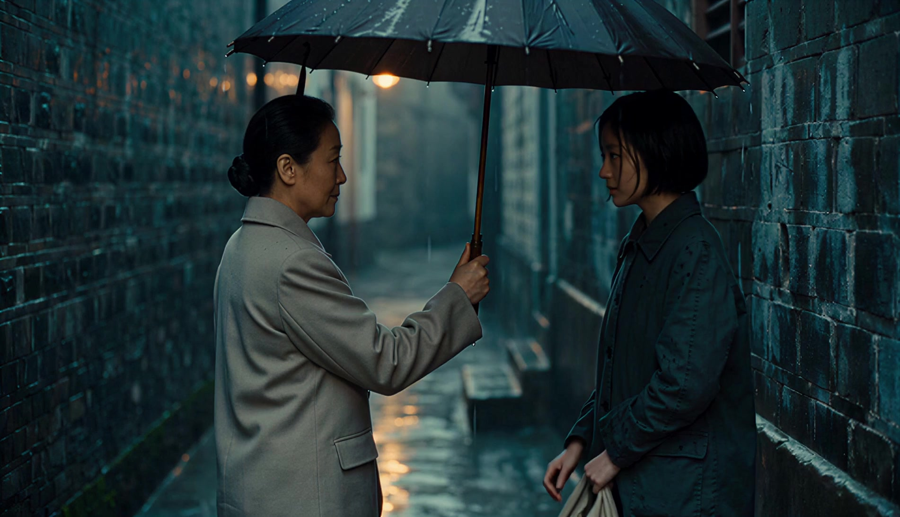
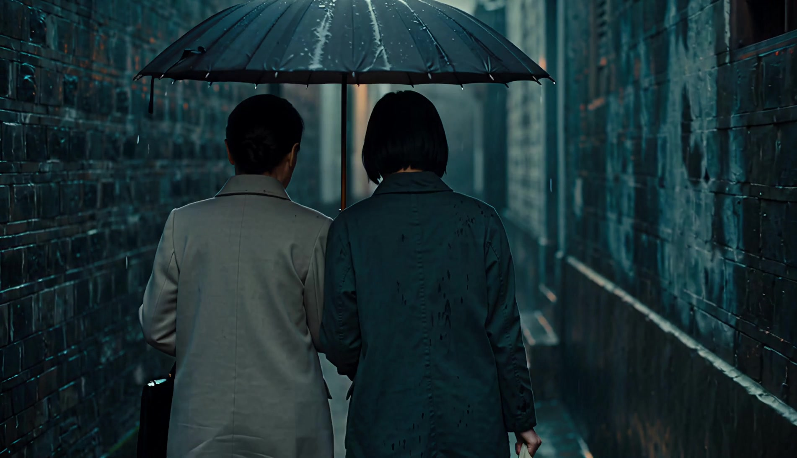

# 《留一点位置》/ 从疏离到被接纳

艺术意图：被看见、被接纳，结尾留下克制的温暖。

具体转译：等候 → 移伞邀请 → 目光回应 → 同行；同一雨巷与光色贯穿。

实际制作：2026-10-22，通过ChatArt调用Seedance 2.0一次文字生成视频；没有输入图片。请求1080p、16:9、10秒、有声；实际返回1902×1092、24fps、10.048秒、H.264/AAC双声道。原件没有重新编码或添加动画和声音。

[实际AI原片](../../assets/examples/shared-space.mp4) · [准确历史指令](video-actual-prompt.txt)

实际观察：实际原片完成了同伞与同行；动作比计划提前，后段多为背影。声音内容未完成听觉审片。

3至5秒已形成邀请与回应，约6.5秒转身，未严格遵守原计划的0–3 / 3–7 / 7–10秒。双脚不在画面中，不能评价完整步态；没有完成听觉审片。被接纳是意图，不是已经得到独立观众验证的结论。

## 事后整理的复用方案

这是参考已完成短片《留一点位置》整理的中文复用方案，不是本片准确提交指令，也不是新生成结果。

交付：16:9、约10秒、有声的完整视频；实际生成后核对返回尺寸、时长和音轨。
艺术意图：从疏离到被接纳，让人通过一次微小的邀请感到被看见；避免煽情和浪漫广告感。
输入与主体：纯文字生成。两位外观清楚不同的虚构成年女子；年轻女子穿深青外套握帆布袋，另一女子穿米灰外套撑深色布伞。
固定风格：胶片写实、青蓝湿砖雨巷、少量琥珀门灯、真实皮肤与衣料；连续镜头保持人物外观、天气和空间关系。
计划0–3秒：年轻女子靠右等候，握包，前方留空；内敛呼吸，避免表演悲伤。
计划3–7秒：撑伞者靠近并移伞留出位置，年轻女子看向伞沿后与对方短暂对视；为回应保留可读的停留。
计划7–10秒：握包的手松开，进入伞下，调整站位并共同前行；不拥抱或夸张微笑。
摄影：35mm平视中景，缓慢横移与靠近；正常动作速度，关注道具、遮挡和重心连续。
声音：雨、脚步、衣料主导，进入伞下后雨声随遮雨空间变化；无对白，结尾至多两个很轻的钢琴音。
避免：字幕替代情绪、粒子装饰、HUD、突然变晴、突然大幅转暖、滑行动作。
检查：先看不读标签能否理解邀请与接受，再检查角色、实际动作秒数、镜头和声音。既有成片邀请提前、后段背影较多；复用时不能声称原计划全部达成。
