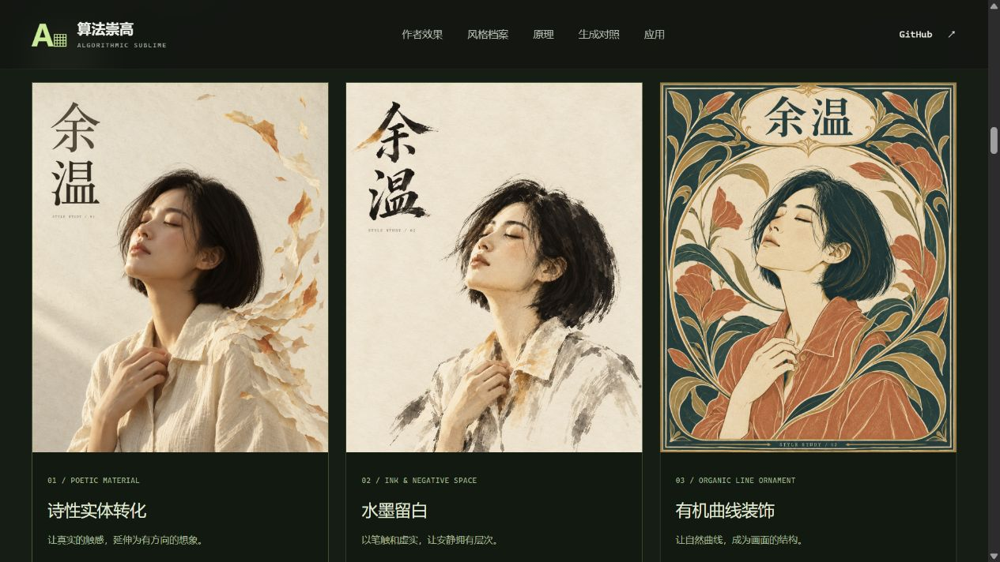
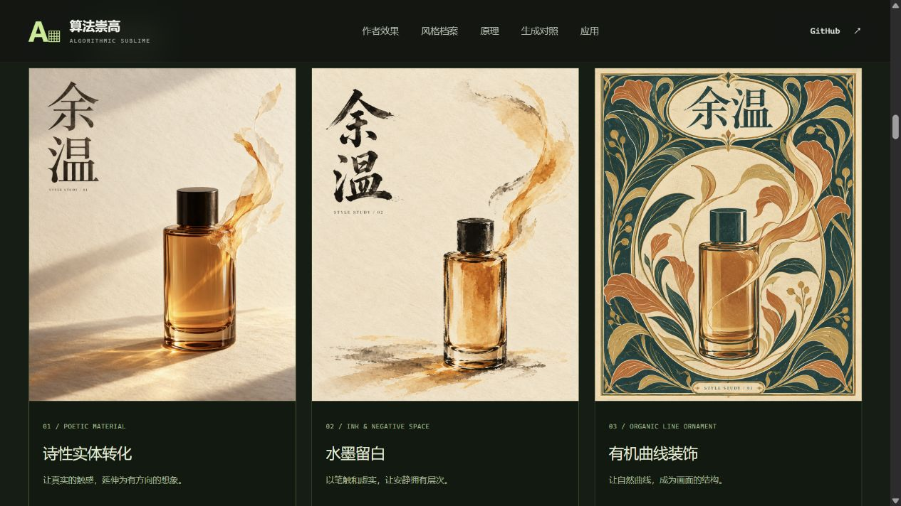

# 风格档案：规则、样例与跨主体探索

本研究把“风格”落实为 **固定视觉规则 + 可变范围 + 禁止倾向 + 参考作品 + 评审问题**。页面入口为 [风格档案](http://127.0.0.1:8033/003-algorithmic-sublime-poster/#style-profiles)，默认先展示 [原有 Algorithmic Sublime 主档案](original-style.md)：保留真实实体、计算结构、转化关系、模块化标题与情绪中心，再定制主体、光色、方式和强度。

下文三种属于跨风格旁支，已折叠在主档案之后。可展开比较同主体的三种风格，也可查看同风格的人物与产品；它们不替代原有风格。

三个名称是本研究的创作工作名，不是上游内置能力、经过训练的个人模型，或严格的艺术史分类。“有机曲线装饰”借鉴植物曲线组织画面的思路，不宣称严格复现某个历史流派或艺术家。

## 三份档案如何区别

| 档案 | 稳定视觉语法 | 可变项 | 禁止倾向 |
| --- | --- | --- | --- |
| 诗性实体转化 | 写实触感、完整识别中心、一侧局部材料转化、同向动势、暖纸编辑版式 | 主体、同暖色系、转化材料与局部范围 | 全图均匀粒子、无关 HUD、破坏脸或产品结构 |
| 水墨留白 | 墨色浓淡与笔触、虚实纸面、黑墨暖纸与少量赭色、书写式标题 | 干湿笔比例、主体、着墨区域和留白疏密 | 写实照片套滤镜、满版无关泼墨、伪书法与随机印章 |
| 有机曲线装饰 | 平面色块与统一线条、连续植物曲线、椭圆主体区与细边框、有限色组 | 主体、曲线节奏、植物形态和色组占比 | 照片外贴花边、互不相连的装饰、霓虹与浮雕 |

完整可复用定义保存在 [profiles.json](assets/styles/profiles.json)，网页从同一文件读取。修改档案原件后重新打包即可同步页面。

## 六张实际生成作品

共同意图为“安静、温暖、向内关注”，标题均为《余温》。两个主体分别是虚构成年女性与无品牌香水瓶。诗性实体转化的两张由文字生成；其余四张各使用对应的诗性人物或产品为主体参考，要求重新解释造型、材质、构图与字形。

| 档案 | 人物作品 / 实际指令 | 产品作品 / 实际指令 |
| --- | --- | --- |
| 诗性实体转化 | [PNG](assets/styles/poetic-portrait.png) · [TXT](assets/styles/poetic-portrait-prompt.txt) | [PNG](assets/styles/poetic-product.png) · [TXT](assets/styles/poetic-product-prompt.txt) |
| 水墨留白 | [PNG](assets/styles/ink-portrait.png) · [TXT](assets/styles/ink-portrait-prompt.txt) | [PNG](assets/styles/ink-product.png) · [TXT](assets/styles/ink-product-prompt.txt) |
| 有机曲线装饰 | [PNG](assets/styles/organic-portrait.png) · [TXT](assets/styles/organic-portrait-prompt.txt) | [PNG](assets/styles/organic-product.png) · [TXT](assets/styles/organic-product-prompt.txt) |

六张均在 2026-10-21 使用内置 ImageGen 工具实际生成，每张一次调用、无修订、无后期修改，尺寸均为 1122 × 1402。工具没有返回具体模型版本。输入角色、参考关系和 SHA-256 见 [生成清单](assets/styles/manifest.json)。原始输出从工具默认目录复制到项目，默认目录中的原件保留。

以上为本地网页浏览器实拍，未经图像编辑。

## 观察与偏差

诗性方向在人物和瓶子上都延续了暖纸、真实触感、右侧上扬转化和左上标题；但人物纸片范围比提示中的小边缘更大。产品图中的玻璃到纸过渡更接近概念广告，不能保证商品实物结构完全准确。

水墨方向的头发、衣领和瓶身出现干笔、墨面与暖色晕染，字形也转成书写式。人物仍有较多写实塑形，主体占幅偏大；产品继承了参考图的上扬轨迹，仍有写实明暗倾向。若需要更疏朗的水墨方向，下一版应明确缩小主体、减少面部塑形、删除参考图的粒片轨迹，并用更典型的水墨样例辅助。

曲线方向在人物和产品上延续了深青、陶土、奶油与柔金的色组，以及平面印刷感、植物曲线、椭圆和标题框。人物尚保留少量明暗细节，产品与人物的植物形态并不相同。两张已呈现共同的视觉语法，但不能据此声称所有题材都能稳定复现。

这些比较同时改变了多个视觉决策，也受输入参考的构图影响；不是严格单变量实验、用户情绪研究或生成成功率测试。

## 如何试用与定制

1. 用“同一人物 / 同一香水瓶”比较不同档案。
2. 进入一份档案，查看固定规则、可变项、禁用倾向和人物／产品两张示例。
3. 展开定制区，或点击图旁“载入此示例配方”。修改具体主体、识别中心、情绪、标题和可变的视觉要求。
4. 复制中文指令，或下载包含档案、配置、参考图片文件名与指令的 JSON；英文实际调用指令在每张图旁独立下载。
5. 另将所需主体图和风格参考图交给图像工具，明确各自角色，再对结果逐条评审。

编辑仅组织本地文本，不调用图像服务。草案与保存配方完全相同时标记对应示例；修改任一字段即显示“自定义草案 · 尚未生成”，上方图仍标为已保存示例。中文配方用于复用，不与最初的英文工具指令逐字相同。网页不持久保存草案，切换档案会重置，需要保存时先下载。

固定规则暂不在表单内直接编辑。若要形成自己的新风格，下载 JSON 后调整固定规则、改名并增加版本，同时记录新样例的成功点与跑偏点，而不是仅堆叠更多形容词。

## 如何评审与积累价值

分开记录三件事：规则是否执行、换主体后是否仍共享视觉语法、目标感受是否能被观众读到。当前只有两类主体的一次生成，足够帮助选方向，但不足以证明稳定性。

后续可加入建筑、动物、复杂产品与不同情绪，同配置重复生成；让评审者在隐藏风格名与指令的情况下判断，保留正反例及具体修订。逐渐沉淀的价值是可沟通、可复用、可返修的视觉规范。需要更强一致性时，参考图、人工排版与后期制作仍应作为流程的一部分。

适用方向包括品牌视觉提案、系列文化海报、香氛生活方式概念、设计教学和团队评审；正式商品、包装与印刷文件仍需要独立制作检查。
