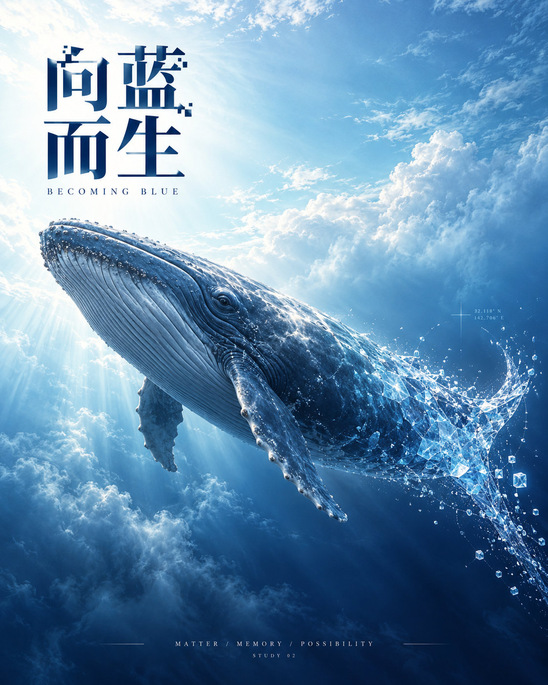
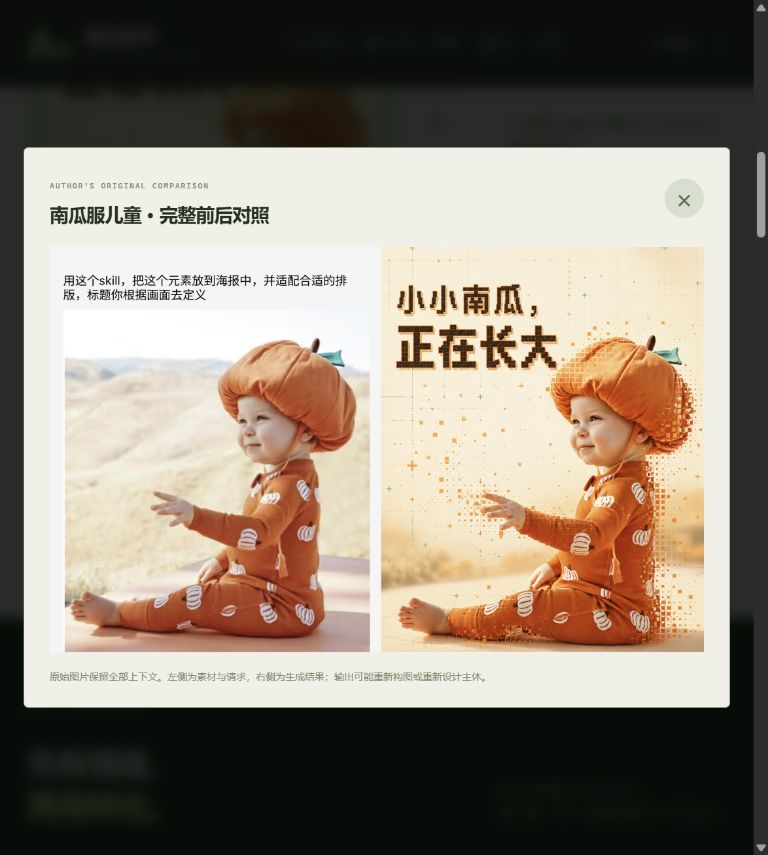
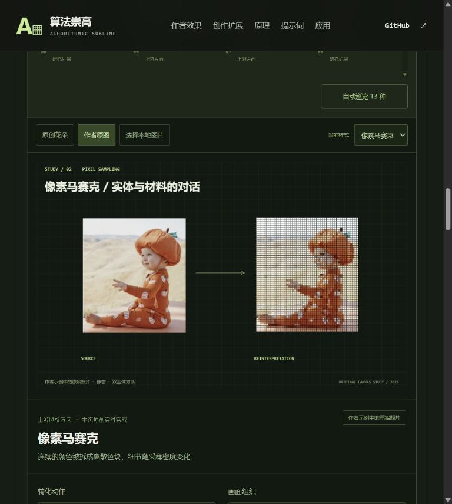
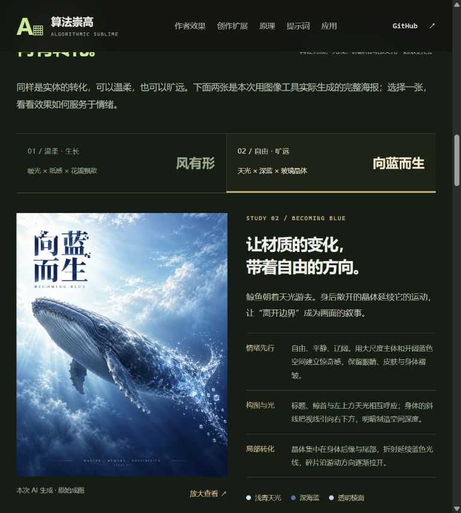
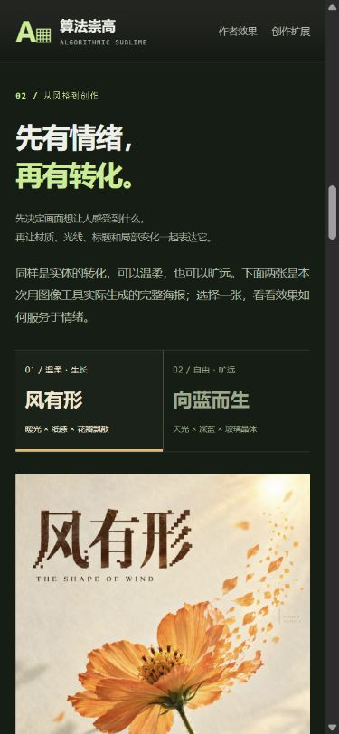

# 从算法示意到有情绪的海报

用户指出新增的 13 种实时效果缺少作者案例中的画面情绪。这个问题成立：程序实现了不同的图像表示，却没有完成主体、空间、光线与标题的整体设计。本次因此调整创作方向和网页展示顺序。

## 差距在哪里

1. 作者案例将主体的表情、姿态和真实材质作为焦点；统一采样会损失这些线索。
2. 作者根据输入选择奶油色、天空色或深色；程序的大部分样式使用固定深绿色画布，素材自己的气氛被模板覆盖。
3. 作者的局部转化沿轮廓、视线或动作展开；程序默认将 88% 的原图处理，变化缺少明确叙事。
4. 作者将标题、留白、灯光与主体一起生成；程序是在固定坐标上放标题和处理后的小图，关系生硬。

密度、速度和粒子数量可以解释计算过程，但不能替代这些设计判断。此前把两类结果并列展示，容易让人误以为增加滤镜数量就是扩展海报创作能力。

## 本次实际生成

使用内置 ImageGen 工具，依据已研究的上游风格规范手工组织指令，各生成一次。没有调用 API 或额外安装模型，没有自动执行上游 Skill。工具未返回具体模型版本，不推断型号。两张都是从文字生成的新画面，没有输入照片，也不声称验证了人像或产品保真。

| 成图 | 情绪与设计关系 | 实际指令 |
| --- | --- | --- |
| [风有形](assets/warm-bloom-poster.png) | 橙色花朵、暖光和象牙纸传递温柔；右侧花瓣顺着同一阵风转化，完整花心保持识别中心 | [完整英文指令](assets/warm-bloom-prompt.txt) |
| [向蓝而生](assets/blue-whale-poster.png) | 蓝色空间、天光和鲸鱼的游动方向表达自由；后缘与尾部变成透明棱面，保持身体大部分真实质感 | [完整英文指令](assets/blue-whale-prompt.txt) |

两张原始 PNG 均为 1122 × 1402，未经后期修改。已人工查看标题、主体、光色、转化位置与整体构图。详细来源、生成轮次和哈希见 [生成记录](assets/generated-posters.json)。图中坐标为装饰，不代表真实测量。

## 网页调整

“创作扩展”优先呈现两张完整海报，并解释情绪、构图与光、局部转化。可切换、放大查看、下载原始成图和实际生成指令。现有 13 种 Canvas 功能保留在折叠的“算法拆解”中，名称明确改为程序原理示意。旧的 `#extension-stage` 深链接会自动展开算法区。

本次改变的是创作方式和展示层级。并未给网页接入在线图像生成服务；切换两张成图只读取本地静态资产，上传图片仍只进入浏览器 Canvas。

## 有限范围的视觉审查

1. 作者温暖人物案例：已有情绪中心，标题与人物视线互相呼应。
2. Canvas 人物处理：采样与重绘正常，但模板和全图处理削弱了主体细节与情绪。
3. 新的创作展厅：用实际成图展示艺术方向，把原理实验放到次级位置；来源标识和生成指令可以核对。

截图与交互验证见 [verification.md](verification.md)。该审查关注画面表达和浏览路径，不构成完整无障碍审计、跨浏览器评测或生成质量统计。
