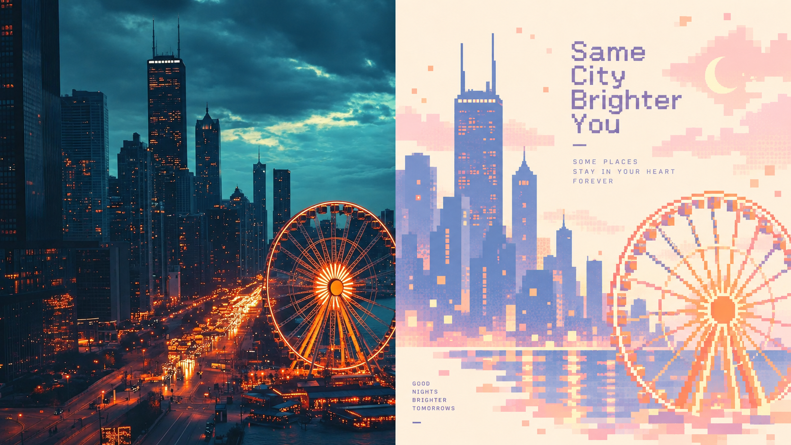
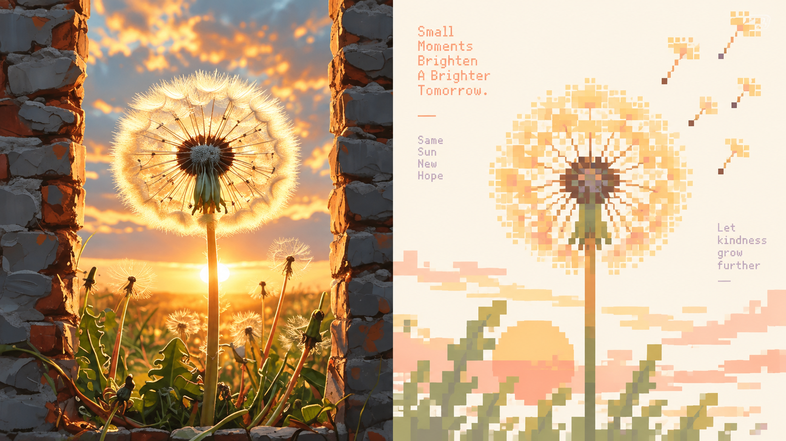
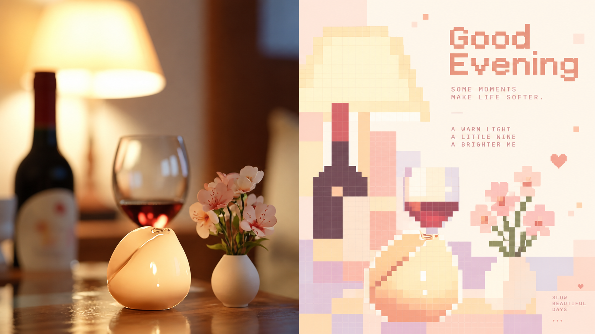
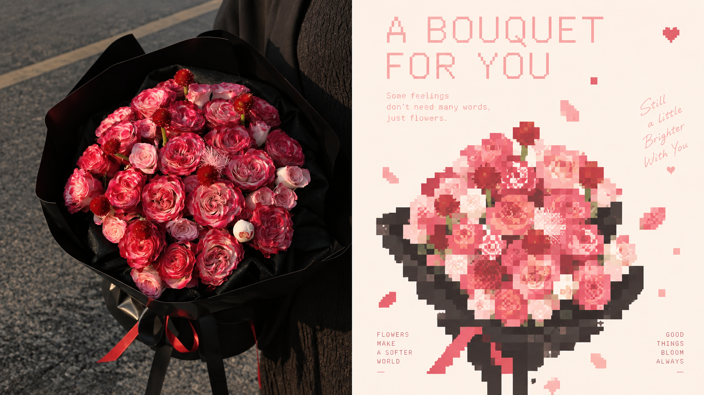
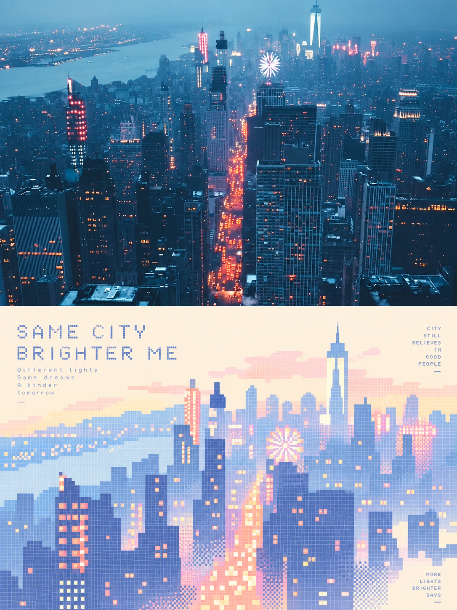
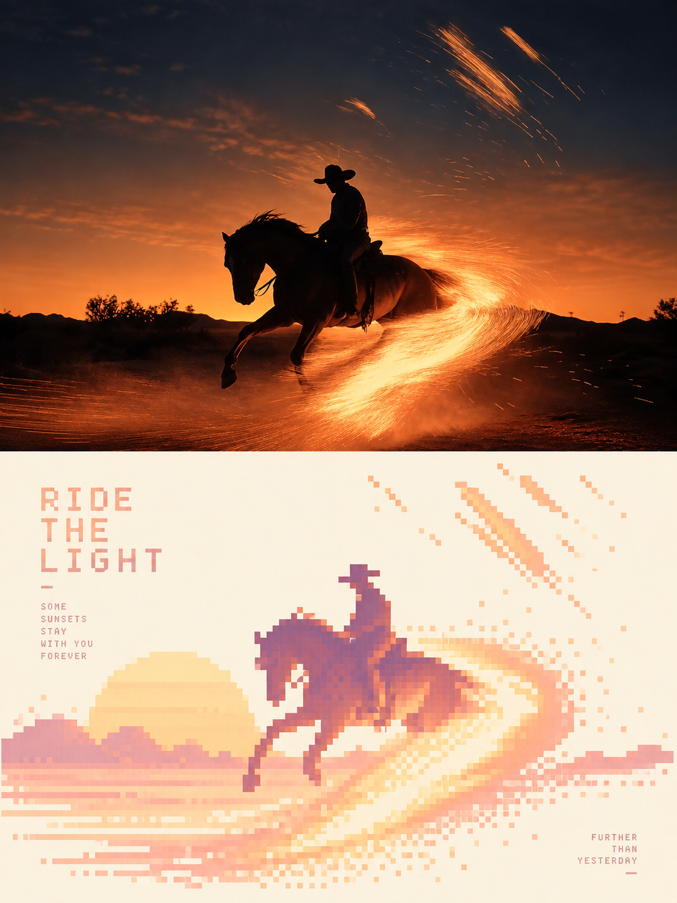
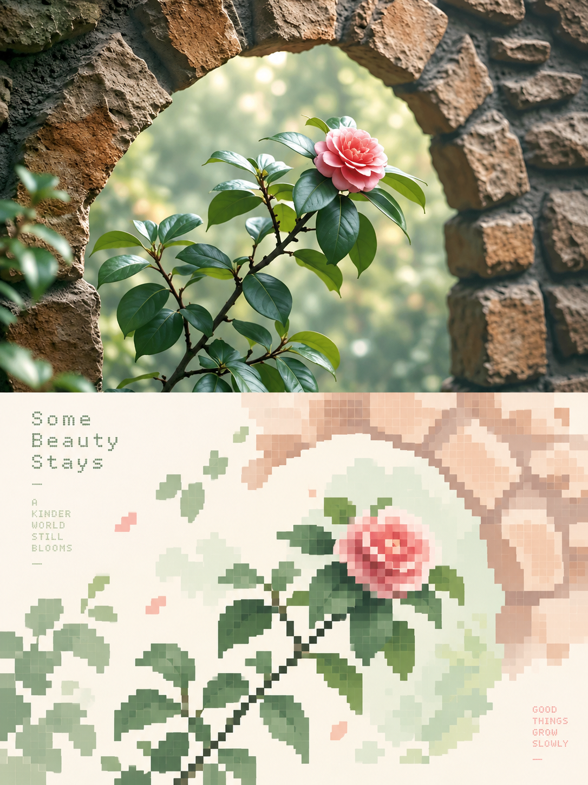
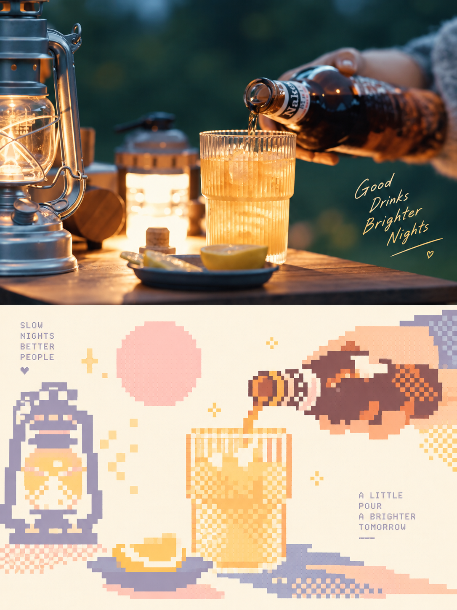

# 004 · XXD Panel 106 · 柔彩像素记

> 以已有图片为输入进行二次处理，通过提示词与图像模型重绘为柔彩几何像素海报。对我们而言，它是探索风格库的一个样本：整理风格规则、提示词、效果和适用场景，便于后续比较与复用。

[在线展示](https://yydshly.github.io/1022_codex_project/004-xxd-panel-106/) · [网页源码](web/index.html) · [网页提示词区](web/index.html#prompts) · [一图理解](guides/README.md) · [真实演示与失败记录](demo.md) · [素材来源](assets/README.md) · [完整媒体登记](media.json) · [验证记录](verification.md)

| 信息 | 内容 |
| --- | --- |
| 上游 | [nevertoday/xxd-panel-106](https://github.com/nevertoday/xxd-panel-106) |
| 固定版本 | [`12a70f6e4d9200b28a95d1b81c808439a5590c74`](https://github.com/nevertoday/xxd-panel-106/tree/12a70f6e4d9200b28a95d1b81c808439a5590c74)，2026-09-11 提交；2026-10-21 再次通过 git ls-remote 核对为 main HEAD |
| 上游许可 | [PolyForm Noncommercial 1.0.0](assets/upstream/LICENSE.txt)，带非商业用途限制 |
| 研究日期 | 2026-10-21 |
| 展示范围 | 全部8张上游样张；1张独立实拍；7张演示成品；3张未通过检查的生成结果 |
| 实际执行 | 内置 image_gen.imagegen；按固定风格正文与相关运行契约执行；未全局安装 Skill，未运行上游 API 桥接 |
| Web 状态 | [已发布到 GitHub Pages](https://yydshly.github.io/1022_codex_project/004-xxd-panel-106/)；构建与部署均成功，见 [部署验证](deployment-verification.json) |


*本研究生成的理解总结图。图中的照片与海报缩略图为示意，提示词为摘要；完整原文与10次海报请求可在网页提示词区阅读、比较、复制和下载，真实结果见demo.md。*

网页提示词区直接读取打包的原始文件，包含原始风格正文和10份完整请求。可切换“完整原文／只看追加指令”，比较版式、文字与失败重试的差异；复制的是当前显示内容，下载始终保留完整原文件。剪贴板不可用时会选中文字并提示手动复制。该交互只展示现有请求，不在浏览器执行生图。

## 先描述能力

项目将一种固定海报审美封装成 Agent Skill。它对已有图片做风格化重绘：用户提供照片或图片目录，Agent 解析模式、尺寸、文字和语言，读取完整中文风格提示词，调用图像模型，再检查成品。“二次处理”指以现有图片为参考进行再设计，不表示必须连续生成两次。

风格目标是保留照片中2—4个决定身份的视觉锚点，用规则网格、硬边色块、柔亮有限色调、局部 dithering（交错像素形成过渡）与留白重新表达主体。识别、取舍、配色和文字排版主要由图像模型完成；Python脚本负责接口、尺寸、拼合、分界检查和偏好。

| 能力 | 工作流规定 | 本次证据与边界 |
| --- | --- | --- |
| 上下对照 | 摄影在上、设计在下，各占50% | 官方4张＋本次1张；本次分界正好在中线 |
| 左右对照 | 摄影在左、设计在右，各占50% | 官方4张＋本次1张；本次分界偏1像素 |
| 纯设计 | 全画布重构，摄影仅作不可见参考 | 本次第2次请求才消除摄影区 |
| 四端壁纸 | 手机、平板、电脑、手表分别构图 | 本次4张连贯壁纸；手表第2次才得到正方形 |
| 连贯／独立壁纸 | 连贯使用原图＋首张定调图；独立仅参考原图 | 实测连贯路径；独立路径仅核对规范 |
| 文字策略 | 自动生成／用户准确文案／无文字 | 本次自动英文、准确中文、无文字均有结果 |
| 多比例与准确像素 | 不同比例独立重构，可指定像素 | 横竖方均已生成；实际像素不同，准确尺寸未通过 |
| 图片目录批处理 | 逐图隔离、共享参数、汇总失败 | 已核对规范；本次未执行目录批处理 |
| 交付偏好 | 保存模式、尺寸等安全字段 | 存在独立脚本，本次未写入宿主偏好 |

## 再看全部官方效果

固定提交提供 `sample-05` 至 `sample-12` 共 **8张**扩展样张，以下全部展示。`sample-01` 至 `sample-04` 仅保留编号，没有对应图片，不制作假样张。横版四张和竖版四张使用不同素材，不能当作同一输入的比例对照。

所有图片按上游字节保留；固定来源链接、实际尺寸、SHA-256见 [media.json](media.json)，原说明见 [README.original.md](assets/upstream/README.original.md)。

| 左右对照：城市与生活 | 左右对照：植物与礼物 |
| --- | --- |
|  |  |
| **05 · 城市与摩天轮**：保留地标关系，暗夜转明亮浅色。 | **07 · 蒲公英与落日**：删去石墙杂草，保留放射轮廓和方向。 |
|  |  |
| **06 · 一盏灯，一杯酒**：光感与物体关系转为色块。 | **08 · 送给你的花束**：轮廓与包装保留；部分字形并非像素字体。 |

| 上下对照：城市与植物 | 上下对照：动作与生活 |
| --- | --- |
|  |  |
| **09 · 城市的灯光记忆**：建筑高度和发光道路形成节奏。 | **11 · 骑向光里**：骑手、马匹与弧形方向构成主体。 |
|  |  |
| **10 · 石拱门里的花**：提炼拱门、斜枝和花朵。 | **12 · 露营的一杯微光**：保留提灯、杯子、倾倒动作。 |

它们是作者提供的结果，不能据此推算成功率或稳定性。样张中的摄影原片未单独提供；部分成品仍保留较多对象与细节，“极简”程度不完全一致。

## 最适合的场景与真实演示

本研究选择 **个人旅行纪念海报与配套壁纸**：允许重新构图和配色，地标外形又鲜明，容易检验删减之后能否保留身份感。原照片中的铁塔、河流、桥梁与冷暖天空有清楚的结构关系。适配判断来自图像观察，不是用户研究结论。


*摄影：Chris Karidis；[Unsplash原作品](https://unsplash.com/photos/eiffel-tower-paris-france-nnzkZNYWHaU)，[Unsplash License](https://unsplash.com/license)。不是本次生成的输入，也不是本研究者拍摄。*

共调用图像工具 **10次**，保留 **7张演示成品＋3张失败记录**。完整作品、请求、尺寸、分界检查和失败前后对照见 [demo.md](demo.md)。

| 输出 | 实际尺寸 | 结果 |
| --- | --- | --- |
| 上下对照／自动英文 | 1086×1448 | 分区正确，英文配文完成 |
| 左右对照／指定中文 | 1672×941 | 中文准确；分界偏1像素 |
| 纯设计／无文字 | 1086×1448 | 重试后全幅像素，细节仍偏密 |
| 手机连贯壁纸 | 841×1870 | 重试后全幅像素，作为家族定调 |
| 平板连贯壁纸 | 1086×1448 | 原照＋手机定调，独立构图 |
| 电脑连贯壁纸 | 1672×941 | 横向重构河面与桥梁 |
| 手表连贯壁纸 | 1254×1254 | 重试后正方形；未验证真机 |

结果中柔彩像素语言和地标辨识度明确，但天空与铁塔细节偏密，**大面积留白、强抽象与极少形状只部分满足**。返回像素均不同于请求值，不宣称已通过准确尺寸、4K或印刷交付验证。对照区也不是原片逐像素保真。

| 场景 | 适用判断 |
| --- | --- |
| 个人旅行回忆、城市纪念海报 | 优先：地标＋少量环境关系有鲜明身份感，本次实际演示 |
| 花束、植物、生活瞬间 | 优先：轮廓、动作和颜色可提炼，上游有多张例子 |
| 社交配图、个人封面、壁纸 | 适合：接受重新构图；交付前检查比例、文字与裁切 |
| 人像纪念、重要服饰与动作 | 条件适合：需检查主体保持；本次未验证人脸一致性 |
| 商品细节、准确品牌、复杂长文 | 条件较弱：结构和文字可能被重构，不宜当准确产品图 |
| 证据图片、图纸、界面与数据图 | 不适合当前目标：要求的信息保真与删减重构存在冲突 |

本库带有非商业许可限制，场景例举不构成商业使用授权。

## 实现原理

1. 解析模式、尺寸、文字、语言与壁纸关系；缺失项由宿主Agent收集。
2. 完整读取中文原始提示词；外层不另写配色、标题和审美体系。
3. 追加一个模式块、一个文字块和当前画幅，不同画幅分别重构。
4. 将当前原照和完整指令送入图像模型；连贯壁纸其余设备额外参考定调图。
5. 检查主体、风格、文字、模式与尺寸；必要时查分界或确定性拼合。

| 上游文件 | 实际职责 |
| --- | --- |
| SKILL.md、agents/openai.yaml | Skill入口与Panel专有覆盖 |
| references/original-prompt/zh-CN.md | 中文原始风格正文 |
| references/soldier-runtime.md | 多模式、批量、文字、生成和验收；主要是供Agent执行的自然语言规范 |
| scripts/configured_imagegen.py | HTTP图片生成/编辑桥接与PNG保存；默认模型字符串为gpt-image-2 |
| scripts/compose_panel.py | Pillow裁切、拼合、尺寸与分界启发式检查，不负责创作与审美评价 |
| scripts/panel_preferences.py | 交付偏好与字段校验 |

可借鉴的是风格与交付参数分离、原图隔离、完整画布生成和针对失败项返修。实际创作依赖图像模型，质量依赖验收。本次工具没有公开底层模型名，不将上游首选模型当作已实测模型。

## 对我们的意义：探索风格库

可以把它整理为风格库中的一个条目：输入要求 → 风格规则 → 完整提示词 → 实际效果与失败 → 适用场景。后续研究其他风格时，使用相同图片和评价维度，比较哪些视觉规则、参数和模型执行会改变结果，再选择适合任务的风格。

当前库提供的是 **1种固定柔彩几何像素风格、4种输出方式**。风格库是我们可以继续探索的整理方向；本库提供了可研究、可复用的单个风格样本。对照区也可能被模型重绘，准确尺寸和留白要求仍需检查。

## 运行与复现

环境为Windows、Python 3.10.11、Node.js 22.15.0；素材登记另需Pillow。静态页无需npm、CDN、后端或生图密钥，展示已有作品，不能在网页直接生成新图。

```powershell
python projects/004-xxd-panel-106/scripts/package_web.py
python projects/004-xxd-panel-106/scripts/package_web.py --check
python scripts/project_catalog.py check
node --check projects/004-xxd-panel-106/web/app.js
python projects/004-xxd-panel-106/scripts/verify_web.py
python scripts/build_site.py --output _site/panel106-preview
python -m http.server 8044 --bind 127.0.0.1 --directory _site/panel106-preview
```

访问 [本地展示](http://127.0.0.1:8044/004-xxd-panel-106/)。重复构建换一个空输出目录；汇总器不会删除已有文件。资源均用相对路径，兼容编号子路径。

重新生图需要有图片编辑能力的Agent：读取固定版本的SKILL、完整运行契约及原始正文，再执行项目 [prompts/](prompts/) 的完整请求。例如以下是Skill指令，并非终端命令：

```text
/xxd-panel-106 source-paris.jpg --mode left-right --size 16:9 --copy "把巴黎留在这一刻" --locale zh-CN
/xxd-panel-106 source-paris.jpg --mode design-only --size 3:4 --text none
/xxd-panel-106 source-paris.jpg --mode wallpaper-pack --wallpaper linked --text none
```

本次未改账户路由、未写入全局偏好。提示词可复现请求意图，结果不保证逐次相同。`build_manifest.py`只在新增或更换素材时运行，需要Pillow；打包与发布检查仅使用Python标准库。
