# 实拍旅行照片 → 纪念海报与壁纸

2026-10-21按上游12a70f6的风格正文与相关运行契约，通过内置image_gen.imagegen真实执行。未全局安装Skill，没有运行上游API桥接；网页用于展示结果。

## 真实输入与场景

用有明确来源的公开实拍模拟个人旅行照片，制作纪念海报与设备壁纸。地标外形鲜明，适合检验删减后的识别感。这里不宣称照片由研究者拍摄。

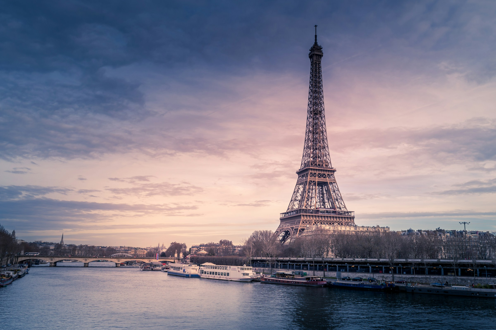

摄影：[Chris Karidis](https://unsplash.com/@chriskaridis)；[原作品](https://unsplash.com/photos/eiffel-tower-paris-france-nnzkZNYWHaU)；[Unsplash License](https://unsplash.com/license)，保存2400×1596下载版本。

## 海报三种交付

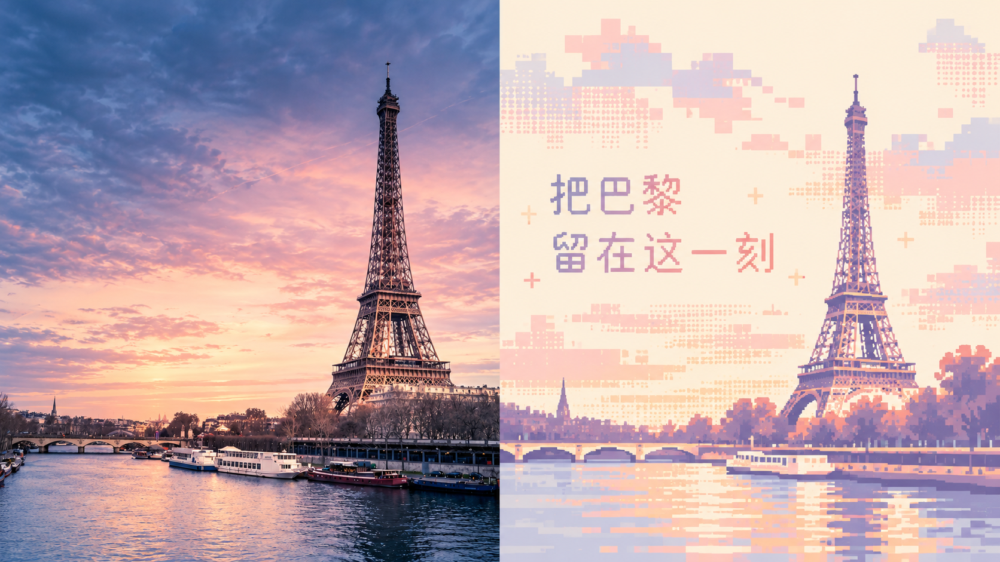

**左右对照、准确中文**：[完整请求](prompts/left-right.txt)。中文“把巴黎留在这一刻”正确，无其他文案。摄影区也被模型重绘，比原照更暖更亮，不能当作原片无损保留。

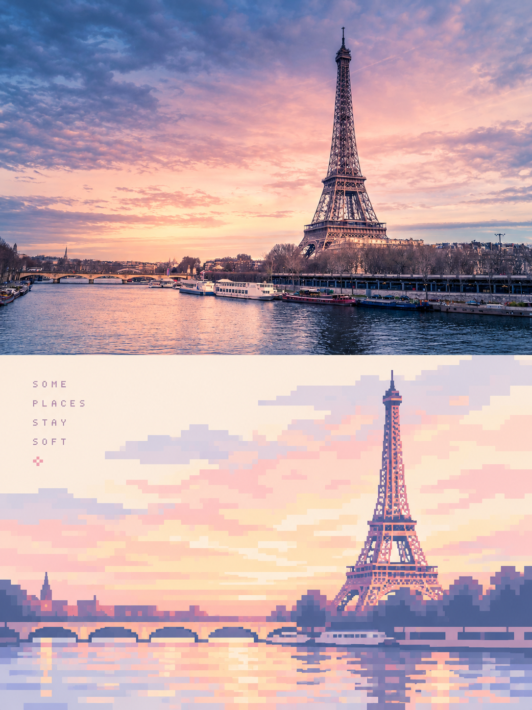

**上下对照、自动英文**：[完整请求](prompts/top-bottom.txt)。模型配文“SOME PLACES STAY SOFT”基于当前照片情绪生成，不含未经核实的旅行日期等信息。

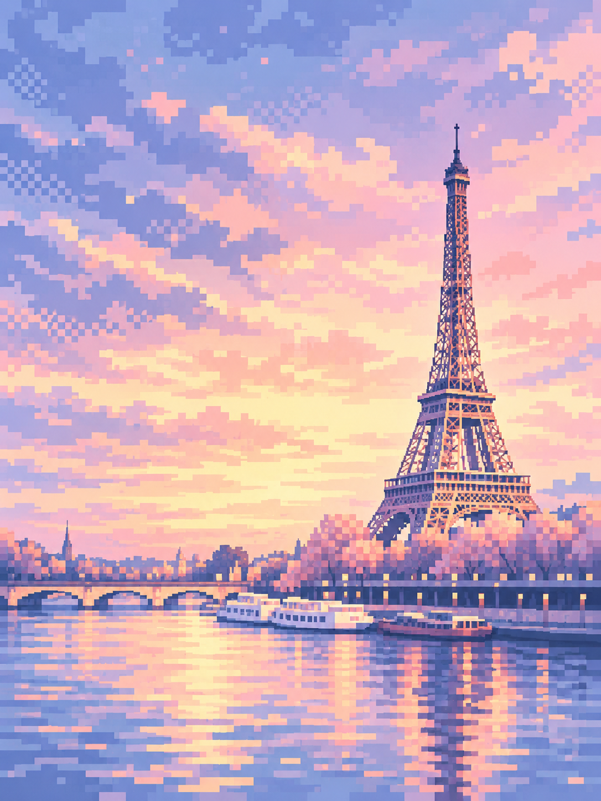

**纯设计、无文字**：[初次请求](prompts/design-only.txt)／[重试请求](prompts/design-only-retry.txt)。第2次才消除摄影分区。主体可辨，但铁塔、船只和云层细节偏多，大面积留白没有充分实现。

## 四端连贯壁纸

手机先生成、经本研究检查，作为视觉家族定调。其余三端共同参考**同一原始实拍＋手机定调图**，分别生成完整画布，没有将手机图裁成其他设备。

| 手机 | 平板 |
| --- | --- |
| 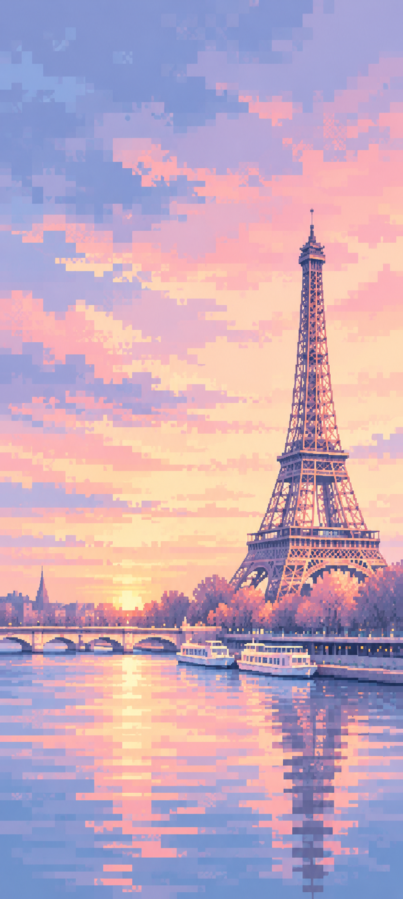 | 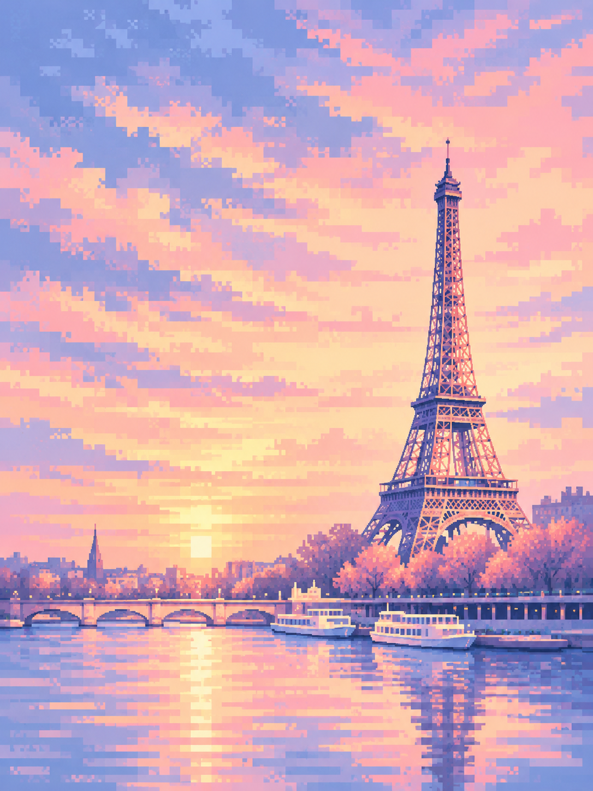 |
| [手机最终请求](prompts/wallpaper-phone-retry.txt) | [平板请求](prompts/wallpaper-ipad.txt) |

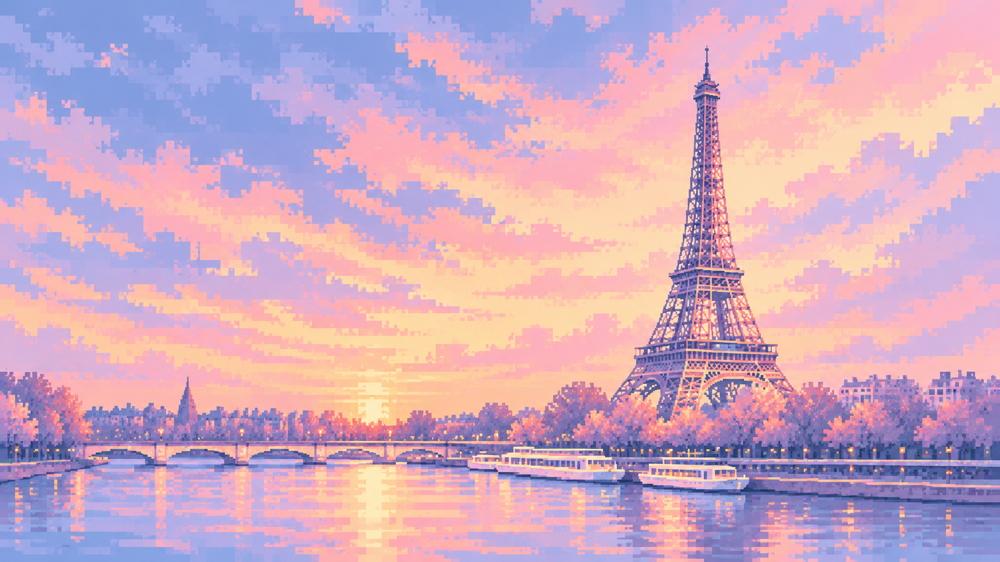

*电脑横版：[完整请求](prompts/wallpaper-desktop.txt)。*

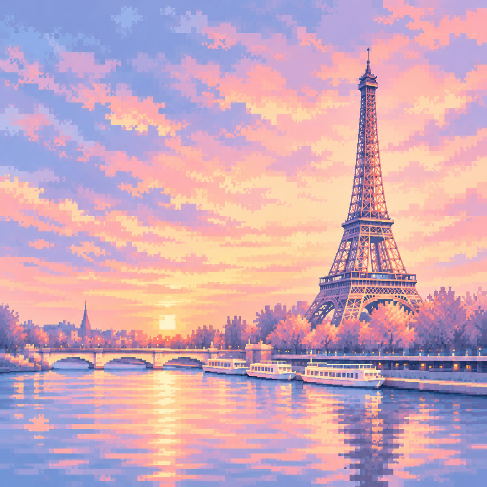

*手表方形：[重试请求](prompts/wallpaper-watch-retry.txt)。没有表盘UI，没有验证设备真机或遮挡。*

## 失败记录与实际尺寸

共10次请求：7个目标，其中3个各重试1次。重试均从原始输入开始；连贯壁纸按已选契约额外参考定调图，不引用失败图。

| 首轮不合格结果 | 失败项 |
| --- | --- |
| 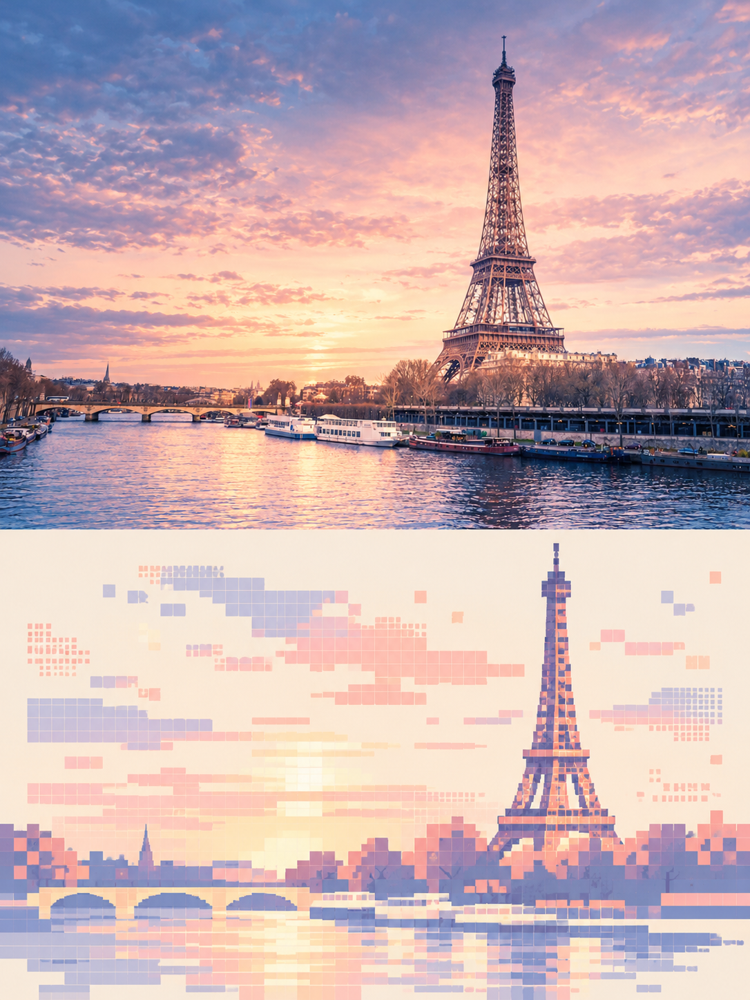 | 应为全幅设计，却生成上下对照；仅加强不可见摄影参考与全幅转译约束后重试。 |
| 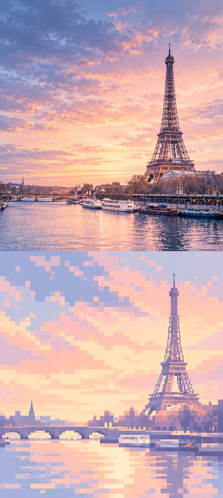 | 应为全幅壁纸，却仍有摄影区域；加强同类约束后重试。 |
| 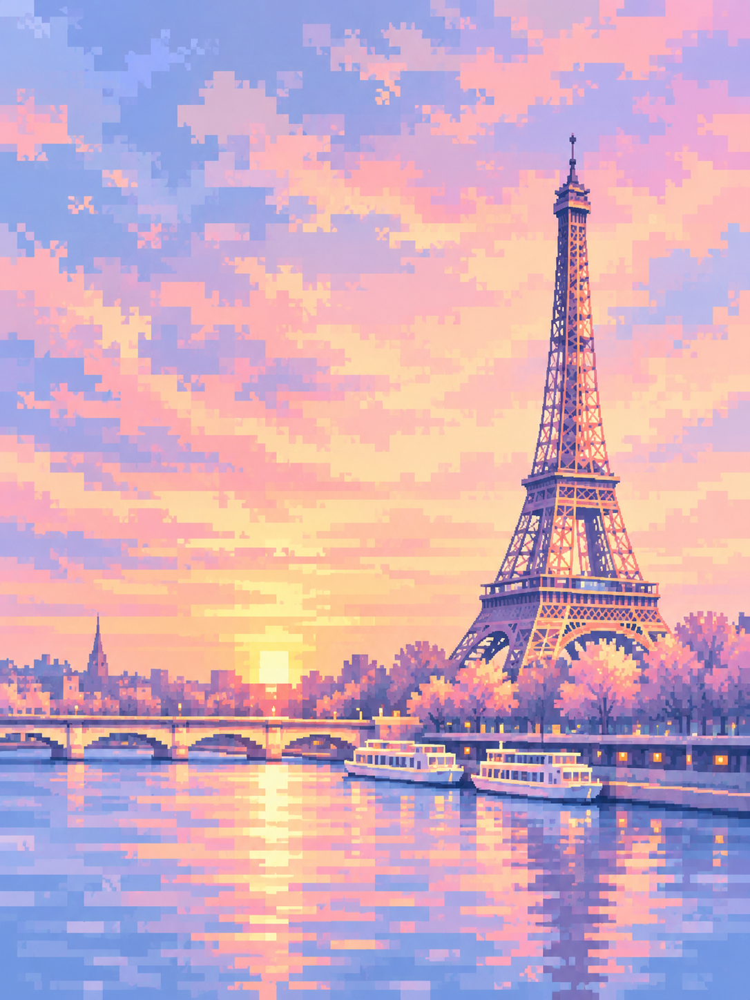 | 重申1:1正方形后重试。 |

| 目标 | 请求像素 | 实际像素 | 模式／比例 |
| --- | --- | --- | --- |
| 上下对照 | 1536×2048 | 1086×1448 | 分区与3:4通过 |
| 左右对照 | 2048×1152 | 1672×941 | 近似16:9，分界偏1像素 |
| 纯设计 | 1536×2048 | 1086×1448 | 重试后全幅设计、3:4 |
| 手机 | 1440×3200 | 841×1870 | 重试后全幅设计、近似比例 |
| 平板 | 1536×2048 | 1086×1448 | 全幅设计、3:4 |
| 电脑 | 2560×1440 | 1672×941 | 全幅设计、近似16:9 |
| 手表 | 1024×1024 | 1254×1254 | 重试后1:1正方形 |

**全部准确像素请求均未通过。** 未通过插值放大把文件改成请求值，以保留当前工具真实边界；不宣称4K、印刷或完整自动尺寸校准链已验证。原始PNG、实际尺寸和SHA-256均记录于 [media.json](media.json)。

## 本次检查与评价

- 上游compose_panel.py审计：上下y=724，中线724，无偏差；左右x=835，中线836，偏-1像素、0.06%。其阈值判OK，不代表绝对等分。
- 准确中文逐字人工查看；英文清楚可读。未运行独立OCR。
- 纯设计与四壁纸人工检查无可见文字，未使用自动检测保证所有伪文字不存在。
- 柔彩、几何像素、地标可辨成立；留白、极少形状和强抽象仅部分满足，更偏像素风景插画。
- 铁塔、河流、桥梁关系保留；局部摄影细节和颜色改变，不能作为事实或原片像素保真证据。
- 四端有相近配色与像素节奏，没有做色差统计、用户偏好实验或真机测试。
- 仅一张源照片，不外推任意照片成功率；没有计费、吞吐量和耗时基准结论。

所有完整请求见 [prompts/](prompts/)。内置工具没有公开底层模型名，不将上游默认gpt-image-2字符串当作本次实际模型证据。当前演示验证工作流意图与可见效果；若要正式交付，需按用途继续检查尺寸、主体保真、抽象程度与文字。
