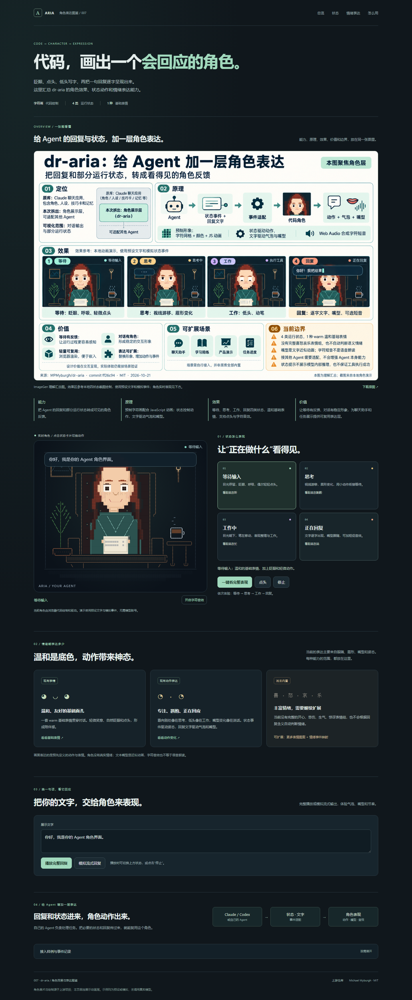

# 007 · dr-aria · 可选接入说明

本页保留角色组件与事件适配的详细用法；项目主入口已调整为[角色效果展示](README.md)。以下测试记录对应原独立组件与模拟事件演示，本轮展示页的新增检查另按实际结果记录。

将 Dr. Aria 的字符画、角色动画、流式嘴型和字符音效拆成无框架依赖的浏览器组件。自己的 Agent 负责生成回复和执行任务，组件接收文字与状态事件并展示动作。

| 信息 | 内容 |
| --- | --- |
| 上游仓库 | [MPMyburgh/dr-aria](https://github.com/MPMyburgh/dr-aria) |
| 作者 | Michael Myburgh |
| 研究版本 | [`ff26c94cf1d6879ad98838df9c50104d06419eb6`](https://github.com/MPMyburgh/dr-aria/tree/ff26c94cf1d6879ad98838df9c50104d06419eb6)，提交说明 Aria 0.5.1 |
| 上游许可 | MIT；[保留的许可证](web/LICENSE.dr-aria.txt)、[来源与修改说明](NOTICE.md) |
| 收录日期 | 2026-10-21 |
| 实现形式 | 原生 JavaScript ES module、Shadow DOM、内嵌字符画、可选 Web Audio |
| 运行条件 | 支持 ES modules、Shadow DOM 的现代浏览器；静态 HTTP 服务 |



*本地浏览器实际截图，使用模拟事件；[上游原版界面](assets/upstream-aria.png) 与[图片说明](assets/README.md)。*

## 本次拆出的能力

- 待机时眨眼、视线变化、轻微呼吸与点头。
- `think()` 展示思考，`write()` 展示低头工作。
- `say(text)` 播放完整文字；`stream()` 接收逐段文字并驱动逐字显示和嘴型。
- 可选字符音效；这是游戏式短音，不是语音朗读。
- `stop()` 中断角色播放，`destroy()` 释放实例资源。
- 统一事件接口，以及 Claude Code / Codex CLI 的示例适配器。

动画组件不包含上游的心理陪聊人设、技巧卡、Markdown 记忆、Claude 登录或 Python 模型桥接。它不会自己判断角色应该开心或难过；表情延续上游的温和风格，动作按事件切换。

## 本地运行

在本仓库根目录执行：

```bash
python -m http.server 8047 --bind 127.0.0.1 -d projects/007-dr-aria/web
```

浏览器打开 [本地演示](http://127.0.0.1:8047/)。静态演示使用样例事件，不调用模型、不需要 API key，也不消耗 Claude 或 Codex 额度。ES modules 请通过 HTTP 服务加载，不使用 `file://` 双击打开。

## 接到自己的 Agent

复制整个 `web/` 目录，或至少保留 `avatar.js`、`upstream-renderer.js`、`upstream-art.js` 和 `LICENSE.dr-aria.txt`。需要 Claude/Codex 事件翻译时再加入 `adapters.js`。原生网页、React/Vue 挂载后的 DOM 容器都可以使用：

```html
<div id="avatar"></div>
<script type="module">
  import { mountAvatar } from './avatar.js';

  const avatar = mountAvatar(document.querySelector('#avatar'), {
    name: '我的助手',
    cps: 28,
    muted: true,
  });

  // Agent 状态由你的应用提供。
  avatar.handle({ type: 'thinking' });
  avatar.handle({ type: 'working' });
  avatar.handle({ type: 'message', text: '任务完成，结果已经整理好了。' });
</script>
```

流式回复可以直接接一个异步文本生成器：

```js
avatar.think();
const speech = avatar.stream();
try {
  for await (const text of yourAgentTextStream) speech.push(text);
  speech.end();
  await speech.done;
} catch (error) {
  avatar.stop();
  throw error;
}
```

这里的 `yourAgentTextStream` 是你的应用已有的接口。组件不绑定 SSE、WebSocket、某个模型或 Agent 框架。后端收到模型事件后，将需要公开的文字和状态转发给前端即可。

| 统一事件 | 角色行为 |
| --- | --- |
| `{type:'thinking'}` | 思考 |
| `{type:'working'}` | 低头工作 |
| `{type:'delta', text:'文字片段'}` | 将增量文字加入当前播放 |
| `{type:'done'}` | 结束当前文字流 |
| `{type:'message', text:'完整回复'}` | 播放一条完整回复 |
| `{type:'listening'}` | 回到倾听状态 |
| `{type:'nod'}` | 点头 |
| `{type:'stop'}` | 停止角色播放 |
| `{type:'error', text:'错误说明'}` | 停止播放，并发出供宿主页面展示的错误事件 |

`stop()` 只停止角色，不会自动取消后端任务。用户点停止时，你的应用应同时取消网络请求或中断对应 Agent 进程。组件卸载时调用 `avatar.destroy()`。

通过 `handle()` 接收的思考、工作事件会等待前面的文字播放完成，避免快速到达的 CLI 事件截断回复。直接调用 `think()`、`write()`、`listen()` 则会中断当前播放，适合明确的界面操作。`say()` 和 `stream().done` 在停止或销毁时兑现为已经播放的文字，排队但未开始的任务返回空字符串。

## Claude Code 与 Codex 的样例适配

[adapters.js](web/adapters.js) 只接收已经获得的 JSON 事件并翻译成统一事件，不创建进程或建立网络连接。

```js
import { createClaudeAdapter, createCodexAdapter } from './adapters.js';

const receive = createClaudeAdapter(avatar); // 或 createCodexAdapter(avatar)

// 后端逐行解析 CLI stdout JSONL 后，经你已有的传输通道发来：
socket.addEventListener('message', event => receive(JSON.parse(event.data)));

// 开始全新的运行、停止或重新连接前，清理适配器的去重状态：
// receive.reset();
```

需要捕获 CLI 事件时，外部进程使用的命令形式为：

```bash
claude -p "请简要介绍这个项目" --output-format stream-json --verbose --include-partial-messages
codex exec --json "请简要介绍这个项目"
```

这两条命令是接入说明，不是本次执行记录。它们会真实调用你的已配置账户，是否能读取文件或使用工具仍由各 CLI 自己的权限、配置和工作目录决定。应在已有受控后端读取进程 stdout，stderr 另行记录；浏览器静态页面不会直接执行这两条命令。不要把用户输入拼接为 shell 命令，后端应采用参数数组启动固定程序。

| 来源 | 接收的主要事件 | 映射与边界 |
| --- | --- | --- |
| Claude Code | `stream_event.event.content_block_delta` + `text_delta` | 真正的增量文字 → `delta`；过滤 thinking 与工具参数 |
| Claude Code | `assistant.message.content` | 无增量时播放完整文字；同一消息已有增量时忽略文字快照，避免重复播放 |
| Claude Code | `content_block_start` + `tool_use` | 工作状态，不展示工具输入或执行结果 |
| Claude Code | `result` | 结束；出错时显示通用错误说明 |
| Codex exec | `turn.started`、工具 `item.started` | 思考 / 工作状态 |
| Codex exec | `item.completed` + `agent_message` | 一条完整回复 → `message`，**不当作 token 流**；角色仍可逐字播放 |
| Codex exec | `turn.completed` / `turn.failed` | 结束 / 错误 |

Claude 的增量事件与完整 `assistant` 快照可能包含同一段文字，适配器对同一消息避免二次播放。Codex 按完成的 `agent_message` 的 item id 去重。未知事件忽略；Claude 子 Agent 的 `parent_tool_use_id` 消息不转播，避免多个角色来源交叉。事件字段来自截至 2026-10-21 核对的官方文档，CLI 版本变化时应重新核对。

## 实现与使用边界

数据流是：`你的 Agent → 事件适配器 → 角色状态 / 文字缓冲区 → 字符画、气泡、嘴型、音效`。角色图案使用上游的字符网格和颜色网格，运行时替换眼睛、嘴、头发、笔等标记；没有逐帧调用图片模型。

Shadow DOM 隔离样式，字符画内嵌在组件中；不存在字体、图片、CDN 或模型的运行时下载。中文可以显示；嘴型只是文字驱动的近似动作，不能当作真实中文发音口型。音频需用户手势解锁，默认建议静音。`reducedMotion` 可覆盖系统的减少动画偏好。

只向组件转发可公开的最终回复、可公开的进度和必要状态。模型推理、工具参数、文件内容、账户信息都不应被整包转发到页面。停止角色播放不等于停止模型；显示“工作中”也不代表具体工具执行成功。

## 验证范围

2026-10-21 在 Windows、Python 3.10.11、Node.js 22.15.0 和 Playwright Chromium 环境通过七组浏览器检查，详见 [verification.json](verification.json)：状态按钮、中文和跨块 emoji、文本转义、流式播放、停止当前及排队任务、销毁清理、多实例隔离、两种 CLI 去重、工具前后多段回复、390px 窄屏与减少动态设置。浏览器未发现控制台错误或失败请求。

截图：[桌面](assets/demo-desktop.png)、[390px 手机宽度](assets/demo-mobile.png)。测试脚本为 [tests/browser.mjs](tests/browser.mjs)，在上述静态服务运行时执行 `node projects/007-dr-aria/tests/browser.mjs`。测试环境需安装 Playwright，或通过 `PLAYWRIGHT_MODULE` 指定已有 Playwright 模块的绝对目录；组件本身无 npm 依赖。

本目录没有通过真实账户调用 Claude Code 或 Codex。两种演示事件均为模拟；实际接入还需要已有后端将 CLI 输出转发给页面。字符音效的浏览器开关与合成代码已提供，未做音质测评。

如需从同一上游版本重新抽取美术和基础渲染器，运行 `python projects/007-dr-aria/scripts/extract_upstream.py <上游本地目录>`。脚本先验证 commit，并在 [SOURCE.json](SOURCE.json) 记录原始文件 SHA-256；自建的生命周期封装与页面不会被覆盖。

## 来源

- [上游设计与角色复用说明](https://github.com/MPMyburgh/dr-aria/blob/ff26c94cf1d6879ad98838df9c50104d06419eb6/docs/design.md)
- [Claude Code：程序化运行与流式 JSON](https://code.claude.com/docs/en/headless)
- [Claude Agent SDK：增量事件、完整消息及工具调用](https://code.claude.com/docs/en/agent-sdk/streaming-output)
- [OpenAI 官方文档：Codex 非交互模式与 JSONL 事件](https://learn.chatgpt.com/docs/non-interactive-mode#make-output-machine-readable)
- [研究笔记](notes.md)、[来源与修改说明](NOTICE.md)、[返回总索引](../../README.md#项目索引)
