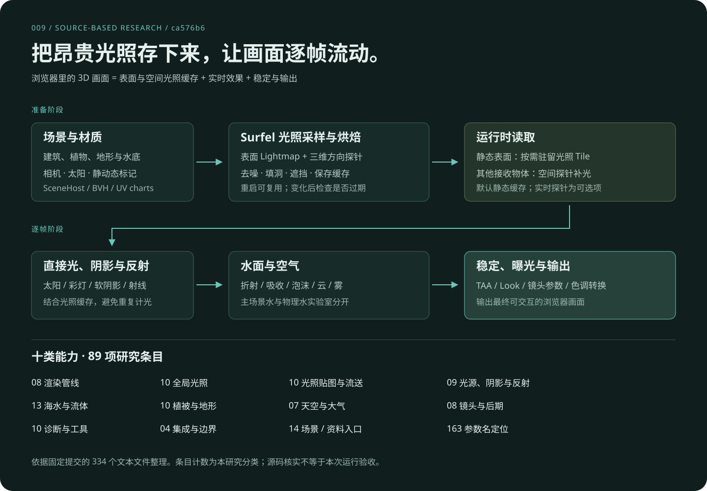

# 技术原理与数据流

该项目用 **预计算表面光照 + 三维空间探针 + 实时直接光/反射/环境效果** 分摊浏览器渲染成本。下文解释固定版本的接入路径；现已运行 Cornell Box、完整村庄、海滩与森林的主管线配置并接入 [真实交互](web/index.html#live-demo)，实际启用范围见 [RUNTIME.md](RUNTIME.md)。

通俗入口见 [原理、九组算法与 AI 区别](PRINCIPLES-AND-AI.md)。先区分“三维模型”（形状）、“数学模型”（描述规律的方程）与“训练模型”（从数据学到规律的 AI）：本库用三维场景与数值算法计算画面，没有现成 AI 图像处理接口。

可以把间接光理解成“红墙让旁边的白球略带红色”：有限方向采样估计反射来光，BVH 加速查找命中，Lightmap 与探针保存照明。改变相机时从同一空间重新绘图；改变太阳或墙面时，则应检查旧缓存是否需要重建。常见 AI 重绘是在图像与条件下生成外观，结构保持取决于具体方法和条件。两者可以组合，不能只凭结果外观判断使用了哪一种算法。

## 1. 程序从哪里开始

根 `index.html` 加载 `src/app/main.ts`，初始化 WebGPU，按 `scene` 查询参数创建场景。默认进入 `features/render-pipeline`；`pipeline=legacy` 选择历史 `features/lighting-pipeline`。

`SceneHost` 交付场景、相机、太阳、控制器与更新函数，还可以提供雾、云、镜头、反射、室内容积等设置。场景负责形体和自己的动画，主管线管理光照、缓存、帧循环和调试。

证据：[应用入口](https://github.com/vibegameengine/web-starter-kit-webgpu-pipline/blob/ca576b601bf84527102f1768372aa8cd96a3c55a/src/app/main.ts)、[SceneHost](https://github.com/vibegameengine/web-starter-kit-webgpu-pipline/blob/ca576b601bf84527102f1768372aa8cd96a3c55a/src/features/render-pipeline/host.ts)。

## 2. 为什么先算光照

如果每个像素、每一帧都重新计算很多次光线反弹，浏览器的成本会很高。代码把静态表面拆成光照 UV 图表（chart），在表面放置 Surfel，发出采样射线，通过 BVH 求交和已有辐照缓存估计间接照明，再迭代收敛。

Surfel 可以理解为“记录这一小片表面收到多少光”的采样单元。它不是三角形本身，也不是最后屏幕上的像素。表面采样间隔、贴图米/texel 和每点射线数是不同参数：分别影响测量密度、结果存储密度和积分质量。

结果经表面约束传播、填洞、去噪和边界 padding 后写成 Lightmap。页面再次启动时可读缓存；缓存持久化还包含 Surfel、探针和来源清单。它是运行准备期可以执行的烘焙，不必然要求离线 DCC 工具。

证据：[StaticLight](https://github.com/vibegameengine/web-starter-kit-webgpu-pipline/blob/ca576b601bf84527102f1768372aa8cd96a3c55a/src/features/render-pipeline/staticLight.ts)、[烘焙模块](https://github.com/vibegameengine/web-starter-kit-webgpu-pipline/tree/ca576b601bf84527102f1768372aa8cd96a3c55a/src/shared/gi/bake)。

## 3. Lightmap 与探针如何分工

| 接收情况 | 光照来源 | 原因与取舍 |
| --- | --- | --- |
| 有合适光照 UV 的静态 chart 表面 | Lightmap | 保留较细的固定表面照明；几何/光照变化后需检查是否重烘焙 |
| 未走 chart 的实例、移动物体或其他接收对象 | 空间探针 | 根据位置、法线和可见性取样；细节精度受探针间距限制 |
| 直接受到太阳或解析光源照射 | 实时直接光与阴影 | 能随光源/物体变化；与静态间接光是不同的项 |
| 低粗糙度的镜面响应 | 场景射线反射，或可选反射缓存 | 根据镜面方向求交；有单独的质量、频率和预算 |

探针采用 DDGI 风格表示：每个探针有 8×8 的方向辐照 tile、16×16 的距离矩 tile，加边界与状态记录。物体在周围探针间插值，并结合表面朝向、距离矩可见性、偏移和室内外层掩码，降低穿墙补光。

**默认探针也是烘焙结果。** `probeLive=1` 才保留方向 Surfel、在每帧射线预算中渐进更新；此更新并不自动重算整张静态 Lightmap，且积分调用当前使用 `includeDynamic: false`。`surfelGi=1` 则启用另一种活动 Surfel 更新链，不要将两者混为“全场景逐帧全动态 GI”。

证据：[探针存储与采样](https://github.com/vibegameengine/web-starter-kit-webgpu-pipline/blob/ca576b601bf84527102f1768372aa8cd96a3c55a/src/shared/gi/probes/probeVolume.ts)、[实时探针](https://github.com/vibegameengine/web-starter-kit-webgpu-pipline/blob/ca576b601bf84527102f1768372aa8cd96a3c55a/src/shared/gi/probes/probeLive.ts)。

## 4. 光照贴图为什么还需要虚拟纹理

场景增大时，全部高分辨率 Lightmap 常驻 GPU 会占据较多内存。当前实现为每个 chart 构建独立 mip 金字塔，把较大层切成带边框的 tile，最粗可放入一块的层作为 tail。

反馈通道根据可见表面请求 tile，驻留规划器管理有限工作池。页表将缺页映射到同一 chart 的驻留祖先或 tail，保证降级时不直接采到别的墙面。当前 `tilePool.ts` 已把半精度 tile 放在浏览器 tab 的 CPU 内存，通过 `device.queue.writeTexture` 分块上传，并对每帧上传量设预算。

这减少的是 GPU 活跃工作集。**它没有证明总内存恒定，也没有实现从网络逐页取光照。** `docs/lessons-virtual-textures.md` 仍描述 stage 1a 的全量 GPU store；当前代码已超过这段历史记录。对照时以固定版本 `tilePool.ts` 为准。

证据：[TilePool](https://github.com/vibegameengine/web-starter-kit-webgpu-pipline/blob/ca576b601bf84527102f1768372aa8cd96a3c55a/src/shared/gi/lod/tilePool.ts)、[历史说明](https://github.com/vibegameengine/web-starter-kit-webgpu-pipline/blob/ca576b601bf84527102f1768372aa8cd96a3c55a/docs/lessons-virtual-textures.md)。

## 5. 一帧画面如何组成

1. 场景 pass 产生 HDR 颜色、albedo、normal、velocity、depth 等缓冲。
2. 材质获取烘焙/探针间接光；根据配置加入实时 GI、接触遮蔽与镜面反射。接触遮蔽只调制间接项，避免对直接阴影重复变暗。
3. 水面在单独 Overlay 层读取主体颜色与深度，计算折射、吸收、反射、泡沫与水下细节；空气透视、雾等由 FrameGraph 按配置组合。
4. 进行 TAA/FXAA/none 选择、可选运动模糊、曝光、Look、眩光与输出转换，最后可叠加显示空间颗粒。这里是概念分组，确切先后看 `frameGraph.ts`，不应把所有艺术控制都视为最后一层滤镜。

TAA 需要正确的前后帧速度。作者维护 r182 Three.js 分支，把实例运动向量修复回移，避免静态实例被错误解释为移动物体。主流 Three.js 更新并不能自动替代本工程所有定制行为。

证据：[FrameGraph](https://github.com/vibegameengine/web-starter-kit-webgpu-pipline/blob/ca576b601bf84527102f1768372aa8cd96a3c55a/src/shared/render/frameGraph.ts)、[Three.js 分支说明](https://github.com/vibegameengine/web-starter-kit-webgpu-pipline/blob/ca576b601bf84527102f1768372aa8cd96a3c55a/docs/lessons-three-fork.md)。

## 6. 水面有两条实现

| 路径 | 已核对的接入 | 可以据此说明的能力 |
| --- | --- | --- |
| `entities/water/index.ts` | 海滩、村庄 | 浅水方程、地形水深、折射、吸收散射、天空 Fresnel、焦散近似、泡沫湿度、喷溅、Worker |
| `entities/water/physicalWater.ts` | `labs/water/main.ts` | 风浪频谱、FFT 微细节、波面几何反射、射线透射/散射与专门光学诊断 |

主场景里的青绿色水面来自底色、路径吸收、散射、反射和光照共同作用；不能简单归因于一张蓝绿色贴图。浅水求解是二维高度/速度场，不是完整三维流体。独立实验的算法存在，也不能证明它们已经接入所有主场景。

固定树没有找到 `/labs/water/` 等声明路径的 HTML 入口/路由装配，复现时需先补接页面，详见 [运行条件](REPRODUCTION.md)。

## 7. 天空、植被和镜头的来源

- **天空与空气**：透射/多次散射/天空视图 LUT、Rayleigh/Mie 散射、云密度步进、云影和 froxel 雾。太阳变化会影响实时环境，但旧静态间接光仍须处理缓存一致性。
- **叶片与树干**：PROSPECT 风格叶光学、薄叶 BSDF、透射和角质层反光；叶脉与树皮来自程序化表面构建。它们是材质模型，未获得生物实验精度认证。
- **电影镜头**：相机传感器和焦距参数控制取景，快门参数关联运动模糊；预设名称不代表完整复刻某台摄影机的镜片、像差、噪声和景深。

完整模块证据与参数见 [89 项能力清单](CAPABILITIES.md)。
