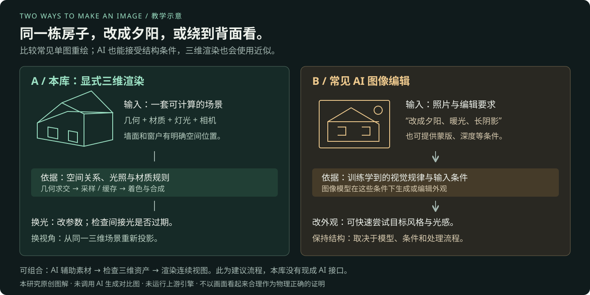

# 它怎样算出画面，以及与 AI 改图有什么不同

先给定三维形状、材质、灯光和相机，再用图形学与数值算法计算光的传播和成像。静态间接光预先采样保存，运行时与实时通道组合。

[展示页的通俗原理](web/index.html#principles) · [AI 区别](web/index.html#ai-comparison) · [详细技术架构](ARCHITECTURE.md) · [完整能力清单](CAPABILITIES.md)

## 先分清三种“模型”

| 词语 | 通俗例子 | 在这里做什么 |
| --- | --- | --- |
| 三维模型 | 房子的墙面、窗户与屋顶网格 | 提供物体形状和空间位置；还要结合材质、灯光与相机，才能得到画面。 |
| 物理或数学模型 | 光的反射规则、浅水方程 | 用方程和参数描述规律，程序再进行数值近似。 |
| 训练得到的 AI 模型 | 接收照片和提示词的图像重绘模型 | 利用训练学到的规律，根据输入和控制条件生成输出。 |

这里把“AI 直接处理”理解为常见的图像补光、编辑、重绘或生成。这里的 AI 直接处理，指常见的单张图片补光、重绘或生成。AI 也可以接收深度、边缘等空间控制；三维渲染同样使用近似，不能简单等同于绝对物理真实。

## 例子一：红墙旁边的白球

阳光照着一面红墙，旁边放着白球。我们希望白球靠近红墙的一侧带一点红，背光处仍保留合理的明暗。

*箭头表示光能传播关系；实际积分器从表面采样方向估计入射光。图中的颜色、采样点和箭头均为教学示意，不是本库运行结果或逐光子模拟。*

### 1. 先算直接光

太阳直接照亮墙面和球。程序根据表面朝向、光源强度与几何遮挡估计受光；被挡住的位置形成阴影。

**记住**：几何回答“被什么挡住”，材质回答“收到光后怎么反应”。

源码依据：[太阳方向与强度控制](https://github.com/vibegameengine/web-starter-kit-webgpu-pipline/blob/ca576b601bf84527102f1768372aa8cd96a3c55a/src/features/render-pipeline/sun.ts#L124) · [接触硬化软阴影](https://github.com/vibegameengine/web-starter-kit-webgpu-pipline/blob/ca576b601bf84527102f1768372aa8cd96a3c55a/src/shared/render/softSunShadow.ts#L38)。

### 2. 再估计反弹光

红墙反射出的光偏红，可能照到白球。Surfel 表面采样点向多个方向发射采样射线，借助 BVH 查找命中，再加权估计间接光。

**记住**：有限方向的采样是在估算积分，不是穷举每一条光线。

源码依据：[Surfel 表面光照采样](https://github.com/vibegameengine/web-starter-kit-webgpu-pipline/blob/ca576b601bf84527102f1768372aa8cd96a3c55a/src/shared/gi/bake/lightmapSurfels.ts#L64) · [基于 BVH 的光线求交](https://github.com/vibegameengine/web-starter-kit-webgpu-pipline/blob/ca576b601bf84527102f1768372aa8cd96a3c55a/src/shared/gi/surfel/sceneBvh.ts#L14) · [间接光迭代与缓存](https://github.com/vibegameengine/web-starter-kit-webgpu-pipline/blob/ca576b601bf84527102f1768372aa8cd96a3c55a/src/shared/gi/surfel/surfelIntegratePass.ts#L73)。

### 3. 把照明存起来

有光照 UV 的静态表面把结果存进 Lightmap；未走该贴图的接收对象从三维探针取得位置相关的补光。探针还记录遮挡距离，减少穿墙取光。

**记住**：表面缓存和空间缓存各有适用对象，不是同一份贴图。

源码依据：[烘焙结果持久化](https://github.com/vibegameengine/web-starter-kit-webgpu-pipline/blob/ca576b601bf84527102f1768372aa8cd96a3c55a/src/shared/gi/bake/persistedBake.ts#L2) · [三维光照探针体积](https://github.com/vibegameengine/web-starter-kit-webgpu-pipline/blob/ca576b601bf84527102f1768372aa8cd96a3c55a/src/shared/gi/probes/probeVolume.ts#L81) · [探针遮挡权重与偏移](https://github.com/vibegameengine/web-starter-kit-webgpu-pipline/blob/ca576b601bf84527102f1768372aa8cd96a3c55a/src/shared/gi/probes/probeVolume.ts#L282)。

### 4. 每帧读取并合成

相机移动时，程序重新绘制视图并读取这些缓存，再组合当前直接光、阴影和反射。太阳或建筑改变后，要检查旧间接光是否需要重新烘焙。

**记住**：相机换位置，不必把所有静态反弹光从头算一遍。

源码依据：[统一画面合成](https://github.com/vibegameengine/web-starter-kit-webgpu-pipline/blob/ca576b601bf84527102f1768372aa8cd96a3c55a/src/shared/render/frameGraph.ts#L99) · [光照来源与陈旧状态检查](https://github.com/vibegameengine/web-starter-kit-webgpu-pipline/blob/ca576b601bf84527102f1768372aa8cd96a3c55a/src/shared/gi/bake/lightingProvenance.ts#L3) · [探针渐进实时更新](https://github.com/vibegameengine/web-starter-kit-webgpu-pipline/blob/ca576b601bf84527102f1768372aa8cd96a3c55a/src/shared/gi/probes/probeLive.ts#L42)。

### 怎样理解“采样”

可以把它想成：想估计一个房间各方向来的光，先量一批方向，再按权重合成结果。量得更多通常更稳定，但计算也更多。表面某点的入射光估计、材质的反射规则和最后像素颜色属于不同环节，不应把它们全部理解成简单平均亮度。

### 怎样理解“探针插值”

把探针想成固定在空间中的测光站。球移动到两个测光站之间时，按位置和其他权重混合附近数据；实际实现读取周围八个探针，还考虑朝向、遮挡距离、有效状态和室内外层。它是已有测量的插值，不是 AI 猜测一个球该有多亮。

## 九组主要算法：名字、工作与边界

### 01. BVH 几何求交

**通俗理解**：先按空间分组，再找射线碰到了谁。

**例子**：判断红墙到白球之间有没有遮挡，或反射方向能看见哪个物体。

**方法**：把几何组织为包围体层级，先排除整组不相交的物体，再测试更细的区域。它是加速查找，不会独自算出光照。

**边界**：计算着色器中的射线求交，不等于已调用专用硬件 RT 管线。

源码依据：[基于 BVH 的光线求交](https://github.com/vibegameengine/web-starter-kit-webgpu-pipline/blob/ca576b601bf84527102f1768372aa8cd96a3c55a/src/shared/gi/surfel/sceneBvh.ts#L14) · [场景射线反射](https://github.com/vibegameengine/web-starter-kit-webgpu-pipline/blob/ca576b601bf84527102f1768372aa8cd96a3c55a/src/shared/gi/reflect/reflectionPass.ts#L44)。

### 02. Surfel 与蒙特卡洛式采样

**通俗理解**：测一些方向，估计整片方向来的光。

**例子**：估计红墙能给白球和地面带来多少红色反弹光。

**方法**：在表面采样单元上选择多个方向，计算命中与来光，并按材质、角度、采样概率等因素加权，迭代更新辐照缓存。

**边界**：有限采样与缓存近似会带来噪声、偏差和收敛时间；不是逐像素无偏路径追踪。

源码依据：[Surfel 表面光照采样](https://github.com/vibegameengine/web-starter-kit-webgpu-pipline/blob/ca576b601bf84527102f1768372aa8cd96a3c55a/src/shared/gi/bake/lightmapSurfels.ts#L64) · [间接光迭代与缓存](https://github.com/vibegameengine/web-starter-kit-webgpu-pipline/blob/ca576b601bf84527102f1768372aa8cd96a3c55a/src/shared/gi/surfel/surfelIntegratePass.ts#L73)。

### 03. Lightmap 烘焙与缓存

**通俗理解**：提前算好的照明，运行时查表。

**例子**：一面不移动的墙，不必每帧重复求所有反弹光。

**方法**：为静态表面分配光照 UV，把采样结果写进光照贴图；较大的结果按 mip 与 tile 管理，再按当前镜头需求上传。

**边界**：它保存的是光照结果，不是模型颜色本身；光照或几何变更后可能过期。

源码依据：[自动分配光照 UV 与图表](https://github.com/vibegameengine/web-starter-kit-webgpu-pipline/blob/ca576b601bf84527102f1768372aa8cd96a3c55a/src/shared/gi/bake/lightmapUv.ts#L5) · [烘焙结果持久化](https://github.com/vibegameengine/web-starter-kit-webgpu-pipline/blob/ca576b601bf84527102f1768372aa8cd96a3c55a/src/shared/gi/bake/persistedBake.ts#L2) · [CPU 到 GPU 的分块上传](https://github.com/vibegameengine/web-starter-kit-webgpu-pipline/blob/ca576b601bf84527102f1768372aa8cd96a3c55a/src/shared/gi/lod/tilePool.ts#L34)。

### 04. DDGI 风格探针插值

**通俗理解**：空间里放测光站，物体从附近取光。

**例子**：白球移动到红墙旁，可从附近探针取得不同于远处的补光。

**方法**：读取周围八个探针，用空间插值、朝向、有效状态、室内外分层与距离矩可见性加权。遮挡权重采用 Chebyshev 风格近似。

**边界**：默认探针预先烘焙；probeLive 是可选渐进更新，不能让整张静态 Lightmap 自动实时改变。

源码依据：[三维光照探针体积](https://github.com/vibegameengine/web-starter-kit-webgpu-pipline/blob/ca576b601bf84527102f1768372aa8cd96a3c55a/src/shared/gi/probes/probeVolume.ts#L81) · [DDGI 风格方向编码](https://github.com/vibegameengine/web-starter-kit-webgpu-pipline/blob/ca576b601bf84527102f1768372aa8cd96a3c55a/src/shared/gi/probes/probeVolume.ts#L77) · [探针遮挡权重与偏移](https://github.com/vibegameengine/web-starter-kit-webgpu-pipline/blob/ca576b601bf84527102f1768372aa8cd96a3c55a/src/shared/gi/probes/probeVolume.ts#L282) · [探针渐进实时更新](https://github.com/vibegameengine/web-starter-kit-webgpu-pipline/blob/ca576b601bf84527102f1768372aa8cd96a3c55a/src/shared/gi/probes/probeLive.ts#L42)。

### 05. 阴影贴图与 PCSS 风格软阴影

**通俗理解**：先知道哪里被挡，再估计阴影多软。

**例子**：椅脚附近的影子较硬，离地更远的部分可以更柔。

**方法**：用深度阴影贴图比较遮挡，搜索遮挡者，再结合光源视角尺寸估计半影范围并滤波。

**边界**：受贴图分辨率、滤波预算和偏移设置影响，属于可控成本的近似。

源码依据：[接触硬化软阴影](https://github.com/vibegameengine/web-starter-kit-webgpu-pipline/blob/ca576b601bf84527102f1768372aa8cd96a3c55a/src/shared/render/softSunShadow.ts#L38) · [接收面修正与阴影范围适配](https://github.com/vibegameengine/web-starter-kit-webgpu-pipline/blob/ca576b601bf84527102f1768372aa8cd96a3c55a/src/features/render-pipeline/sun.ts#L141)。

### 06. GGX、Fresnel 与 Beer–Lambert

**通俗理解**：描述表面反光，以及光穿过水会少掉多少。

**例子**：掠视水面更像镜子，水越深或光走得越远，水底的颜色越受吸收影响。

**方法**：GGX 近似微表面镜面反射；Fresnel 描述反射率随角度变化；透射可用 T = exp(−σL) 描述，其中 σ 是衰减系数，L 是路径长度。

**边界**：这些是不同环节的数学描述；水的形状还要由另外的流体或波浪算法计算。

源码依据：[随路径长度的吸收与散射](https://github.com/vibegameengine/web-starter-kit-webgpu-pipline/blob/ca576b601bf84527102f1768372aa8cd96a3c55a/src/entities/water/index.ts#L210) · [Fresnel 天空反射与太阳闪光](https://github.com/vibegameengine/web-starter-kit-webgpu-pipline/blob/ca576b601bf84527102f1768372aa8cd96a3c55a/src/entities/water/index.ts#L704) · [薄叶透光与表面反光](https://github.com/vibegameengine/web-starter-kit-webgpu-pipline/blob/ca576b601bf84527102f1768372aa8cd96a3c55a/src/shared/render/foliage/leafMaterial.ts#L206)。

### 07. 浅水方程与有限体积法

**通俗理解**：把水面切成格子，逐步更新水高和流速。

**例子**：浪遇到浅岸会改变形态，水流可以冲上沙面再退回。

**方法**：主浅水求解器采用 Kurganov–Petrova 中心迎风有限体积格式，配合重建、静水修正和 SSP-RK2 时间推进。

**边界**：二维高度/速度场，不能由此推出任意三维流体能力；独立水实验室另有频谱与 FFT 微细节。

源码依据：[浅水高度与流速求解](https://github.com/vibegameengine/web-starter-kit-webgpu-pipline/blob/ca576b601bf84527102f1768372aa8cd96a3c55a/src/entities/water/shallowWater.ts#L46) · [风浪频谱与 FFT 微细节](https://github.com/vibegameengine/web-starter-kit-webgpu-pipline/blob/ca576b601bf84527102f1768372aa8cd96a3c55a/src/entities/water/physicalWater.ts#L162)。

### 08. Rayleigh / Mie 散射与查找表

**通俗理解**：估计光穿过空气后怎样变色。

**例子**：天空偏蓝、低太阳偏暖，远处物体逐渐融入空气颜色。

**方法**：使用散射模型、光线步进和大气查找表；云、空气透视与体积雾有各自的采样和组合步骤。

**边界**：参数化的实时近似，不代表气象预测或无限精度的体积光计算。

源码依据：[物理大气与天空 LUT](https://github.com/vibegameengine/web-starter-kit-webgpu-pipline/blob/ca576b601bf84527102f1768372aa8cd96a3c55a/src/shared/render/sky/atmosphereLuts.ts#L51) · [Rayleigh 与 Mie 散射](https://github.com/vibegameengine/web-starter-kit-webgpu-pipline/blob/ca576b601bf84527102f1768372aa8cd96a3c55a/src/shared/render/sky/scatteringMarch.ts#L11) · [空气透视](https://github.com/vibegameengine/web-starter-kit-webgpu-pipline/blob/ca576b601bf84527102f1768372aa8cd96a3c55a/src/shared/render/sky/aerialPerspective.ts#L36) · [Froxel 体积雾](https://github.com/vibegameengine/web-starter-kit-webgpu-pipline/blob/ca576b601bf84527102f1768372aa8cd96a3c55a/src/shared/render/atmosphere/volumetricFog.ts#L44)。

### 09. TAA 时间抗锯齿

**通俗理解**：把多帧信息对准后结合，减少闪烁。

**例子**：相机转动时，细树叶和建筑边缘不应不停跳亮跳暗。

**方法**：抖动相机采样，借助运动向量重投影历史画面，再做历史裁剪与时间累积。

**边界**：错误速度会导致拖影或闪烁，历史图像也不能照单全收。

源码依据：[TAA 时间抗锯齿](https://github.com/vibegameengine/web-starter-kit-webgpu-pipline/blob/ca576b601bf84527102f1768372aa8cd96a3c55a/src/shared/render/temporalAA.ts#L120) · [Three.js 定制修复说明](https://github.com/vibegameengine/web-starter-kit-webgpu-pipline/blob/ca576b601bf84527102f1768372aa8cd96a3c55a/docs/lessons-three-fork.md#L15)。

## 与 AI 直接改图的区别

| 对比点 | 本项目的三维渲染管线 | 常见 AI 图像重绘 |
| --- | --- | --- |
| 需要什么输入 | 三维几何、材质、灯光、相机与场景配置。 | 常见是图片、提示词、蒙版和可选结构控制信息。 |
| 凭什么决定画面 | 依据已定义的空间关系、材质模型、光照规则与数值近似。 | 依据训练学到的视觉规律与当前输入、生成方法和控制条件。 |
| 怎样调整光照 | 改变太阳角度、灯光强度或材质参数，重新计算相关通道。 | 通过提示词、参考、蒙版或光照/几何条件，引导模型生成相应外观。 |
| 结构是否保持 | 仅改变光照时，通常继续使用同一份几何；波面等显式模拟除外。 | 普通重绘可能连窗户、纹理和边界一起改变；结构控制能减少这种变化。 |
| 换一个视角 | 从同一三维场景重新投影和渲染，遮挡关系有显式依据。 | 单图重绘需要推断未见部分；具有多视图或三维约束的方法可加强一致性。 |
| 准备与运行成本 | 先准备资产并承担烘焙/编译成本，运行时按帧绘制；仍受硬件与场景复杂度限制。 | 按具体模型和流程承担生成成本；生成一张、编辑多张和连续视频是不同任务。 |
| 结果的可信范围 | 有明确参数和几何依据，但会有采样、缓存、材质与离散化误差。 | 可以产生有说服力的外观，但画面合理不自动代表几何或物理计算正确。 |

比较的是常见单图重绘与本项目的显式三维渲染管线，不把所有 AI 方法归为一类。ControlNet 等研究已经展示边缘、深度、分割和姿态条件能够控制图像扩散模型；这不等于每次生成都严格保持全部几何。

参考：[Adding Conditional Control to Text-to-Image Diffusion Models](https://arxiv.org/abs/2302.05543v3)。支持 AI 可接收空间结构条件这一补充；不是本项目依赖或本轮 AI 实测。

## 例子二：同一栋房子的三个问题

### 同一栋房子：阴天改夕阳

- **三维渲染**：保留原来的房屋几何与窗户，把太阳移低、调暖。直接光和阴影更新；静态反弹光仍需检查是否重烘焙。
- **AI 图像处理**：给原图“夕阳、暖光、长阴影”等编辑要求。模型可以生成目标外观，但普通重绘可能顺带改变屋顶、窗格或纹理。
- **如何选择**：手里只有一张照片、目标是一张效果图时，AI 改图通常更容易开始；已有三维场景、需要明确参数控制时，渲染管线更直接。

### 同一栋房子：绕到背面看

- **三维渲染**：移动相机，从现有背面几何重新绘制；如果场景根本没有背面资产，渲染器也不会自动建好它。
- **AI 图像处理**：单张正面照片不包含完整背面，需要推断或生成；多视图、深度或三维条件可以加强约束。
- **如何选择**：需要连续交互、稳定空间关系时，先建立共同三维场景更合适；不能从一张漂亮结果图推断出完整三维资产。

### 只有照片，能直接交给这个库吗？

- **三维渲染**：这个库的主输入是三维场景。单张照片不会自动变成可旋转的建筑，需要先建模、重建或导入资产。
- **AI 图像处理**：图像模型可以直接处理照片；也可辅助生成贴图、概念和三维素材，但产物仍要检查和接入。
- **如何选择**：可以组合：AI 辅助准备素材 → 检查几何与材质 → 三维渲染负责连续成像。本库当前没有现成 AI 接口。

## 为什么两种方式可以组合

可以用 AI 辅助准备概念、贴图或资产，再让三维场景提供共同的空间依据，交给渲染器持续生成不同视角。也可以把渲染器输出的深度、法线和图像作为图像模型的约束。组合方案需要另外开发接口和验证一致性，不是当前库已具备的完整工作流。

## 图解与验证范围

本章示意图、步骤切换与情境说明均为原创教学资料，图中画面不是数值求解或 AI 生成结果。后续新增的独立实时演示确实运行了原库 Cornell Box、村庄、海滩与森林；其启用配置与验证范围见 RUNTIME.md，不把教学图解当作实测截图。

这些讲解新增为研究资料，没有增加原清单的 89 项能力计数。交互步骤只选择图解和说明，不会运行 GI 求解或 AI 推理。验证记录见 [verification.md](verification.md)。
