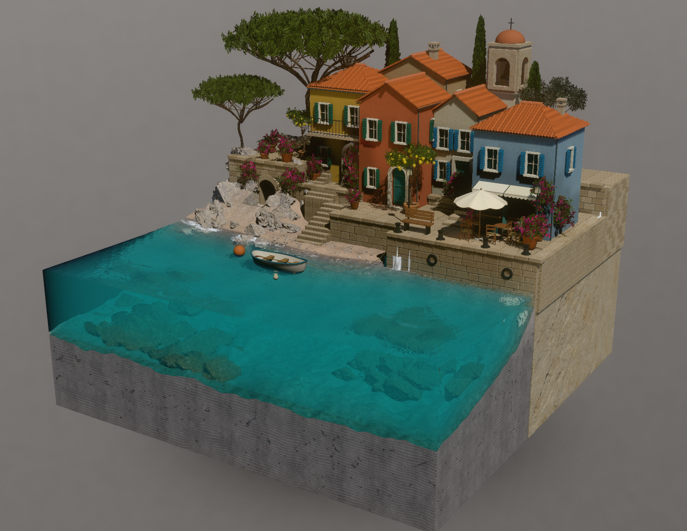
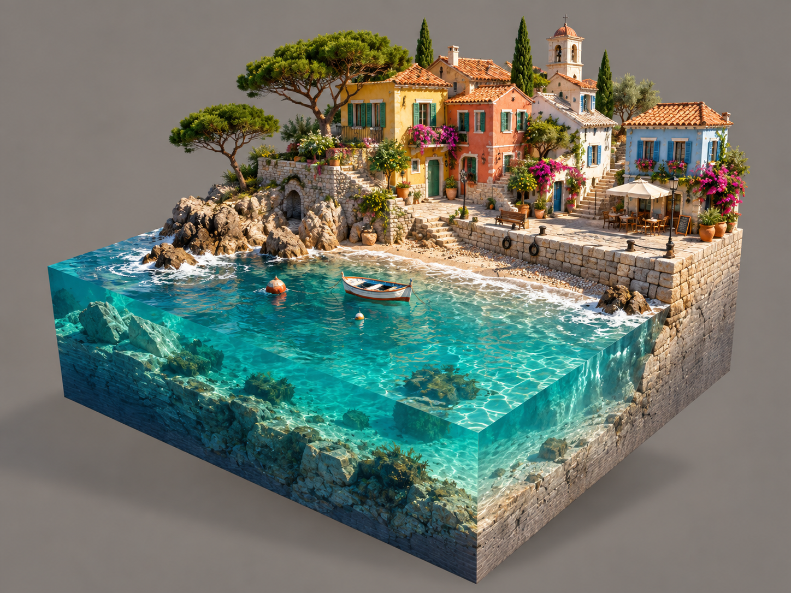
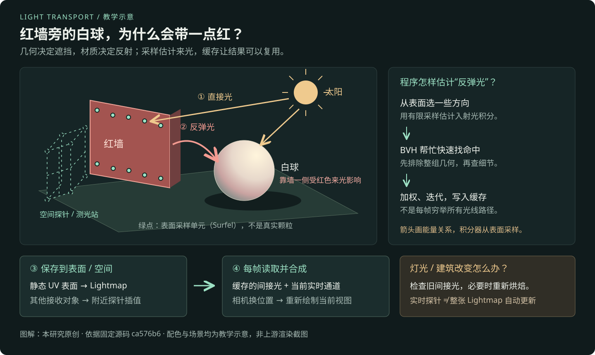

# 009 · WebGPU Render Pipeline · 光照效果实现与复用

**这个库的核心价值，是实现浏览器三维场景的光照效果，并把实现方法沉淀为可复用的渲染能力。** 它让物体拥有明暗、反弹光和投影，让水面、树叶等自然材质对光线产生响应。它是一套带场景与诊断工具的 WebGPU 渲染实验工程。

**原理**：以几何、材质、光源和相机为输入，借助 BVH 与 Surfel 采样估计间接光，保存为静态表面的 Lightmap 和空间光照探针；逐帧读取缓存，再组合实时阳光、阴影、水面、植被与后期。移动相机可直接重绘；太阳改变后，静态间接光需要检查并重烘焙。

**可见效果与复用方向**：反弹光、环境补光、软阴影、反射、水下成像、岸线泡沫、叶片透光与环境层次，可用于浏览器游戏、建筑与空间漫游、产品展厅和图形学教学。进一步扩展需要接入自有资产、角色与交互，整理接口和性能预算；玩法系统和目标设备验收由项目另外完成。详见 [价值、效果与复用说明](VALUE.md)。

**研究展示：10 类、89 项能力条目，14 个场景/资料入口，163 个参数名定位。** 数量是本研究的组织方式；每项都附效果、原理、启用范围、边界和固定提交的源码链接。现已跑通原库的 Cornell Box、完整海岸村庄、海滩、森林与 WebGPU 主管线，并接入真实交互；其余场景和全部能力仍以源码研究为主。

[打开真实演示](web/index.html#live-demo) · [运行与实测记录](RUNTIME.md) · [完整能力清单](CAPABILITIES.md) · [通俗原理、算法与 AI 区别](PRINCIPLES-AND-AI.md) · [场景地图](SCENES.md) · [技术原理](ARCHITECTURE.md) · [复现条件](REPRODUCTION.md) · [参数定位](PARAMETERS.md) · [边界与验证](verification.md)

## 从一张图开始

[打开可点击的总览入口](web/index.html#overview) · [下载高清 PNG](assets/project-overview.png) · [下载矢量 SVG](assets/project-overview.svg) · [读图说明与来源](OVERVIEW.md)


*原创研究总览，四张缩略图来自本机真实运行。图中能力标记表示源码接入范围；应用方向为能力推导，不把研究条目当作全部运行验收。网页中的能力板块和实测缩略图可点击进入详情。*

## 直接调节原库画面

打开 [本地演示](http://127.0.0.1:8049/#live-demo)，选择 Cornell Box、海岸村庄、海滩或森林，点击“启动真实演示”；运行时也可切换。太阳方位角、高度角和强度会直接更新原库光源；相机环绕、仰角、距离及画面内拖动作用于同一三维场景。太阳改变后可点击“按当前太阳重烘焙间接光”，相机改变不必重烘焙。提供光照/相机预设、重置、暂停和停止。室外场景另有水面、叶片、溪流、树冠等细节视角。海滩可选房车因固定源码缺少模型而关闭；森林溪流为不透明波纹材质，与海滩浅水模拟不同。

渲染使用固定上游的 Cornell Box、完整村庄、海滩、森林与原始水模拟、Surfel/BVH 烘焙、Lightmap/探针、太阳阴影及画面合成。`runtime/` 新增启动与控制桥接；另对原库小块补采样增加有效表面判断，完整来源和准确配置见 [RUNTIME.md](RUNTIME.md)。

## 先看实际画面与设计目标



*上游 `public/lighting-look-development.html` 中标为现有画面的原图，按字节提取，未重绘；它是作者提供的历史截图，不能据此断言当前固定版本在本机的画质与性能。来源、原文说明和哈希见 [媒体记录](media.json)。*

<details>
<summary>查看作者的概念参考图——用于说明目标，非运行效果</summary>



*与现有画面来自同一份作者文档。两张图构图、比例和素材并不完全一致，因此展示页并列呈现，不提供误导性的像素差分或同图效果滑杆。概念图不能作为当前实现验收。*

</details>

## 能力总览


| 类别 | 条目 | 主要能力 | 肉眼或使用效果 |
| --- | ---: | --- | --- |
| 渲染管线 | 8 | WebGPU、TSL/WGSL、多缓冲、静动态分离、实例化、合成 | 多种场景接入同一套渲染流程 |
| 全局光照 | 10 | Surfel、BVH、迭代缓存、方向探针、可见性、室内外分层 | 暗处有环境补光，物体受周围颜色影响 |
| 光照贴图与流送 | 10 | UV/chart、密度、填洞、缓存、mip、tile 与 CPU→GPU 上传 | 静态表面保留细节，按镜头需求使用 GPU 工作池 |
| 光源、阴影与反射 | 9 | 太阳、软阴影、彩灯、接触遮蔽、场景反射、反射缓存 | 阴影软硬有变化，接触更明确，表面反映环境 |
| 海水与流体 | 13 | 浅水、水深、折射、吸收、泡沫、湿沙、喷溅及独立 FFT 实验 | 水底可见、海面起伏、岸线浪花与泡沫 |
| 植被、地形与材质 | 10 | 叶光学、透光、叶脉、树干、针叶林、沙地、地形与建筑 | 植物逆光、地表层次与程序化场景细节 |
| 天空与大气 | 7 | 散射 LUT、空气透视、体积云、云影、环境图、雾 | 日落、云影、雾化远景与空气层次 |
| 镜头与后期 | 8 | TAA/FXAA、曝光、Look、输出转换、颗粒、运动模糊、镜头参数 | 更稳定的边缘与可控制的明暗、色彩和运动表现 |
| 诊断与研究工具 | 10 | 分屏、漏光追踪、测试房间、LOD lab、计时、冻结和 GUI | 能定位画质缺陷、缓存问题和运行成本 |
| 集成与使用边界 | 4 | SceneHost、R3F、Three.js 修复、URL 场景选择 | 理解接入方式以及尚需补齐的环境 |

状态含义、逐项条件和证据见 [CAPABILITIES.md](CAPABILITIES.md)。`主管线` 也仅表示有代码接入，不表示本次通过了运行验收。

## 理解它的三个关键

1. **把昂贵光照预先算成可读取的数据。** 有光照 UV 的静态表面读 Lightmap；其他接收对象从三维探针中取光。直接光、阴影和部分反射继续实时更新。
2. **可选实时更新与默认烘焙是不同路径。** `probeLive` 和 `surfelGi` 默认关闭；改变太阳/天空后，旧 Lightmap 不会自动成为新的正确反弹光。
3. **按实际接入点判断能力。** 海滩/村庄与独立水实验室使用不同水实现；文档中的 Lumen、RDR2、120 FPS 和概念图都是研究背景或目标，不自动等于已交付效果。

## 用两个例子理解原理与 AI 区别

**红墙旁的白球**：太阳照亮红墙，墙反射的偏红来光会影响白球。程序借助 BVH 查找采样射线的命中，通过 Surfel 与加权采样估计间接光，再把静态照明存入 Lightmap 或空间探针供逐帧读取。它不是每帧穷举所有光线，也不是把图片交给训练模型重新画一遍。



*本研究原创示意；箭头表示能量传播关系，实际积分器从表面采样方向估计来光。*

**同一栋房子改成夕阳，再绕到背面**：三维管线从同一份几何、材质和相机计算视图；改光后还需检查缓存是否过期。常见 AI 单图重绘根据图片、提示与可选结构条件生成外观，可能同时改变窗格或纹理；多视图和三维约束可以改善一致性。没有背面资产的渲染器也不能自动造出背面。

完整说明包括 **9 组算法、7 个对比维度和 3 种房屋情境**，见 [通俗原理与 AI 对照](PRINCIPLES-AND-AI.md)。展示页新增 [四步光照讲解](web/index.html#principles) 和 [情境切换](web/index.html#ai-comparison)。这些图解均为教学资料，与上方真实交互的运行证据分开；没有调用 AI 生成效果对比。

## 场景怎么浏览

- **想看综合画面**：海滩、森林、开发中的地中海村庄。
- **想理解光照**：Cornell Box、封闭走廊、移动彩灯走廊。
- **想排查问题**：全封闭漏光房间、光照 LOD 比例尺、单栋房屋轻量夹具。
- **想研究单项算法**：天空实验、物理水实验室、R3F 实验室、渲染技术阅读页。

主场景代码可由 `scene` 参数选择。独立实验室和阅读页虽然在作者目录中有路径，但固定树未找到对应 HTML/路由装配，需要先补接，详见 [SCENES.md](SCENES.md)。

## 打开本次研究展示

在仓库根目录执行：

```powershell
python projects/009-webgpu-render-pipeline/scripts/package_web.py
python -m http.server 8049 --bind 127.0.0.1 --directory projects/009-webgpu-render-pipeline/web
```

首次还需按 [RUNTIME.md](RUNTIME.md) 准备固定上游依赖并构建 `web/live/`。之后打开 [http://127.0.0.1:8049/](http://127.0.0.1:8049/)，资料浏览不要求 WebGPU；点击真实演示后才加载引擎，需要兼容的 WebGPU 设备。已构建的页面和纹理都从本站读取，不使用 CDN 或 AI 服务。当前未发布在线地址，登记表的 `demo_url` 保持为空。

## 来源、环境与许可

| 信息 | 内容 |
| --- | --- |
| 上游 | [vibegameengine/web-starter-kit-webgpu-pipline](https://github.com/vibegameengine/web-starter-kit-webgpu-pipline) |
| 作者/组织 | `vibegameengine` |
| 固定提交 | [`ca576b601bf84527102f1768372aa8cd96a3c55a`](https://github.com/vibegameengine/web-starter-kit-webgpu-pipline/tree/ca576b601bf84527102f1768372aa8cd96a3c55a) |
| 提交时间 | 2026-09-17 02:36:50 UTC |
| 收录/取证日期 | 2026-10-21 |
| 取证范围 | 固定树完整目录核对；334 个文本文件的 SHA-256 与行号；89 项能力逐项链接 |
| 上游许可 | GitHub 返回 `null`；固定树未找到 LICENSE/COPYING，不能按默认自由许可复用 |
| 上游技术栈 | Three.js r182、TSL/WGSL、Vite 6、TypeScript 5.8；另引用定制 Three.js 与 R3F |
| 本地研究环境 | Windows / PowerShell；Python 3.10.11；Node.js v22.15.0、npm 10.9.2；Chromium WebGPU |
| 上游运行情况 | 已在固定依赖与明确配置下运行 Cornell Box、完整村庄、海滩、森林 / WebGPU 主管线；独立实验室与其他场景未逐项验收 |
| 验证记录 | [verification.md](verification.md) / [verification.json](verification.json) |

完整上游工作树放在忽略的 `_upstream/`，生成的真实演示放在忽略的 `web/live/`，由固定脚本重建。两张作者图、原始运行纹理与本机截图分别保留出处和哈希；新增范围见 [NOTICE.md](NOTICE.md)，图片来源见 [assets/README.md](assets/README.md)，取证索引见 [SOURCE.json](SOURCE.json)。

[返回总索引](../../README.md#项目索引)
