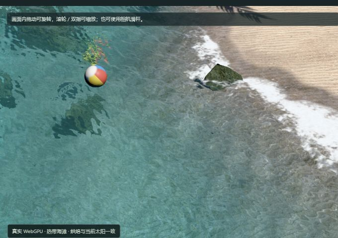
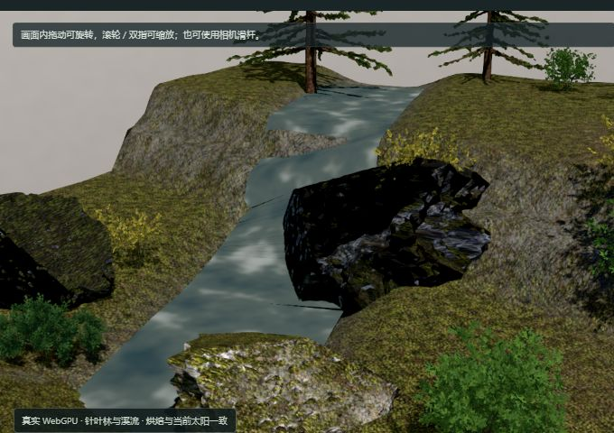
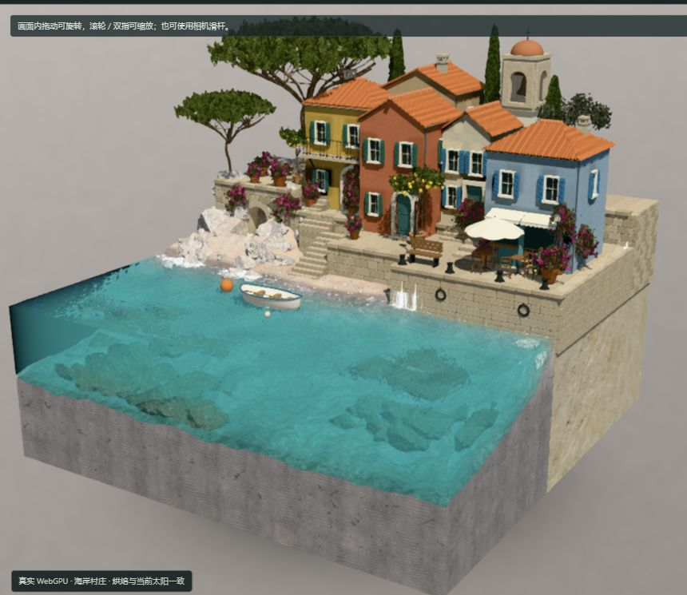

# 原库运行与真实交互演示

展示页的 [真实演示](web/index.html#live-demo) 可切换固定上游的 **Cornell Box、完整 `midsee-village` 海岸村庄、热带海滩和针叶林与溪流**，共用 `features/render-pipeline`，并提供太阳方位、高度、强度与相机环绕、仰角、距离控制。它生成真实的 WebGPU 帧，不是图片滤镜、视频或教学图解。

## 运行方式

首次需要 Git、Python 3.10+、Node.js 22 与 npm，并能访问 GitHub 和 npm registry。在根目录执行：

```powershell
python projects/009-webgpu-render-pipeline/scripts/setup_runtime.py
python projects/009-webgpu-render-pipeline/scripts/build_runtime.py
python projects/009-webgpu-render-pipeline/scripts/package_web.py
python -m http.server 8049 --bind 127.0.0.1 --directory projects/009-webgpu-render-pipeline/web
```

打开 [本地真实演示](http://127.0.0.1:8049/#live-demo)，选择场景，点击“启动真实演示”。第一次准备包含着色器编译和照明烘焙；村庄还要生成海岸、采样水底并预运行浅水模拟。页面显示当前阶段，完成后滑杆可用。运行时选择另一个场景会卸载旧 iframe，再启动所选场景；加载中也可切换或停止。已构建的 `web/live/` 可以直接由静态服务器或 GitHub Pages 托管，不依赖运行中的 Vite、CDN 或 AI 服务。

Windows 已构建后，也可运行 `powershell -File projects/009-webgpu-render-pipeline/scripts/preview.ps1` 启动后台静态预览；脚本复用本项目的 8049 服务，不覆盖其他页面占用的端口，日志与 PID 放在 `_upstream/`。

`setup_runtime.py` 把工作副本放到根目录忽略的 `_upstream/`，保留最初的文本取证缓存不动。依赖按 `runtime/package-lock.json` 安装；`build_runtime.py` 输出到专门忽略的 `web/live/`。页面打包检查要求真实构建产物存在，不能静默退回假演示。修改控制桥接后重跑构建和打包。

## 三份固定源码

| 部分 | 仓库与提交 | 选择依据 |
| --- | --- | --- |
| 原库场景与渲染器 | [web-starter-kit @ ca576b6](https://github.com/vibegameengine/web-starter-kit-webgpu-pipline/tree/ca576b601bf84527102f1768372aa8cd96a3c55a) | 与能力研究相同的主仓库快照 |
| 作者 Three.js fork | [three.js @ 7d33436](https://github.com/vibegameengine/three.js/tree/7d3343686e52f532e97c67440f55b1adb7aba28c) | `r182-instance-velocity` 在主仓库快照时间之前的最后提交，包含同期作者修复 |
| 作者 React Three Fiber fork | [react-three-fiber @ b297b51](https://github.com/vibegameengine/react-three-fiber/tree/b297b512181dfddbb287f75374223a56ccf1757b) | 同期作者 fork；使用源码 alias 与 patched reconciler，村庄原始 TSX prefab 由它装配 |

原库未提交 vendor，并缺少 React / React DOM / Vite React 插件等直接依赖。本次用锁文件补齐环境，编译作者的 patched reconciler。没有复制研究用文本缓存冒充完整运行工作树，没有切换到 npm stock Three 来假装等价修复。

`runtime/main.ts` 被复制到工作副本的 `.atlas/`，直接导入原库的 `initRenderer`、`createRenderPipeline`、`createCornellScene` 与 `populateCornell`，按需动态导入 `createMidseeVillageScene`、`createBeachScene`、`createForestScene`。村庄保留完整房屋、钟楼、咖啡馆、码头、船、植被、海岸岩石与原始 Worker 水模拟，没有换成单栋 `village-light` 夹具。海滩保留地形、岩石、四棵棕榈、灌木、浮球、浅水与植被更新；森林保留近景针叶树、远景树群、灌木、地表与溪流。新增桥接负责启动、进度、错误、设备检查、场景选择和控制。

**海滩的可选房车关闭。** 固定源码树没有 `public/models/nomad/nomad-van.glb`，因此使用原库 `van=0` 参数；不拿其他模型替代，不声称房车已复现。森林树木来自锁定的 `@dgreenheck/ez-tree@1.1.0`，其内嵌纹理由 Vite 打包。

环境图、蓝噪声、岩石/地面纹理、八张沙地分层纹理和九张森林地表纹理共 25 个 public 资源从固定上游提取，按 Git blob SHA-1 和 SHA-256 核对。八张村庄材质图由 Vite 从固定源码目录打包；保留原作者的 `assets/README.md` 到 `live/licenses/village-texture-sources.md`，其中说明部分纹理由作者使用 AI 生成。这不改变运行时按三维算法计算画面的方式。精确来源、锁文件哈希、资产字节数、源码补丁及构建文件哈希见 [runtime/SOURCES.json](runtime/SOURCES.json) 与生成的 [构建记录](web/live/build-info.json)。

## 控制怎样影响画面

| 操作 | 实际调用 | 画面变化 |
| --- | --- | --- |
| 太阳方位 / 高度 / 强度 | 原管线 `__audit.sun()`，调用 `updateLightFromAngles()` | 直接光与太阳阴影跟随新的光源方向、强度 |
| 相机三个滑杆与预设 | 原管线 `__camera()` 与同一个 `OrbitControls` | 从共同几何重新渲染，遮挡、透视和阴影投影关系有明确空间依据 |
| 拖动 / 滚轮 / 双指 | 原库 `OrbitControls` | 旋转、平移或缩放，并把当前相机位置回传给面板 |
| 重烘焙 | 原 GUI 的 `re-bake now` 控制 | 用当前太阳重新求静态光照贴图和探针；不是给旧图片染色 |
| 暂停 / 继续 | 原管线 `__audit.pause()` | 暂停或恢复逐帧绘制 |
| 停止 | 卸载演示 iframe | 释放本次画面及其 GPU 资源，再启动会重新初始化 |
| 切换场景 | 卸载旧 iframe，按场景参数启动新实例 | 四个场景使用同一套控制；半径：Cornell 5–24、村庄 8–120、海滩 0.8–100、森林 0.8–160 |
| 细节视角 | 位置与观察目标一起切换 | 海滩“水面近看 / 棕榈叶片”，森林“溪流近看 / 树冠仰看”，村庄“码头近看 / 屋顶近看” |

父页与画面通过同源 `postMessage` 通信，双方核对来源窗口、origin、通道名及每次启动的 session；父页还核对场景名，丢弃旧场景的迟到消息。画面回传的是引擎应用后的太阳、相机和累计调用计数，不仅是滑杆自己的值。输入限定为有限数值，并限制在可用范围。页面中的网格、实例与三角形数从实际场景遍历统计，包含实例重复量，不表示逐帧可见三角形或 FPS。

**太阳变化与相机变化分开处理。** 仅移动相机不会使静态照明过期；改变太阳后，面板提示旧间接光需要重烘焙。直接光的立即改变不能当作全场景间接光已实时重算。

## 本次演示配置

- Cornell Box 保留原始红、绿、白墙和方块；村庄使用完整原始场景与源材质。
- Surfel / BVH 采样、静态 Lightmap、空间探针、太阳软阴影和原画面合成链。
- Cornell：Lightmap 上限 64 轮、预算 4 秒，每点 16 条采样射线，采样间距 0.25 m，光照贴图密度 0.08 m/texel，探针间隔 3 m、64 轮。
- 村庄：Lightmap 页边长 2048，上限 64 轮、预算 6 秒，每点 16 条射线，采样间距 0.7 m，光照贴图密度 0.12 m/texel，探针间隔 8 m、32 轮。预算不绕过原库至少 32 轮的固定样本要求。页尺寸是启动验证的一部分，不应直接换回 512；在新增补采样修复之前，该尺寸的村庄分页试验在合成阶段触发“chart 无测量 texel”检查。
- 海滩：Lightmap 页边长 1024、采样间距 0.5 m、密度 0.12 m/texel、探针间隔 5 m、32 轮，光照贴图上限 64 轮、预算 6 秒、每点 16 条射线。2048 页试验遇到排布容量上限；更大的页也会增大最小 chart 的对齐开销，不能单纯放大页解决。
- 森林：Lightmap 页边长 2048、采样间距 0.7 m、密度 0.12 m/texel、探针间隔 12 m、32 轮，光照贴图上限 64 轮、预算 6 秒、每点 16 条射线。近景/远景植被均使用原场景装配逻辑。
- 固定曝光 1，使光源强度变化不会被自动曝光抵消；FXAA、DPR 不高于 1.25。
- 背景 HDR 保持固定，太阳滑杆改变显式方向光，没有启用动态大气天空重建。
- 关闭颗粒、体积雾、眩光、运动模糊、独立反射与探针镜面补充；`probeLive`、`surfelGi` 默认关闭。
- 本次演示禁用服务器烘焙缓存，每次启动重新烘焙；适用于纯静态托管，不向缺失写入端点发送保存请求。

这个预算是交互展示配置，会保留可见的间接光噪声与低分辨率痕迹，不是最高质量验收或 120 FPS 承诺。全库 TypeScript、独立物理水实验室和其他场景仍需分别验证。

## 已解决的启动问题与范围

1. 补齐缺失 npm 依赖、作者 vendor 路径及 patched reconciler 构建。
2. Three fork 不能只取今天的分支头：初次用了晚于主快照的依赖版本，首帧编译阻塞。现按主仓库时间固定同期提交，聚焦入口实际出帧。
3. 24 轮烘焙会触发 `Bake contains unconverged, unpinned surfels`。本次没有删除此正确性检查，改用不低于 32 的配置。
4. 主入口引用所有 TSX 场景；展示构建接入上述四个场景，三个室外场景按需动态导入。构建启用 React 插件与两个 Fiber alias，水模拟及浮球 Worker 以 ES module 输出。
5. 真实浏览器初始化、首帧和控制链路的最终记录见 [runtime/verification.json](runtime/verification.json)，截图均保存在 `assets/runtime/`。
6. 海滩首次以 1024 页、0.5 m 采样启动时，564 / 3667 个 chart 没有测量数据。定位到 `lightmapSurfels.ts` 的 fallback 原子计数先于覆盖判断：空白边缘可能占用补采样名额。新增一条 `posSample.w > 0.5` 条件，仅允许有效表面竞争名额；原有空 chart、收敛和容量检查全部保留。`setup_runtime.py` 从固定 Git blob 精确应用并校验补丁，不覆盖其他本地改动；原始与补丁 SHA-256 写入构建来源。尝试每个纹素采样则超过 262144 surfel 容量，已撤回该配置。

## 海滩与森林观察路线

海滩先看默认全景，再点“水面近看”观察水下地形、岸边泡沫和浮球；“棕榈叶片”观察叶片透光与风动。改变太阳高度和强度，观察水面高光与树影；改变相机，观察同一水面在不同方向的反射与透视。

森林先看针叶林和地表，再点“溪流近看”观察波纹，点“树冠仰看”观察叶片遮挡与群落阴影。森林仰角范围扩展到 −60°–85°，允许真正从林下向上看。

**两种水的实现不同。** 海滩和村庄使用 `entities/water/index.ts` 的 Worker 浅水模拟与水面渲染。森林 `entities/grove/streamMaterial.ts` 是不透明材质的程序化波纹溪流，不具有海滩的透射、水深模拟和浮球耦合。森林当前更新函数只驱动溪流；不把海滩的风动叶片或 ez-tree 的原始 GLSL 风动自动算作森林已启用。展示统一关闭体积雾，也不把森林雾气作为本配置效果。





两个新增场景均完成首帧、太阳参数与三个相机滑杆、细节预设、太阳强度归零及低角度光照验证；重烘焙后 `bakedSun` 更新为 `[110,18,4]`，旧间接光提示消失。海滩遍历统计为 63 个网格对象、16446 个网格实例、1794644 个三角形；森林为 224 个网格对象、2370258 个三角形。数字包含实例重复量，不表示屏幕可见量或 FPS。完整引擎回传与截图参数见 `runtime/verification.json`、`runtime/screenshots.json`。

最终海滩启动没有运行错误，但保留上游告警：极小 UV 岛读取邻近 chart、两个 chart 无覆盖保持未照明、surfel 池扩容与 TSL `atan2` 提示。编号路径的森林还记录少量缺失 `uv` 属性提示及一个无覆盖 chart。原库对少量无覆盖 chart 有容忍阈值，未放宽阈值；本配置的首帧与重烘焙通过，不等于这些细小画质问题已全部修复。

## 村庄观察路线

先保留默认视角看整村和水下石头，再点击“斜侧”观察另一侧建筑；“俯看”检查屋顶、台阶和庭院。六个相机/太阳滑杆与 Cornell 共用，村庄预设使用更大的世界尺度，恢复初始参数会回到原作者的 hero 视角。



*本机 Chromium / WebGPU 的原始画面区域截图；非作者历史图，未调色或重绘。水面持续模拟，因此不同时间截图的波纹不构成严格静态 A/B。*

已在本机 Windows、Node.js 22.15.0、npm 10.9.2、Python 3.10 和 Codex 内置 Chromium 的 WebGPU 环境验证。适配器报告 NVIDIA / Lovelace、16 个存储缓冲上限、1024 次计算调用上限；这不是显卡型号、跨设备兼容或统一性能基准。

额外的多标签验证曾在同时加载两份完整村庄时出现浏览器页面崩溃，未定位为某一资源或算法的单独问题；并行多实例不在通过范围内。页面内切换卸载旧 iframe，只保留一个场景。村庄原始构建和烘焙成本较高，首次准备应保持页面可见。

## 来源与许可证

固定主快照没有仓库级许可证，不为其补写许可。Three.js 和 React Three Fiber 的 MIT 原文随产物放在 `web/live/licenses/`；npm 依赖许可和通知汇总在 `npm-NOTICES.txt`。新增控制桥接、构建脚本与实测截图分别记为本研究新增与本机运行证据，详见 [NOTICE.md](NOTICE.md)。
