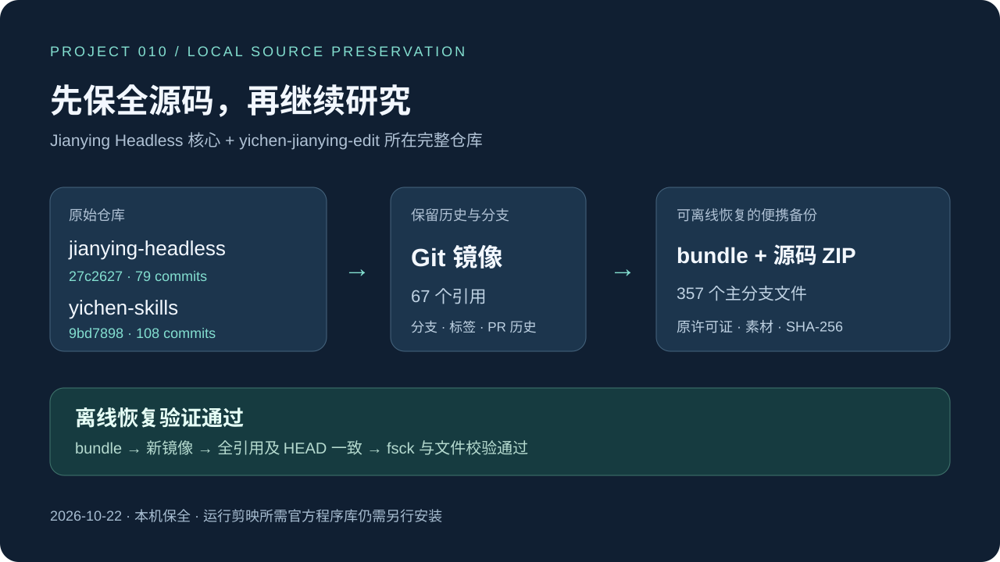

# 010 · Jianying Headless：核心与 Skill 离线归档与恢复

已于 **2026-10-22 13:58（北京时间）** 保存最初两个链接对应的完整 Git 仓库，并从独立 bundle 完成离线恢复验证。

保存目的：防止上游仓库删除、封禁或将来访问中断后丢失研究对象。这是提前保全的固定快照，不代表上游已经被封禁。**2026-10-23 将既有备份统一打包，作为本子项目的一部分提交远端**，不以远端上游可用为恢复前提。

**[下载统一备份包](backups/upstream-preservation-20261022.zip)** · [外层 ZIP 的 SHA-256](backups/upstream-preservation-20261022.zip.sha256) · [归档内容与恢复步骤](backups/README.md) · [归档校验记录](preservation-package.json)

| 原始目标 | 保存范围 | 主分支固定提交 | 全引用可达提交数 |
| --- | --- | --- | --- |
| [mcncarl/jianying-headless](https://github.com/mcncarl/jianying-headless) | 核心仓库全部可获取引用及历史 | `27c2627bbd0fccc8484000f32e9d66a820f4b698` | 79 |
| [yichen-jianying-edit](https://github.com/mcncarl/yichen-skills/tree/main/yichen-jianying-edit) | **整个 yichen-skills 仓库**，包含该 Skill | `9bd78982aa75aa179258bc9009fe4dcf2f2973b9` | 108 |



*根据实际备份清单绘制的原创图解，不是剪映运行截图。*

## 阅读源码与校验

- 解压统一归档，再解压其中的两个源码 ZIP，即可直接阅读固定版本，无需联网或安装剪映。
- 独立 Skill 位于 `yichen-skills/yichen-jianying-edit/SKILL.md`；核心自带 Skill 位于 `jianying-headless/skills/yichen-jianying-edit/SKILL.md`，两个来源按原样分别保全。
- [备份记录](backup-record.json)：来源、版本、引用数量、文件数量、产物大小、SHA-256 与验证结果。

统一 ZIP、外层 SHA-256 和说明随本研究仓库保存；Git bundle 能恢复历史，源码 ZIP 用于直接阅读。原始本机镜像、展开副本和恢复临时目录继续忽略，不重复提交。

克隆本研究仓库后，在根目录即可检查最终归档，无需原始 `_upstream/`：

```powershell
python projects/010-jianying-headless/scripts/package_preservation.py --check
```

## 目录与产物

```text
010-jianying-headless/
├── README.md / notes.md / backup-record.json
├── scripts/backup_upstreams.py
├── scripts/package_preservation.py
├── preservation-package.json         # 最终 ZIP 身份与独立恢复记录
├── backups/README.md
├── backups/upstream-preservation-20261022.zip       # 两仓统一归档，随 Git 保存
├── backups/upstream-preservation-20261022.zip.sha256
├── backups/20261022T135829+0800/        # 整体保存此目录即可携带历史备份
│   ├── jianying-headless.bundle        # 全部引用与可达 Git 历史
│   ├── yichen-skills.bundle
│   ├── jianying-headless-27c2627bbd0f.zip  # 主分支源码，无 Git 历史
│   ├── yichen-skills-9bd78982aa75.zip
│   ├── *-refs.json                    # 完整引用映射
│   ├── manifest.json                  # 357 个源码文件逐项哈希
│   ├── SHA256SUMS.txt                 # 归档与清单的校验值
│   └── verification.json              # 离线恢复结果
└── _upstream/
    ├── jianying-headless.git/          # 首次抓取的完整裸镜像
    ├── yichen-skills.git/
    ├── sources/20261022T135829+0800/   # 精确 Git blob 的可读主分支副本
    └── restore-checks/20261022T135829+0800/ # 只从 bundle 恢复的独立镜像
```

原始源码、许可证、第三方声明与仓库已有公开媒体均保留。只有最终统一归档、外层校验和说明进入父仓库提交；原始日期目录与 `_upstream/` 仍留在本机。GitHub Pages 只复制 `web/`，不携带上游归档。

原始源码 ZIP 是当时 Windows 环境的 `git archive` 产物，部分文本采用 CRLF 换行，与 manifest 对应的精确 Git blob 换行不同。归档保留原 ZIP 字节与原 SHA-256；检查器先验证 ZIP 身份，再逐文件按原字节或仅做 CRLF→LF 后核对。需要精确 Git 对象和文件内容时，以 bundle 恢复的仓库为准；具体计数保存在最终归档记录。

## 已完成的验证

| 检查 | jianying-headless | yichen-skills |
| --- | --- | --- |
| 镜像引用 | 38 | 29 |
| 分支 / 标签 / PR 引用 | 10 / 0 / 28 | 7 / 2 / 20 |
| 主分支源码文件 | 108 | 249 |
| 非浅克隆与严格 fsck | 通过 | 通过 |
| bundle 校验与离线恢复 | 全部引用及 HEAD 相同 | 全部引用及 HEAD 相同 |
| 产物和源码 SHA-256 | 通过 | 通过 |
| LFS / .gitmodules 历史 | 无额外对象 | 无额外对象 |

提交数量包含已抓取分支和 PR 历史。备份过程中没有执行上游代码、安装 Skill、编译桥接或启动剪映。

原始展开副本仍在时，在研究仓库根目录可重新进行原始保全复核；仅克隆远端的用户应使用上面的最终归档检查：

```powershell
python projects/010-jianying-headless/scripts/backup_upstreams.py --verify projects/010-jianying-headless/backups/20261022T135829+0800
```

实际环境：Windows、Python 3.10.11、Git 2.42.0.windows.2、Git LFS 3.4.0。备份脚本要求 Python 3.10+ 和 Git，首次保全还使用 Git LFS 检查额外对象；离线复核不联网。

## 上游删除后的恢复命令

先按 [归档说明](backups/README.md) 解压统一 ZIP，取得 `preservation-20261022/snapshot/`。bundle 自身包含恢复所需的 Git 对象。以下在解压后的 `preservation-20261022/` 目录执行，目标目录需要尚不存在：

```powershell
# 精确保留全部分支、标签及 PR 引用
git clone --mirror ./snapshot/jianying-headless.bundle D:/restored/jianying-headless.git
git clone --mirror ./snapshot/yichen-skills.bundle D:/restored/yichen-skills.git

# 创建可编辑工作目录
git -c core.autocrlf=false clone D:/restored/jianying-headless.git D:/restored/jianying-headless
git -c core.autocrlf=false clone D:/restored/yichen-skills.git D:/restored/yichen-skills
```

仅阅读主分支源码也可解压 ZIP；其他分支和 PR 内容从 bundle 或镜像检出。本次实际验证的是“bundle → 新裸镜像 → 引用与 HEAD 对照 → fsck”，不是剪映原生运行。

## 范围与许可

- 已保存：抓取时公开可获取的 Git 引用及可达对象，含分支、标签、可获取的 PR 引用、源码和仓库内演示媒体。
- 未包含：GitHub Issue/评论、Release 独立附件、未公开或已删除对象、剪映安装包与官方程序库、外部素材和服务。
- 两仓原创部分采用 **Personal Learning and Non-Commercial Use License**；原文保存在各自快照的 `LICENSE`，Skill 自身许可和第三方声明一并保留。
- 本归档用于个人非商业学习研究保全，保留原始来源与全部许可声明；不作为额外授权的技能集合、模板产品、官方 SDK 或商业工具分发。后续使用仍受上游个人学习与非商业许可及第三方条款约束，本项目不授予额外权利。

[研究笔记](notes.md) · [图片来源](assets/README.md) · [返回总索引](../../README.md#项目索引)
