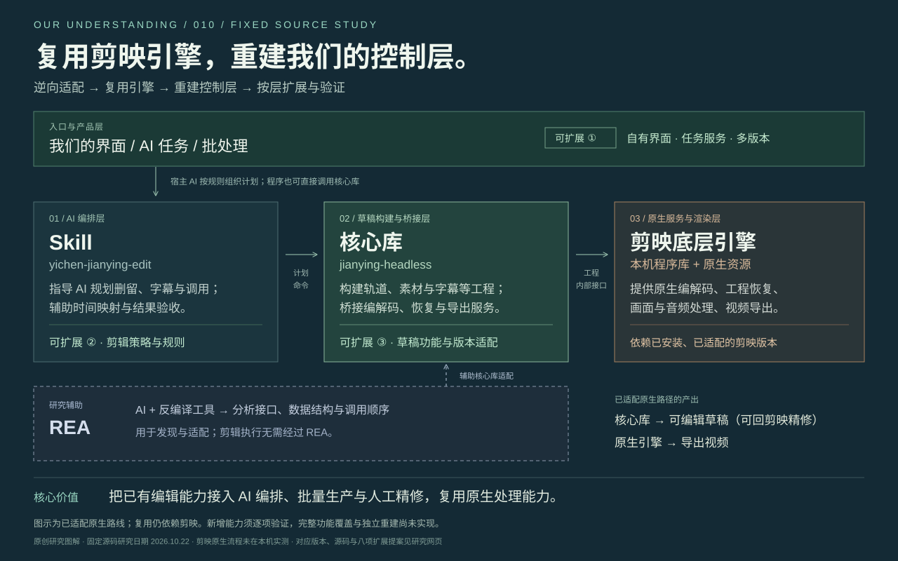

# 010 · 剪映无界面调用：原理研究与上游离线备份

> 通过逆向适配剪映工程格式与内部接口，复用本机原生引擎，重建 AI 可编排的剪辑控制层；整理核心库、Skill、REA 的关系与扩展位置，并保存两个原始仓库的固定版本、Git 历史和源码快照，防止上游删除、封禁或访问中断后研究资料丢失。

**[打开交互研究网页](web/index.html)** · [完整离线网页](web/standalone.html) · [结构化研究资料](research.json) · **[两个上游仓库的统一备份 ZIP](backups/upstream-preservation-20261022.zip)** · [校验与恢复说明](BACKUP.md)

**线上阅读：[剪映引擎原理与双仓离线备份](https://yydshly.github.io/1022_codex_project/010-jianying-headless/)**。已核对 10 个线上文件与内容提交逐字节一致，并在浏览器打开验证首屏与备份说明。

**本项目包含两类成果。** 原创研究说明解释“如何调用、能力从哪里来、可以在哪层扩展”；离线备份保存 2026-10-22 获取的 `jianying-headless` 和整个 `yichen-skills`（包含 `yichen-jianying-edit`）。2026-10-23 将这些既有副本统一打包，归档随本子项目保存，远端克隆后也能恢复，后续不必依赖上游仍可访问。

备份含两个全引用 Git bundle、两个主分支源码 ZIP、引用映射、文件清单、SHA-256、恢复记录和原始许可声明，共 **67 个 Git 引用、187 个可达提交、357 个主分支文件**。它不包含剪映官方引擎、安装包或用户账号数据；详细清单见 [归档记录](preservation-package.json) 与 [备份目录说明](backups/README.md)。

远端内容提交为 [`c30682d`](https://github.com/yydshly/1022_codex_project/commit/c30682d1f177fa10cacfde3f6e949b79718a6fde)。已从 GitHub 完整取回 25,087,701 字节并核对 SHA-256，与本地独立恢复验证的归档一致；[远端交付核验记录](publication-verification.json) 同时记录自动检查和网页部署状态。归档可从仓库下载，网页是否发布成功以记录中的实际部署结果为准。



*原创研究图解；依据固定源码与我们的对话整理，不是剪映运行截图。*

## 核心理解

1. 已适配的无界面流程由自己的桥接程序调用本机剪映程序库，继续复用剪映的内部工程服务与渲染能力。
2. 计划、脚本、AI 和自有界面可以重新组织操作入口；可编辑草稿仍可交回剪映精修。
3. “软件具备能力”“已弄清完整调用链”“项目已实现并验证”是三个阶段。不能据此保证完整界面功能覆盖。
4. 复用引擎主要研究调用与编排；完全独立重建还需自行实现算法、后端、资源和兼容性。
5. Skill 指导宿主 AI 形成计划与调用工具，核心库构建工程并桥接本机服务，REA 辅助分析未知接口与适配。产品入口、剪辑策略和桥接适配是三个可继续扩展的位置。

核心价值是把剪辑判断落实为可编辑时间线，让程序和 AI 组织重复任务，并允许人回到剪映继续精修。接口调用需要正确的工程数据、初始化、对象布局和执行顺序；不是找到一个按钮同名函数就完成适配。

## 网页内容

- 首屏理解总览：用一张响应式关系图说明入口、Skill、核心库、剪映引擎与 REA 的分工，标出产品、策略、适配三个扩展位置，汇总草稿与视频产出、实际价值和边界。提供 SVG 下载；同一理解主线进入研究笔记与结构化资料。
- 三种架构切换：剪映界面、AI 无界面、独立重建。
- 六步实现链路：计划、构造工程、原生编解码、本地登记（按需）、引擎导出、结果验收；每步附输入、产物、关键点和固定源码链接。登记不是冻结快照导出的必要前置条件。
- 四项目分工：核心、独立 Skill、Windows 原生路线 jy-draftc、逆向辅助工具 REA。
- 八个扩展提案：统一协议、口播初剪、原生回归、多版本生产、本地工具服务、REA 版本适配、自有界面、后端解耦。
- 两条工程路线对照、六个对话问题、九个固定来源、验证与保全边界；支持下载研究笔记和结构化资料。

网页是原创研究整理，未连接剪映、ASR 或在线 AI 接口。扩展方向均为提案，尚未实现。平台与版本描述固定到所列提交，不代表未来版本状态。

## 固定来源与证据

| 材料 | 版本 | 本次状态 |
| --- | --- | --- |
| mcncarl/jianying-headless | 27c2627bbd0fccc8484000f32e9d66a820f4b698 | 本地完整保全、源码核对 |
| mcncarl/yichen-skills / yichen-jianying-edit | 9bd78982aa75aa179258bc9009fe4dcf2f2973b9 | 所在仓库完整保全、说明与入口核对 |
| wenshui330/jy-draftc | 4f705a972da3f042a79dabc8b778e95d31af0a0f | 已核对公开源码；本轮未备份 |
| morluto/rea | 905cbaf2398c905e96a1492b6145ece13e91c3cc | 已核对官方说明；本轮未备份 |

核心固定主分支中 Mac 11.5.0 / 11.4.2 有原生导出配置，11.6.0 的无界面导出仍拒绝，界面导出是另一条验收路径。原项目 Windows 为 FFmpeg；jy-draftc 提供另一条 Windows 原生调用实现。未把实验分支或其他项目能力混入已备份主分支。

本机已完成两个仓库的镜像、bundle、SHA-256 与离线恢复验证；没有执行剪映原生运行测试。作者案例与我们的观察在网页中分开标注。

## 本地阅读与生成

网页为无依赖 HTML / CSS / JavaScript，使用相对资源路径。可直接打开 web/index.html；web/standalone.html 把图解、数据、样式和脚本嵌入单文件。

仓库根目录执行：

```powershell
python projects/010-jianying-headless/scripts/package_web.py
python projects/010-jianying-headless/scripts/package_web.py --check
python projects/010-jianying-headless/scripts/verify_web.py
python projects/010-jianying-headless/scripts/package_preservation.py --check
node --check projects/010-jianying-headless/web/app.js
python scripts/project_catalog.py check
```

research.json 为原创研究内容，assets/research-overview.svg 为源图。网页打包器仅生成说明、图解、备份摘要与离线页；上游统一归档保存在本子项目 backups/ 下，随 Git 提交，但不复制进 web/ 或 GitHub Pages。_upstream/ 和原始展开目录继续忽略。web/ 下生成产物随研究提交保留，根构建器可以直接复制到编号路径，无需新增构建依赖。

实际浏览器检查与范围见 [网页验证记录](web-verification.json)。两个上游为个人学习和非商业使用许可，原 LICENSE、NOTICE 和第三方声明均保留于归档。归档是原始项目的研究保全副本，不是官方 SDK 或额外授权的技能产品；本研究不授予商用或其他额外使用权。

[保全与恢复说明](BACKUP.md) · [原始保全记录](backup-record.json) · [研究笔记](notes.md) · [图片来源](assets/README.md) · [返回总索引](../../README.md#项目索引)
