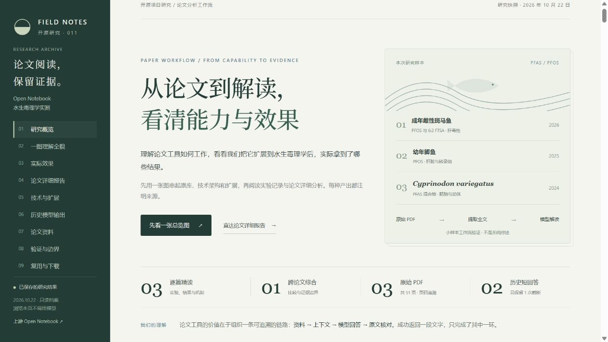
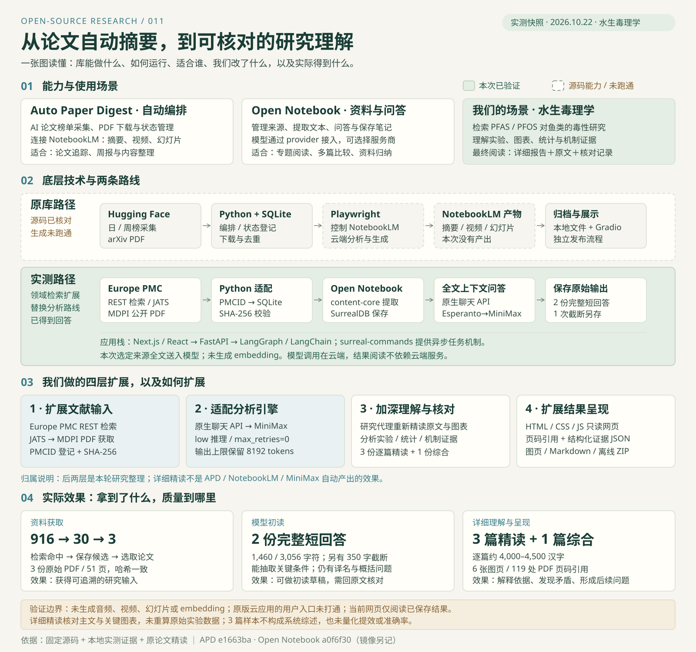
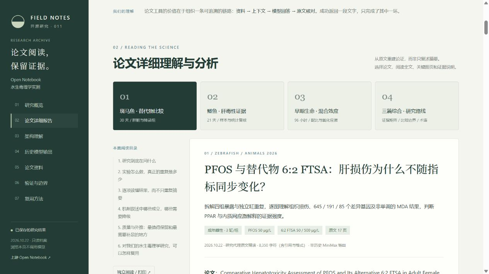

# 011 · Auto Paper Digest · 水生毒理学研究档案

> 从 Auto Paper Digest 的「采集论文 → NotebookLM 生成 → 归档发布」出发，研究如何将通用论文工具用于水生毒理学。原库以 Python、SQLite、Playwright 和 Gradio 编排流程；本次因 NotebookLM 接入未取得产出，转用 Open Notebook 的 Next.js / FastAPI / SurrealDB 架构，通过 Esperanto 接入 MiniMax，完成 PDF 提取与全文问答。再加入 Europe PMC 领域检索、模型参数适配和原文精读，形成可追溯、可阅读、可下载的研究档案：3 篇详细报告、1 篇跨论文综合、2 份历史模型短回答及失败证据。

[原始源库：Auto Paper Digest](https://github.com/brianxiadong/auto-paper-digest) → [替代探索：Open Notebook](https://github.com/lfnovo/open-notebook) → 本项目研究成果

[打开正式研究网页](https://yydshly.github.io/1022_codex_project/011-open-notebook-research/) · [直接阅读详细报告](https://yydshly.github.io/1022_codex_project/011-open-notebook-research/#deep-reports) · [研究方法](research-method.md) · [研究笔记](notes.md) · [来源与版本](SOURCE.json)



*本项目静态研究页的实际截图，展示已保存结果。Open Notebook 原版界面的访问另见验证记录。图片来源见 [assets/README.md](assets/README.md)。*

## 一张图理解能力、架构、扩展与效果



[能力与效果总结](knowledge-summary.md) · [网页总览](web/index.html#understanding) · [实际效果](web/index.html#effects) · [架构证据](results/evidence/architecture-evidence.json)

Auto Paper Digest 编排论文采集、NotebookLM 生成与归档发布；Open Notebook 组织资料和模型问答。我们新增领域检索、MiniMax 参数适配、原文精读与静态展示。模型初读产生两份完整短回答，详细报告来自后续研究代理核读；两者的效果和边界分别记录。图为本项目原创整理，来源与许可说明见 [assets/README.md](assets/README.md)。

## 探索为什么切换，最终解决什么

目标是检验「论文工具能否帮助理解水生毒理学研究」，并把实验设计、结果、统计与机制说明白。工具跑通是中间步骤，能回到原文核对的详细报告才是本次交付目的。

| 探索环节 | 遇到的问题 | 我们的切换或扩展 | 得到的结果 |
| --- | --- | --- | --- |
| 从 AI 榜单到领域文献 | 原 APD 以 HF 榜单、arXiv 为入口，不覆盖本次选题 | 以 Europe PMC REST 检索，登记 PMCID，下载公开 PDF 并校验哈希 | 916 条命中、30 条候选、3 篇原文 |
| 从 NotebookLM 到可调用模型 | 企业接口缺少许可；个人 HTTP 路线未取得解读 | 独立试跑 Open Notebook，将选定全文经 Esperanto 交给 MiniMax；适配推理参数 | 3 PDF 提取约 17.1 万字符，2 份完整短回答；NotebookLM 产出仍为 0 |
| 从回答到详细理解 | 短回答存在译名、概括和引用问题，不能展开全部论证 | 研究代理读取完整主文，核对关键图表、统计口径和页码 | 3 篇逐篇精读 + 1 篇综合，6 张图页、119 处 PDF 页码引用 |
| 从云端试跑到可访问成果 | 原版应用在云机内可用，但用户网页入口未打通 | 停止完整应用访问排查，改为发布静态研究档案 | 浏览器阅读、来源追溯、独立打印与离线下载；在线上传和问答未交付 |

这条路线保留了原 APD 的研究起点，但 Open Notebook 是独立替代试验；没有把 APD 改成可自动切换服务的统一系统。静态网站发布也不等于部署了可在线生成的 Open Notebook 应用。

## 论文详细理解与分析

这次直接阅读三篇完整原文（共 51 页），视觉核对关键方法、表格及图页。逐篇报告约 4,000–4,500 个汉字，涵盖研究问题、处理组、样本量、实验方法、关键结果、图表读法、机制证据、统计问题、生态外推和后续研究。它们是本轮研究代理新增的原文分析，不是历史 MiniMax 短回答的改写，也不冒充 NotebookLM 产出。

| 详细报告 | 阅读重点 |
| --- | --- |
| [斑马鱼与替代物比较](results/detailed/PMC13162690-analysis.md) | 为什么高剂量病理更明显，却只有 85 个 DEG；MDA 与通路显著性如何解释 |
| [PFOS 鲫鱼肝毒性](results/detailed/PMC11851982-analysis.md) | 样本剔除、病理与转录证据；高剂量正文 1036 个 DEG、图中 612 个的不一致 |
| [早期生命阶段混合效应](results/detailed/PMC10819493-analysis.md) | 四套试验、LC50/CI、配比依赖、氧化应激百分比基准与机制缺口 |
| [跨论文综合与研究路线](results/detailed/synthesis-analysis.md) | 哪些能比较、哪些不能；共性、分歧、证据矩阵与后续验证优先级 |

网页提供报告选择、章节目录、原文 PDF 页码、6 张关键原文整页预览，以及 Markdown、独立 HTML 阅读/打印与完整离线 ZIP。每篇附结构化证据 JSON。图表解读和重要数值经过研究代理交叉核对；未取得完整补充材料、未重跑测序或个体级实验数据，因此保留不能确定的问题。



## 我们得到的理解

这一流程可以拆成四项工作：找到可用论文、取得并登记原文、让模型基于论文回答、检查回答并呈现。Python 负责检索下载和流程连接；NotebookLM 或 Open Notebook 负责组织来源和模型交互；模型提供解读内容；结果页负责阅读与追溯。网页能打开、接口返回成功、模型回答完整和科学结论可靠，是不同的验收条件。

本研究从 [Auto Paper Digest 的历史试跑](results/history/README.md) 延续而来。本子项目以 Auto Paper Digest 为研究起点，按「原库能力 → NotebookLM 接入验证 → Open Notebook 替代探索 → 水生毒理学研究成果」组织内容；008 保留原 APD 试跑与历史故障记录；本项目已保存阅读与复核所需的公开摘要和证据，不依赖 008 公开发布。替代路线的生成结果没有记成 NotebookLM 已成功。

| 组成 | 原本负责什么 | 本轮实际做了什么 |
| --- | --- | --- |
| Auto Paper Digest | 从 Hugging Face 日/周榜采集 AI 论文，按 arXiv 编号下载，连接 NotebookLM 与门户展示 | 复用 Paper、SQLite 和展示入口；本轮 NotebookLM 产出为 0 |
| 本研究 Python 适配 | 为水生毒理学补足文献来源 | Europe PMC REST 检索、筛选、期刊 PDF 获取、SHA256 校验与 PMCID 登记 |
| Open Notebook | 管理笔记本、来源与模型问答 | 3 篇 PDF 入库、文本提取、选定来源全文上下文问答、保存来源标记与会话 |
| MiniMax | 接收上下文并生成文本 | MiniMax-M3.1-Flash；参数适配后得到单篇解读及三篇综合比较 |
| 本项目静态网页 | 汇集已导出的材料与研究说明 | 阅读答案、核对来源、查看证据和研究方法；不连接模型或云端应用 |

## 真实结果

| 结果 | 数量或观察 |
| --- | --- |
| 检索 | 保存的检索式在 2026-10-21 命中 916 条，保留 30 条候选 |
| 论文输入 | 3 份原始 PDF，合计 18,897,613 字节，下载与云端输入 SHA256 一致 |
| 提取文本 | 50,134 / 61,337 / 59,970 字符；有空格丢失和重复标题 |
| 历史完整短回答 | 2 份，`finish_reason=stop`；单篇 1,460 字符，综合 3,056 字符 |
| 失败对照 | 原版首次生成 `finish_reason=length`，350 字符，保留原文，不计成功 |
| 生成调用 | 累计 3 次，108,597 tokens；来自会话元数据，不是费用金额 |
| 未生成 | embedding、音频、视频、幻灯片均未作为本轮成果 |

三篇论文是 PFAS/PFOS 鱼类毒性的小样本试验，不能把命中数看成整个领域的文献量，也不能把本轮产出称为系统综述。

| 论文 | 研究主题 | 原文 |
| --- | --- | --- |
| PMC13162690 · 2026 | 成年雌性斑马鱼；PFOS 与 6:2 FTSA 的肝毒性比较 | [DOI 10.3390/ani16091368](https://doi.org/10.3390/ani16091368) |
| PMC11851982 · 2025 | 幼年鲫鱼 *Carassius auratus*；PFOS 肝毒性 | [DOI 10.3390/ani15040610](https://doi.org/10.3390/ani15040610) |
| PMC10819493 · 2024 | *Cyprinodon variegatus* 胚胎与幼体；PFAS 混合效应 | [DOI 10.3390/toxics12010091](https://doi.org/10.3390/toxics12010091) |

[单篇解读原文](results/answers/open-notebook-single-answer.md) · [综合比较原文](results/answers/open-notebook-synthesis-answer.md) · [截断原文](results/answers/open-notebook-single-truncated.md) · [接入文件与 SHA256](results/import-manifest.json)

## 结果如何使用

模型原文保留实际用词和错误，研究代理的核对说明独立展示，没有通过改写原文掩盖问题。历史短回答先做关键字段抽查；本轮进一步读完整主文并核对关键图表，仍不等同于原始数据重分析或同行评议。

- **可用之处**：能提取实验剂量、暴露时间、LC50 及置信区间，区分不同混合条件，形成单篇初读与跨论文比较的初稿。
- **明确错误**：*Cyprinodon variegatus* 在两份回答中被写成不同且不可靠的中文俗名，阅读时应以论文拉丁学名为准。
- **过度概括**：综合回答中“三种鱼均具有肝脏或发育毒性”的概括过宽；两篇研究肝毒性，第三篇主要研究胚胎/幼体急性致死与亚致死效应，不能据此系统证明发育异常。
- **引用局限**：部分综合断言缺少紧邻引用；`[source:…]` 是会话来源标记，不能当成已验证的 PDF 页码定位。
- **仍需核对**：模型提出的机制与后续问题属于推断或研究建议；特定剂量和组合的 PFOS/PFOA 拮抗不应外推为所有 PFAS 混合暴露的结论。

完整说明见 [历史质量核对记录](results/history/README.md)。本轮没有新增论文检索或外部模型 API 请求；已另行基于原 PDF 新增详细精读及关键图表复核，见上方四份报告。历史模型原文保持不变。

## 验证路线与本轮边界

NotebookLM 官方企业接口曾因缺少许可而返回 `FAILED_PRECONDITION`。个人 HTTP/RPC 客户端保存登录后仍收到 `location=unsupported`，但用户报告浏览器可见笔记本列表，所以不能据此断言个人账号或所在地本身不可用。两条路径均没有得到论文解读或媒体产出。

Open Notebook 在 Codex 云端容器中完成实际导入与 REST 问答。原版参数首次输出截断；仅针对本轮 MiniMax 模型增加 `reasoning_effort=low` 与 `max_retries=0` 后，两次完整返回。`max_tokens=8192` 保持不变。采用选定来源全文上下文，未建立 embedding 索引，不能称为已验证向量检索。

云机内服务健康、来源和问答可读取；用户浏览器访问原版完整应用未验收。原生预览与内网穿透没有取得可用入口，ngrok 与 Microsoft Dev Tunnels 目标被当前代理返回 `403 Domain forbidden`。根因未确认，也不能推断所有 Codex 环境都禁止隧道。完整 Open Notebook 应用的访问排查已停止，失败记录作为研究材料保留；本轮发布的是下述静态成果网站。

## 网页发布与本地阅读

已通过 GitHub Pages 发布：[正式研究网站](https://yydshly.github.io/1022_codex_project/011-open-notebook-research/)。首次发布提交 `a496004`，[构建与部署通过](https://github.com/yydshly/1022_codex_project/actions/runs/39743460386)；HTTP 与离线包验收记录见 [publication-verification.json](publication-verification.json)。

`web/` 保存已打包的只读页面及其资料，可直接打开；修改研究原始文件后再运行打包脚本更新。静态资源使用相对路径，兼容仓库编号目录。本轮按仓库 GitHub Pages 规范发布此静态成果，站点入口及部署验收状态以项目登记表和部署记录为准；完整 Open Notebook 在线应用未部署给用户使用。

无需安装 Open Notebook、Docker、数据库或模型。现有 Python 可用于启动静态文件预览；浏览内容不会产生模型调用。

```powershell
# 在仓库根目录运行
python projects/011-open-notebook-research/scripts/package_web.py
python projects/011-open-notebook-research/scripts/package_web.py --check
python projects/011-open-notebook-research/scripts/serve.py --port 7871
```

访问 [http://127.0.0.1:7871/](http://127.0.0.1:7871/)。也可以直接打开 `web/index.html` 阅读正文。打包脚本同时生成包含网页和论文的离线 ZIP；`--check` 核对打包副本。这个地址只提供本项目静态资料，没有上传分析或在线提问入口。实际页面验证见 [verification.json](verification.json)。

## 版本、许可与复现环境

| 项目 | 记录 |
| --- | --- |
| 原始源库 / 研究起点 | [brianxiadong/auto-paper-digest](https://github.com/brianxiadong/auto-paper-digest) |
| 后续替代探索 | [lfnovo/open-notebook](https://github.com/lfnovo/open-notebook)，Luis Novo |
| Open Notebook 研究源码 | `a0f6f3081ae06328f0a451b3a3ef2959ca25721d` |
| Open Notebook 许可 | MIT，保留原始许可证链接和历史副本 |
| APD 源码 | `e1663ba5e73a3501904b2a43699f3c12fb4a4300`；声明 MIT，该版本无独立 LICENSE 文件 |
| 云端运行 | Linux x86_64，Docker 28.4.0，Compose 2.40.3，SurrealDB 2.7.0 |
| 模型适配 | Esperanto 2.28.0；MiniMax-M3.1-Flash，低推理档位 |
| 本机历史采集/门户 | Windows，Python 3.12.13，Gradio 4.44.1 |
| 本项目展示 | 静态 HTML、CSS、JavaScript；Python 标准库用于可选本地预览 |
| 记录日期 | 2026-10-21 至 2026-10-22，Asia/Shanghai |

源码 commit 与实际镜像摘要分别记录于 [SOURCE.json](SOURCE.json)，不能直接视为同一个版本标识。SurrealDB 2.7.0 使用 BSL 1.1；镜像内依赖并非全部 MIT。论文清单记录为 CC BY，原文和模型输出的归属见同一来源记录。

导入后应用与数据库内存合计约 568 MiB，是瞬时快照，不是处理峰值，也不包含整个 Docker/平台开销，不能直接据此估计 Windows 本地安装负担。

[方法与验证标准](research-method.md) · [历史研究证据](results/history/README.md) · [返回项目索引](../../README.md#项目索引)
