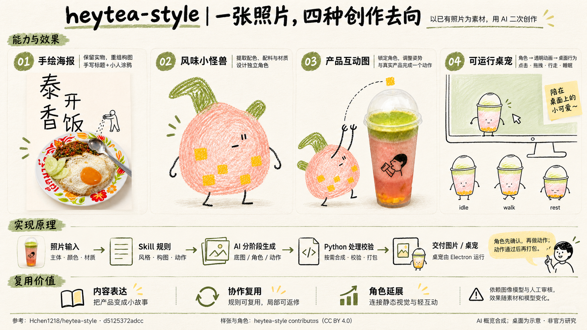

# heytea-style 一图总览



使用内置 ImageGen 生成，参考五份上游原始素材。图中并排呈现手绘海报、风味小怪兽、产品互动图与可运行桌宠；下方解释照片输入、Skill 规则、AI 分阶段生成、Python 处理与 Electron 运行的分工，并归纳内容表达、协作复用和角色延展的价值。

这是一张 AI 研究概览合成图，桌面场景为示意。它不代表本次运行上游创作流程生成了四种新作品，也不代表本次运行了原生 Electron 桌宠。上游未修改样张仍在 assets/upstream/ 与网页效果图集中独立保留。

- 图片：assets/capability-overview.png
- 原始生成方式：内置 image_gen.imagegen；无 CLI / API 回退。
- 来源版本：d5125372adcc945c2314cfb649c50407379a18ab。
- 样张与角色署名：heytea-style contributors，CC BY 4.0；原有第三方标识权利另行保留。
- 参考顺序：带字海报、怪兽身份稿、产品互动图、写实卡通桌宠动作审核表、原始饮品照片。
- 原始输出与工作区副本的哈希、尺寸、完整提示词见 image-generation.json。

## 本次完整生成提示词

```text
Use case: infographic-diagram.
Create ONE polished, high-resolution landscape Chinese research infographic, ideally 3840×2160 with a 16:9 composition. It must summarize the real open-source project heytea-style in one image: capabilities, four visible output types, implementation principles, and practical value. The intended reader is a nontechnical Chinese reader who needs an immediate, concrete understanding.

INPUT IMAGES AND ROLES:
Image 1 (typography-poster.png): faithful visual reference / supporting insert for output 01, a real food photograph with crooked Chinese lettering and a tiny doodle worker.
Image 2 (pet-v3/preview.png): faithful identity and wax-crayon material reference / supporting insert for output 02, the pink rounded creature with green appendages, yellow ingredient squares, and two black-line arms and two black-line legs.
Image 3 (pink-green-monster-product-interaction.png): faithful composition reference / supporting insert for output 03, that same creature tossing a yellow flavor cube toward the photographed pink/green drink.
Image 4 (contact-sheet.png): source-faithful desktop-pet pose reference. Use the actual pink-and-green cup character's idle, walk and rest poses for output 04 inside a simple desktop scene; keep the cup silhouette, color layering and hand-drawn limbs.
Image 5 (source-drink.png): original photo input reference, for a small input thumbnail only if useful. Do not imply this drink photo was the source of the food poster.
All images are references/supporting inserts for a NEW infographic; none is the base edit target. Faithfully represent the supplied examples; do not replace them with unrelated generic mascots. Existing brand emblems need not be reproduced, and do not add an official logo.

ART DIRECTION:
Warm ivory paper, charcoal ink, muted olive-green rules and annotations, very restrained peach and yellow accents matching the references. Elegant editorial information design with a playful handmade undertone. Use generous white space, precise Chinese typography, fine rules, a few imperfect hand-drawn arrows. The four effect images should dominate the top-middle half and be large enough to inspect, not tiny decorative icons. Clean coherent margins. No gradients, no neon, no 3D cartoons, no corporate dashboard UI, no decorative information clutter. Chinese body text should be crisp, dark, accurately rendered and readable. Titles can have a modest hand-lettered flavor; technical labels should use clear Chinese sans serif.

LAYOUT:
Top ~14%: one clear title and concise plain-language subtitle.
Middle ~43%: FOUR equal, clearly labeled output columns. In column 01 show the complete tall food poster with recognizable food and title. Column 02 show the independent pink creature alone and fully visible. Column 03 show both the creature and real drink, their throw gesture and one trajectory. Column 04 show a minimal desktop / monitor outline with the cup pet standing on its bottom edge, a mouse cursor and two smaller walk/rest poses beneath; a desktop demonstration illustration, not a fabricated screenshot. The four outputs must look materially different and each be explicitly named.
Next ~25%: a left-to-right arrow workflow with five steps and one small human-review note. The workflow explains which part supplies instructions, which generates visuals, which processes files and which runs the pet.
Bottom ~14%: three short, useful value statements with very simple icons or handwritten marks. Include one concise dependency boundary.
Footer ~4%: attribution, fixed source commit, and the illustration status. Keep source text readable and do not let it collide with other blocks.

EXACT CHINESE COPY (render verbatim, do not invent extra sentences):
Title: "heytea-style｜一张照片，四种创作去向"
Subtitle: "以已有照片为素材，用 AI 二次创作"
Small section labels: "能力与效果" ; "实现原理" ; "复用价值"

Column 01:
"01 手绘海报"
"保留实物，重组构图"
"手写标题＋小人涂鸦"

Column 02:
"02 风味小怪兽"
"提取配色、配料与材质"
"设计独立角色"

Column 03:
"03 产品互动图"
"锁定角色，调整姿势"
"与真实产品完成一个动作"

Column 04:
"04 可运行桌宠"
"角色 → 透明动画 → 桌面行为"
"点击 · 拖拽 · 行走 · 睡眠"

Workflow, in order:
"照片输入" / "主体 · 颜色 · 材质"
"Skill 规则" / "风格 · 构图 · 动作"
"AI 分阶段生成" / "底图 / 角色 / 动作"
"Python 处理校验" / "按需合成 · 校验 · 打包"
"交付图片 / 桌宠" / "桌宠由 Electron 运行"

Review note:
"角色先确认，再做动作；动作通过后再打包。"

Three value groups:
"内容表达" / "把产品变成小故事"
"协作复用" / "规则可复用，局部可返修"
"角色延展" / "连接静态视觉与轻互动"

Dependency note:
"依赖图像模型与人工审核，效果随素材和模型变化。"

Footer:
"参考：Hchen1218/heytea-style · d5125372adcc"
"样张与角色：heytea-style contributors（CC BY 4.0）"
"AI 概览合成；桌面为示意 · 非官方研究"

ACCURACY REQUIREMENTS:
The library is a skill/workflow + Python tools + an Electron pet runtime; image generation is supplied by the host's image model. Do not imply the repository is its own trained model or that this infographic is a freshly run native desktop app. The food poster and the drink-based characters are different examples. Show all four output types. All essential text and subjects must be within the frame.
```

## 校对说明

主要标题、四类产物、处理链、确认关卡与三项价值均已人工目视检查。图片为模型排版，精确文案以本说明及网页正文为准。1672 × 941 像素；保留模型原始输出，未通过代码覆盖文字或改绘效果。
