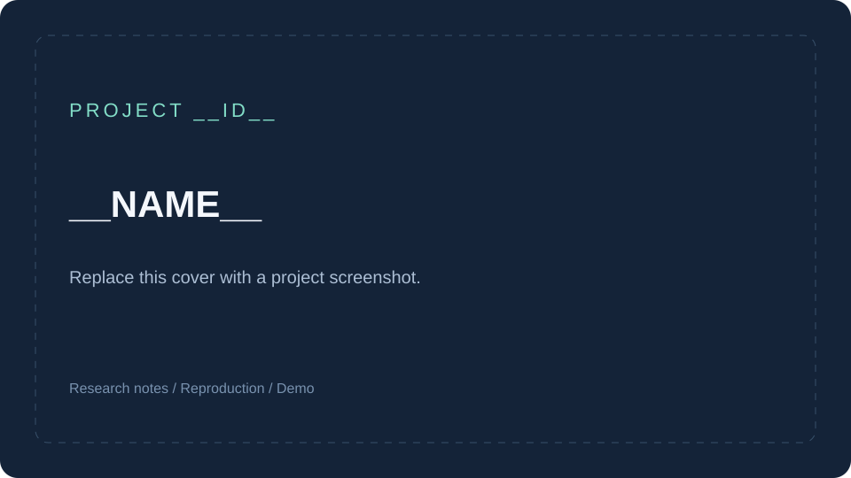

# __ID__ · __NAME__

> __SUMMARY__

| 信息 | 内容 |
| --- | --- |
| 原项目 | [__REPO__](__REPO__) |
| 作者 / 组织 | 待补充 |
| 研究版本 | 待补充 commit SHA 或 tag |
| 上游许可 | 待核对原仓库 LICENSE |
| 收录日期 | __DATE__ |
| 研究进度 | 以 [项目登记表](../catalog.json) 为准 |
| Web 演示 | 暂无，部署后填写实际地址并更新登记表 |

*当前为模板占位图；研究开始后请替换为实际截图，并说明展示的功能或场景。*

## 项目简介

- 它解决什么问题：待补充。
- 为什么值得研究：待补充。
- 适合什么使用场景：待补充。

## 本次研究目标

- [ ] 核对上游版本、许可和运行条件。
- [ ] 跑通核心功能，记录可复现的操作步骤。
- [ ] 理清关键模块、数据流和实现取舍。
- [ ] 整理截图、研究结论与可借鉴之处。

## 复现与运行

记录实际验证过的环境、依赖安装、配置示例、启动命令和成功标志。需要环境变量时，提交不含真实凭据的 `.env.example`。

尚未验证运行步骤。

## 实现拆解

根据实际研究内容补充架构、核心模块和关键源码位置。引用源码时标明上游文件与版本。

## 研究结论

记录已验证的能力、局限、可借鉴方案，以及后续实验方向。

## 图片说明

图片文件、来源、授权和说明见 [assets/README.md](assets/README.md)。新增截图应配有替代文字和简短图注。

## 研究记录与来源

- [研究笔记](notes.md)
- [原始仓库](__REPO__)
- [返回总索引](../../README.md#项目索引)

本目录为独立研究记录。第三方代码、图片及其他材料遵循其各自许可；引入时补充来源与必要声明。
